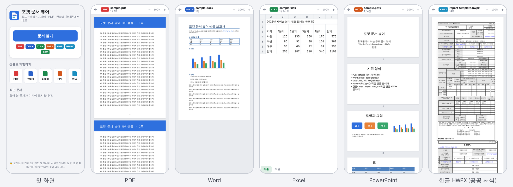

# 04 · 개인 프로젝트: AI로 만든 소프트웨어

연구 밖에서 진행한 개인 프로젝트입니다. AI 코딩 에이전트를 지휘해 아이디어를 짧은 시간 안에 실제로 동작하는 제품으로 만든 사례입니다. 요구사항 정의, 설계 결정, 검증은 직접 하고 구현은 에이전트에 맡깁니다. 연구 도구를 빠르게 만드는 것과 같은 방식입니다.

## 🎾 [코트사이드 코치](https://github.com/MeowMeowEngineer/Courtside-Coach)
휴대폰 카메라로 테니스 스윙을 실시간 분석해, 한 번 칠 때마다 고칠 점을 한국어 음성으로 알려주는 안드로이드 앱입니다.

- 포핸드, 백핸드, 서브, 발리, 스매시 5종을 지원하고 바디턴, 테이크백, 타점, 팔로스루 등 스트로크별 지표를 채점합니다.
- MediaPipe 포즈 추정을 기기 안에서 실행하며, 인터넷 권한 없이 동작합니다.
- 스윙 감지·분류·채점 엔진을 직접 설계하고 합성 스윙 데이터로 테스트했습니다.
- **걸린 시간**: 아이디어부터 첫 설치 파일까지 약 18분, 실기기 설치와 데이터 내보내기(v0.1.1)까지 약 1시간 10분 (2026-10-18)
- **기술**: `JavaScript` `MediaPipe` `Android WebView` `TextToSpeech`

## 📄 [포켓 문서 뷰어](pocket-doc-viewer/README.md)
휴대폰에서 워드·엑셀·피피티·PDF·한글(HWP/HWPX) 문서를 바로 여는 무료 문서 뷰어입니다. React로 만든 웹 앱(PWA)과 안드로이드 앱 두 가지로 배포합니다.

- 문서는 기기 안에서만 처리합니다. 안드로이드 앱은 인터넷 권한과 저장소 권한을 요청하지 않고, 다른 앱의 '열기/공유'로 넘어온 문서를 바로 엽니다.
- PowerPoint(.pptx)와 한글(.hwpx) 렌더러는 직접 만들었습니다. 슬라이드·레이아웃·마스터 상속과 테마 색 변형을 풀고, 병합 셀이 많은 공공기관 HWPX 서식도 표가 깨지지 않게 열 너비를 역산합니다. 한글이 저장한 줄 배치 정보로 쪽을 나눕니다.
- 확장자 대신 파일 내용(매직 바이트)으로 형식을 판별해, 이름 없이 넘어온 파일도 엽니다. CSV·텍스트는 UTF-8과 EUC-KR을 자동 구분합니다.
- 보안: 콘텐츠 보안 정책(CSP)으로 문서 속 스크립트 실행과 외부 통신을 막았습니다. 취약점이 있는 PPTX 라이브러리 대신 렌더러를 직접 만들었고, pdf.js는 취약점이 고쳐진 버전을 씁니다.
- 검증: 단위 테스트 13개(형식 판별, HWPX·PPTX 해석)와 휴대폰 화면 크기 자동 스모크 테스트(형식별 화면 촬영, 콘솔 오류 검사)를 만들었습니다. 실제 공공기관 서식(국가연구개발 계획서 HWPX 양식)과 HWP 5.0 문서로도 확인했습니다.
- **걸린 시간**: 아이디어부터 다섯 가지 형식이 모두 열리는 웹 앱까지 약 30분, 안드로이드 프로젝트·자동 빌드·문서 정리까지 약 40분 (2026-10-20)
- **기술**: `React` `TypeScript` `Vite` `PWA` `Capacitor (Android)` `pdf.js` `SheetJS` `docx-preview` `hwp.js` `Vitest` `Playwright`

## 🗜️ 압축풀기
광고와 데이터 수집 없이 압축 파일을 기기 안에서 바로 푸는 안드로이드 앱입니다.

- 다른 앱에서 '열기'로 넘겨받은 압축 파일도 처리하고, 암호 압축을 지원합니다. 암호는 메모리에만 보관합니다.
- 인터넷 권한이 없고 위험 권한도 요청하지 않습니다. 저장 폴더는 안드로이드 시스템 폴더 선택으로 지정합니다.
- **걸린 시간**: (작성 필요)
- **기술**: `Android`

## ✈️ [Travel App Project](https://github.com/MeowMeowEngineer/Travel-App-Project)
- **설명**: (작성 필요)
