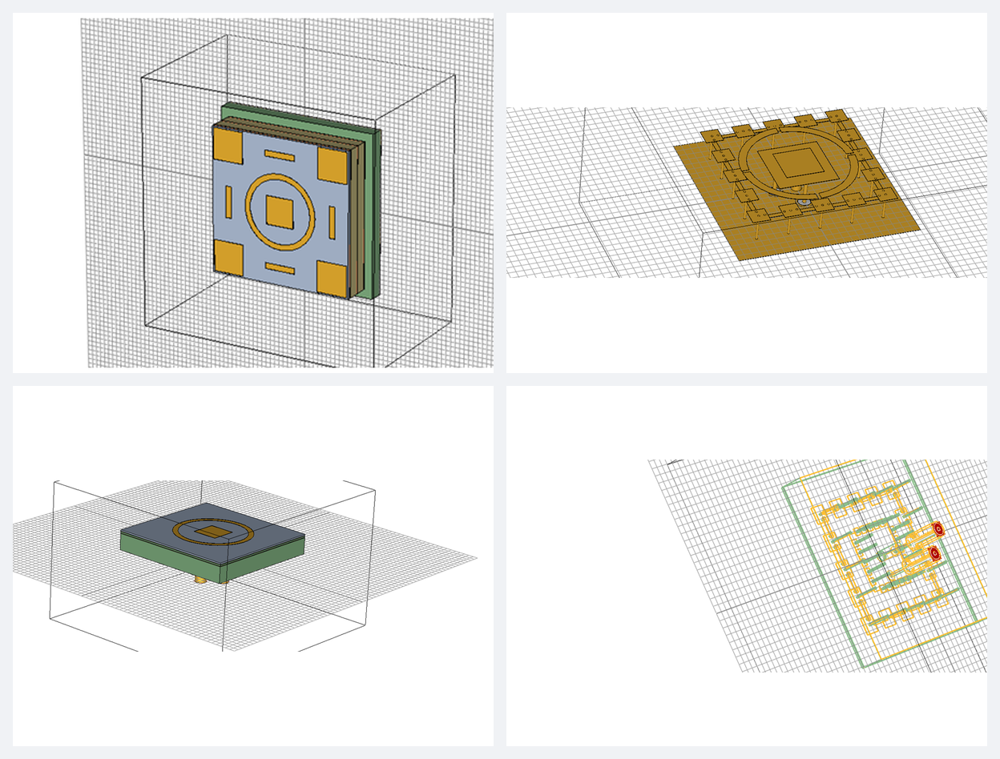

# AI 활용 역량

AI를 문서 작업 보조에 그치지 않고 **레이다 신호처리와 하드웨어 구현, 전자기 설계까지 연구 전 과정에 적극적으로 활용**합니다. 걸린 시간은 커밋과 작업 기록 기준입니다.

| 영역 | 무엇을 하는가 | 대표 사례 |
|---|---|---|
| 📡 신호처리 | 레이다 신호처리 알고리즘을 AI·머신러닝으로 설계하고 검증 | [벽 투과 인체 탐지 AI 레이다 신호처리](#신호처리-벽-투과-인체-탐지-ai-레이다-신호처리) |
| 🔧 하드웨어 구현 | 레벨 시프터 회로 설계·구현, SPI 제어 코드, 실험 지그 설계, 디버깅 로그 분석에 AI를 활용 | [위상배열·빔포밍 하드웨어 구현](#하드웨어-구현-위상배열빔포밍-하드웨어) |
| 📐 전자기 설계 | LLM이 EM Simulator 3D 모델링과 해석을 대신하는 **바이브 안테나 설계** | [바이브 안테나 설계](#안테나-설계-자동화-루프-비공개-연구-저장소) |
| 📝 문서·제안서 | 제안서 그림과 문구 작성, 연구실 문서 검수 자동화 | [과제·제안서](../proposals/README.md), [연구실 업무 자동화](#연구실-업무-자동화-스킬) |
| 💻 소프트웨어 제작 | AI 코딩 에이전트로 아이디어를 몇 분~몇 시간 안에 동작하는 앱으로 구현 | [AI로 만든 소프트웨어](../apps/README.md) |

## 신호처리: 벽 투과 인체 탐지 AI 레이다 신호처리

분산형 이중편파 FMCW 레이다로 벽 뒤 사람을 탐지하는 연구에서 신호처리 단계에 머신러닝을 적용했습니다.

- **머신러닝 기반 거리 빈 선택**: 정면·측면 움직임을 관측하는 분산 레이다에서 코히어런트 적분에 쓸 거리 빈을 머신러닝으로 고릅니다. (APMC 2025)
- **이중편파 채널 결합**: 대역 에너지 차를 기준으로 편파 채널을 결합해 벽 투과 탐지 성능을 높였습니다. (한국전자파학회 2026 동계)
- **기술**: `Python` `MATLAB` `Machine Learning`

## 하드웨어 구현: 위상배열·빔포밍 하드웨어

X밴드 아날로그 빔포밍 SAR 시스템을 만들면서 회로 설계, 제어 코드, 실험 지그, 디버깅까지 하드웨어 구현 전 과정에 AI를 활용했습니다.

- **SPI 레벨 시프터 회로**: ADAR1000을 제어하는 데 필요한 레벨 시프터 회로를 AI로 설계하고, 브레드보드로 직접 구현했습니다.
- **ADAR1000 SPI 제어 코드**: 빔포머 칩의 SPI 제어 코드를 AI로 작성하고, 빔 제어 매뉴얼로 정리했습니다.
- **빔포밍 실험 지그**: 빔포밍 실험에 쓸 아크릴 지그를 AI로 설계했습니다.
- **디버깅**: 디버깅 로그를 AI로 분석해 수신단 역전압 문제의 원인을 좁히고 디버깅 절차를 정리했습니다.
- **기술**: `ADAR1000` `SPI` `Level Shifter` `Breadboard`

<!-- 그림: figures/level-shifter.png (브레드보드 회로), figures/acrylic-jig.png (아크릴 지그 도면) -->

## 안테나 설계 자동화 루프 (비공개 연구 저장소)

**바이브 안테나 설계**: 전자기 설계 영역의 대표 사례입니다.

*LLM에 말로 지시해 EM Simulator에서 자동으로 그린 안테나 3D 모델 예시*

EM Simulator로 안테나를 설계하려면 원래 복잡한 3D 모델을 손으로 하나하나 그려야 합니다. 이 과정을 LLM과 연결해, 원하는 구조를 말로 지시하면 모델이 자동으로 그려지고 해석까지 이어지게 만들었습니다. 그 위에서 설계 → 해석 → 분석 → 다음 설계를 사람 손을 거의 거치지 않고 반복합니다.

- **효과**
  - **바이브 안테나 설계**: 직접 그릴 때보다 3D 모델링 시간 95% 이상 단축
  - 3D 모델링을 할 줄 모르는 사람도 말로 안테나를 설계할 수 있습니다.

- **구성**
  - EM Simulator 안에서 도는 VBA 드라이버 매크로가 주문을 받아 모델을 짓고, 해석하고, 결과를 내보냅니다.
  - 파이썬 CLI가 주문 검증, 결과 수집, 설계 대장, 1차 예측을 맡습니다.
  - 에이전트가 결과를 해석하고 다음 실험을 정합니다.
- **연구 내용**
  - 1,000건이 넘는 해석 데이터로 안테나 구성 블록의 효과를 학습해, 블록을 조합한 구조의 응답을 예측하는 대리 모형을 연구했습니다.
  - 논문 방법(Circuit-GNN, neuro-TF)을 재현해 비교했습니다.
- **기간**: 2026-10-14 시작, 5일 동안 커밋 1,537개 (진행 중)
- **기술**: `Python` `VBA` `EM Simulator` `Gaussian Process` `openEMS` `JAX`

## 전자기 해석 시간 근본 원인 분석

대리 모형이 필요한 이유인 "해석이 왜 오래 걸리는가"를 셀 수, 시간 스텝, 링다운으로 나눠 정량화했습니다. 그다음 공진기 모형과 모멘트법(MoM) 같은 수리·물리 대안을 직접 구현해 상용 EM Simulator와 비교했습니다.

- **기간**: 2026-10-19 오전, 약 2시간 30분 (분석, 구현, 보고서 페이지 작성까지)
- **기술**: `Python` `NumPy` `openEMS`

## 연구실 업무 자동화 스킬

반복되는 연구실 문서 작업을 에이전트 스킬로 만들었습니다.

- **랩미팅 발표자료 검토**: 연구실 양식(제목·본문 글자 크기 위계, 출처 표기, 그림 번호)을 체크리스트로 점검하고, 양식 위반은 스크립트로 자동 교정합니다.
- **국가 R&D 제안서 작성**: 연구개발계획서 실제 제출본을 역분석한 서식 규격으로 HWPX 문서를 작성하고 편집합니다.
- **강의자료 검수**: 강의 스크립트와 자료를 검수하고 기록을 남깁니다.
