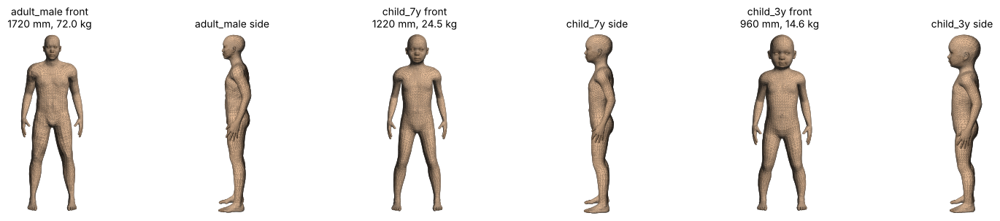

# MakeHuman 기반 인체 외형 모형 (성인, 7세, 3세)

| 파일 | 대상 | 키 | 질량(밀도 1050 kg/m³ 가정) | 삼각형 |
|---|---|---|---|---|
| `adult_male.stl` | 성인 남성 30세 | 1720 mm | 72.0 kg | 26,756 |
| `child_7y.stl` | 7세 남아 | 1220 mm | 24.5 kg | 26,756 |
| `child_3y.stl` | 3세 남아 | 960 mm | 14.6 kg | 26,756 |

모두 닫힌 표면(watertight)이고 단위는 mm다. 세부 수치는 `humans_summary.json`에 있다.

## 출처와 만든 방법
- **형상 데이터**: MakeHuman 기본 메쉬(hm08)와 매크로 타깃. 출처는 makehumancommunity/mpfb2 저장소(커밋 b1a2dc9)이고, 자산은 **CC0**(자유 이용)이다. 논문에는 "MakeHuman 1.x 자산(CC0)"으로 인용한다.
- **매크로 설정**: MPFB2의 매크로 계산 규칙을 그대로 썼다(`build_humans.py`).
  - 성별: 남(1.0). 인종: asian 1.0. 근육: 0.5.
  - 나이 슬라이더: 0 = 1세, 0.1875 = 11세, 0.5 = 25세.
- **키와 체중 맞추기**: 키는 균일 스케일로 맞췄다. 체중은 체중 슬라이더를 이분법으로 찾아 맞췄다.
  - 목표값은 성인 172 cm / 74 kg, 7세 122 cm / 24 kg, 3세 96 cm / 14.5 kg이다(한국 평균 근사, 성장도표·Size Korea로 확인 필요).
  - 성인은 체중 슬라이더 최대에서도 72 kg으로 목표에 조금 못 미쳤다. 아동은 최소에서도 목표보다 0.1~0.5 kg 무거웠다.
- **자세**: 기본 A자세의 팔을 MPFB2 기본 리그 스키닝 가중치로 회전시켜, 몸 옆으로 내렸다(수직에서 바깥으로 12°). 팔꿈치는 편 상태다. 팔과 몸통 사이는 띄웠다.
- **좌표**: 발바닥 z = 0, 좌우 중심 x = 0, 몸의 가장 앞점 y = 0. 사람은 -y 방향(오븐 쪽)을 본다.

## 기준점 (mm, CST에서 거리 맞출 때 사용)
| 모형 | 얼굴 앞(코끝) y | 가슴 앞 y | 배 앞 y | 발끝 y | 눈 중심 (x, y, z) | 유리체 반지름 |
|---|---|---|---|---|---|---|
| 성인 | 35.1 | 63.4 | 62.9 | 0.0 | (±31.0, 73.2, 1605.8) | 12.0 |
| 7세 | 3.9 | 30.6 | 33.9 | 0.0 | (±26.8, 39.0, 1121.4) | 11.2 |
| 3세 | 0.0 | 25.9 | 21.8 | 12.5 | (±25.3, 37.8, 863.6) | 10.5 |

- **성인**: 기존 정의대로 "문 ~ 몸통 앞면" 거리 d를 쓰려면 y 방향으로 (d - 63) mm 평행이동한다.
- **아동**: "문 ~ 얼굴 앞면" 거리 d를 쓰려면 7세는 (d - 3.9), 3세는 (d - 0) mm 평행이동한다.
- **눈 높이**: 7세 눈 높이(1121 mm)는 문 높이 범위(z 약 890~1160) 안이다. 3세(864 mm)는 오븐 바닥(880)보다 낮다. 3세가 문을 들여다보는 상황은 받침대에 올라선 것으로 보고 z를 올려 눈을 문 중심에 맞추는 시나리오로 정의한다(논문에 명시).

## CST에서 쓰는 법
1. File > Import > STL, 단위 mm. 고체로 불러와지는지 확인한다(닫힌 표면이라 정상이면 solid).
2. **조직(1단계, 권장)**: 균질 조직으로 둔다.
   - 근육 물성: Hirata 2008의 보수적 추정과 같은 방식이다.
   - 2/3 근육: 전신 평균 조직 근사다.
   - 비교용으로 두 가지를 다 돌리면 좋다.
3. **눈**: 위 표의 눈 중심에 유리체 구를 Insert한다. 수정체(지름 9 mm 원기둥, 눈 앞면에서 3 mm 안쪽)도 기존 단순 모형과 같은 방식으로 넣는다.
4. **층 구조(2단계, 선택)**: 피부 2 mm 층을 넣으려면 CST에서 표면 안쪽 offset(Shell)을 시도한다. 손가락·겨드랑이처럼 좁은 곳에서 실패하면 균질 조직으로 유지한다.
5. **메쉬**: 손가락이 가늘어 인체 2 mm 국부 메쉬에서 셀이 늘어난다. 평면파 해석에서 셀 수가 너무 많으면 3 mm로 키운다.

## 한계
- **내부 장기 없음**: 겉모양만 실제 사람이고, 내부 장기가 없다. 해부학 voxel 모형(CST Voxel Family, Virtual Population 등)을 대신하지는 못한다. 위치는 "단순 기하 형상 → 실제 체형 → 해부학 모형" 사이의 중간 단계다.
- **나이별 체형**: MakeHuman의 나이별 체형은 통계적 표준 체형이며, 특정 인구 측정 자료와 1:1로 맞춘 것은 아니다.
- **질량**: 질량은 밀도 1050 kg/m³ 가정이다. CST에서 조직 밀도로 다시 계산한다.
