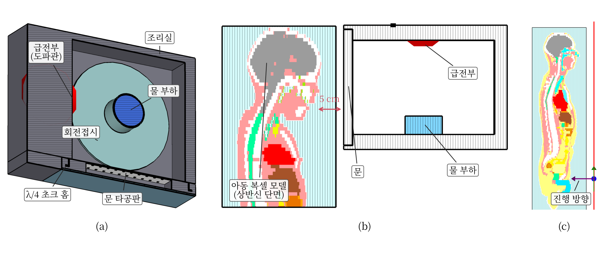
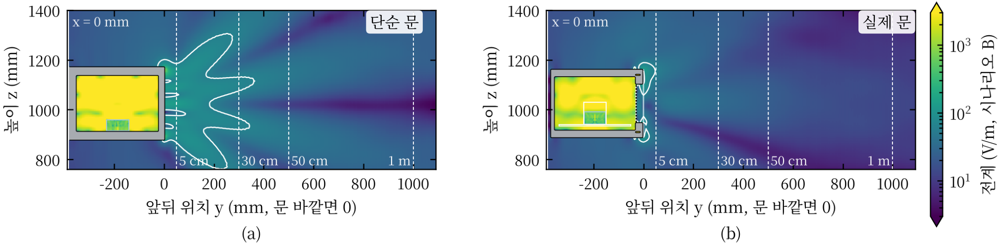
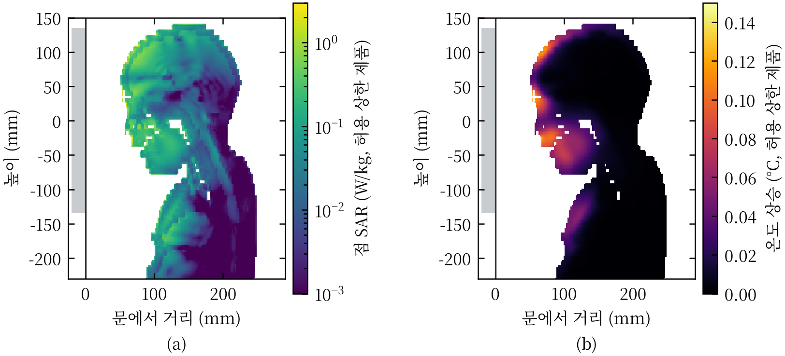
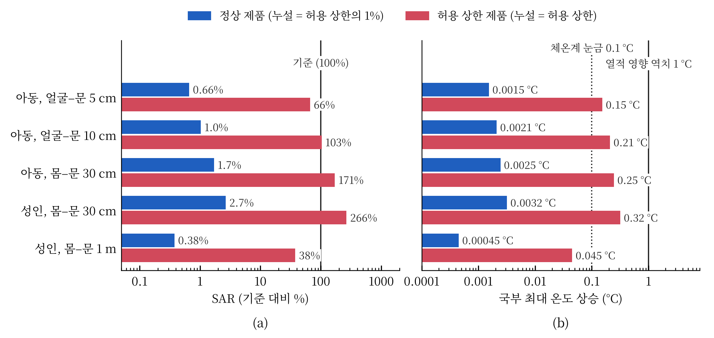

제1회 라이너 스콜라 연구공모전

장은성

작성일: 2026년 11월 ○일

## 초록

"작동 중인 전자레인지 앞에 서 있으면 해롭다"는 통념을, 해로움을 인체보호기준이 막으려는 열적 영향으로 정의하고 노출 기준의 근거, 누설의 실측 수준, 인체 흡수와 온도 상승의 세 주제로 나누어 검토하였다. 기준 문서와 체계적 문헌고찰, 누설 측정 자료, 인체 흡수 계산 연구를 비교하고, 문헌에 없는 "실제 사용 거리에서 사람이 흡수하는 양"은 3차원 전자기 해석으로 보완하였다. 확인된 위해는 조직 가열이다. 동물 실험에서 행동 변화가 나타난 흡수량은 전신 평균 비흡수율(SAR, 몸 1 kg당 흡수 전력) 약 4 W/kg이며, 일반인 기준은 그 1/50인 0.08 W/kg이다. 측정 자료에서 가정용 제품의 누설은 평균적으로 사용 중 허용 상한(문 외면 5 cm에서 50 W/m²)의 약 1%였다. 이 수준의 정상 제품 앞 30 cm–1 m에 선 성인과 7세 아동의 SAR은 가장 보수적인 가정에서도 기준의 약 3% 이하, 온도 상승은 0.004 °C 이하였고, 문에 얼굴을 5–10 cm까지 댄 아동도 기준의 약 1%였다. 국내 측정값을 가장 불리하게 해석해도 기준의 10% 미만이었다. 따라서 정상 제품에 대해서는 이 통념을 지지하기 어렵다. 누설이 허용 상한 부근인 제품에 가장 보수적인 가정을 적용하면 기준에 근접하거나 이를 넘을 수 있으므로, 통념은 문이 손상되어 누설이 커진 제품에 한해 조건부로 성립한다.

## 제1장 서론

### 제1절 연구의 배경과 목적

전자레인지는 2.45 GHz 마이크로파로 음식 속 물을 데운다. 이 전자파가 문틈으로 새어 나와 인체에 해를 줄 수 있다는 우려가 있으며, 작동 중에는 전자레인지 앞에 서 있지 말라는 조언이 지금도 널리 퍼져 있다. 2.45 GHz 광자의 에너지는 약 10⁻⁵ eV로 분자 결합을 직접 끊지 못하므로, 지금까지 확인된 위해 기전은 열적 작용이다. 비열적 영향에 대한 주장은 제2장 제1절에서 따로 검토한다. 이 글에서는 "해롭다"를 인체보호기준이 방지하려는 열적 영향, 곧 몸이 흡수하는 전력이나 그로 인한 온도 상승이 기준 또는 생리적 역치를 넘는 경우로 정의한다. 따라서 이 통념의 검증은 누설된 에너지가 몸을 의미 있게 가열할 만큼 큰지를 따지는 정량적 문제가 된다.

그런데 관련 기준은 두 계통으로 나뉘어 서로 다른 물리량을 규정한다. 제품 방출 기준은 오븐 외면 5 cm에서 전력밀도(단위 면적을 지나는 전자파 전력, W/m²)를 판매 전 10 W/m², 사용 중 50 W/m² 이하로 제한한다 [1], [2]. 인체보호기준은 몸 1 kg이 흡수하는 전력인 비흡수율(SAR, W/kg)을 제한한다 [3], [4]. 5 cm에서의 측정값만으로는 사람이 서는 위치의 노출이나 몸이 흡수하는 양을 직접 알 수 없다.

이 글의 연구 질문은 다음과 같다. **"정상 동작하는 가정용 전자레인지 앞 30 cm–1 m에 선 성인과, 문에 얼굴을 5–10 cm까지 댄 아동이 흡수하는 전자파 에너지와 그로 인한 온도 상승은 인체보호기준과 열적 영향 역치에 비해 어느 수준인가?"**

### 제2절 검토한 문헌과 방법

1.  연구의 범위

> 대상은 2.45 GHz 가정용 전자레인지의 문 누설이며, 누설 크기는 정상 제품 수준과 사용 중 허용 상한 수준을 모두 다루었다. 비열적 영향(암, 자각 증상)은 2024년 WHO 의뢰 체계적 문헌고찰 [5], [6]과 국제암연구소(IARC) 분류 [7]로 검토하되, 이들 근거의 대부분이 머리에 대고 쓰는 휴대전화 노출에서 나왔다는 점을 함께 고려하였다. 휴대전화 노출의 개별 연구는 노출 조건이 달라 따로 비교하지 않았다. 인터록(문이 열리면 전원을 끊는 장치) 고장으로 문이 열린 채 동작하는 상황은 결론의 범위 밖으로 두고 참고로만 다루었다.

2.  연구의 방법

> **문헌 검토.** 2026년 10월 19–22일에 웹 검색엔진과 학술 데이터베이스 서지 레코드(PubMed, IEEE Xplore, IOP, 출판사 페이지)를 통해 "microwave oven leakage survey", "microwave oven leakage SAR", "2.45 GHz whole-body SAR child plane wave", "lens temperature 2.45 GHz", "ICNIRP basic restriction rationale", "전자레인지 전자파 누설" 등의 검색어로 1970–2025년 문헌(방법론 고전 문헌 제외)을 찾았다. 포함 기준은 (1) 가정용 전자레인지 누설의 측정·해석, (2) 2.45 GHz 부근 인체 흡수 또는 온도 계산, (3) 기준 문서와 그 근거 문헌이다. 상당수 문헌은 원문 전문이 아니라 초록, 서지 레코드, 기관 안내문 발췌 수준에서 확인하였고, 그 범위에서만 인용하였다. KCI, RISS, DBpia는 검색하지 못하였다. 초안은 라이너 스콜라의 심사 기능으로 연구 질문, 근거의 신뢰성, 인용의 적절성을 점검하였고(2026년 10월 27일), 그 지적에 따라 2000년 이후 측정 조사와 독립 근거를 추가 탐색하여 보완하였다. 문헌 탐색, 서지 확인과 초안 작성에는 AI 도구(Anthropic Claude)도 사용하였으며, 모든 수치와 결론은 저자가 원자료와 대조하여 검토하였다.
>
> **수치 해석.** 문헌에는 "실제 사용 거리에서 사람이 흡수하는 양"을 직접 다룬 연구가 드물어, 상용 전자기장 시뮬레이터(시간영역 유한적분법) [8]로 이를 계산하였다. 국내에서도 판매되는 23 L 단독형 제품 계열의 공개 사양 [9]에 맞추어 오븐을 두 가지로 만들었다. 하나는 문 둘레 전체가 새는 단순 문(누설을 크게 잡는 모델)이고, 다른 하나는 유리, 타공판(작은 구멍이 뚫린 금속판), λ/4 초크(문 둘레로 새는 전자파를 상쇄하는 홈)를 넣은 실제 문이다(그림 1). 누설 크기는 방출 기준의 시험 조건(물 275 mL 부하, 외면 5 cm)에서 전계로 환산한 전력밀도를 누설 측정기의 검출 면적(약 25 cm²)으로 평균한 최댓값이 정상 제품 수준 0.5 W/m²(시나리오 A, 허용 상한의 1%)와 허용 상한 50 W/m²(시나리오 B)가 되도록 맞추었다. 이렇게 맞추면 한 점의 최댓값으로 맞출 때보다 누설이 1.18–1.23배 커진다. 모든 결과는 누설 크기에 비례하므로 다른 누설 수준으로 바로 환산할 수 있다.
>
> 인체는 해부학적 복셀(3차원 화소) 모델인 성인 남성(38세, 176 cm)과 7세 여아(115 cm) [8]를 썼다. 30 cm 이상에서는 오븐 단독 해석에서 전력 흐름과 전계 환산값이 4% 이내로 같아, 인체에 정면 평면파(한 방향으로 고르게 진행하는 전자파)를 쬐어 1 W/m²당 SAR을 구하고 몸 앞 전력밀도를 곱하였다. 몸 앞 전력밀도는 실제 문의 몸 앞 평균(현실적 추정)과 단순 문의 몸 앞 최댓값(몸 전체가 가장 센 곳의 세기를 받는다는 보수적 가정) 두 가지를 썼다. 얼굴을 문에 댄 5–10 cm는 오븐(단순 문)과 아동 상반신을 함께 해석하였다. SAR은 국제 표준의 1 g·10 g 정육면체 평균으로 구하고, 전신 평균은 시뮬레이터가 계산한 조직 질량으로 나누었다. 국부 온도 상승은 Pennes 생체 열전달 방정식 [10]을 머리·목 영역에서 3차원 정상상태로 풀어 구하였고(몸 표면은 공기로 열을 내보냄), 심부 체온 상승은 30분간 열 손실이 없다는 단열 가정(상한)으로 추정하였다.

그림 1. 해석 환경. (a) 실제 문 모델의 겉모습과 (b) 천장을 떼어 낸 내부: 문에는 유리 뒤에 타공판이 있고 문 둘레에 초크 홈이 있으며, 조리실에는 회전 접시와 물 부하(275 mL), 옆벽에는 전자파를 넣는 급전 도파관이 있다. 해석 모델의 좌표로 그린 그림이며, 모델에서는 조작부가 왼쪽에 있다(참고한 제품과 좌우 반대). (c) 문에 얼굴을 댄 7세 아동의 근접 해석(측면 단면, 얼굴–문 약 5 cm, 단순 문 오븐). (d) 30 cm 이상에 선 성인의 해석: 오븐 쪽에서 평면파를 쬔다. (c), (d)의 인체 색은 조직 종류(회색 뇌, 빨강 심장, 갈색 간 등)이다 [8]. 출처: 본 연구.

## 제2장 주제별 분석

### 제1절 열적 영향의 역치와 노출 기준

노출 기준은 동물 실험에서 확인된 가열 역치에 근거한다. ICNIRP가 정리한 실험에서 학습 과제를 하던 쥐와 원숭이는 전신 평균 SAR 약 4 W/kg에서 과제를 멈추었고, 이때 심부 체온은 약 1 °C 올랐다 [11]. 국제비전리방사선방호위원회(ICNIRP)는 이를 건강 영향의 역치로 보고 일반인에 1/50을 적용해 전신 0.08 W/kg을 기본 제한(몸 안에서 넘지 말아야 할 값)으로 정하였고, 2020년 개정에서도 유지하였다 [3], [11]. 몸 밖에서 재기 쉬운 참고 수준(2.45 GHz에서 전력밀도 10 W/m²)은 기본 제한을 지키도록 정한 값이다 [3]. 국내 기준도 전신 0.08 W/kg이며, 국부 기준은 머리·몸통 1 g 평균 1.6 W/kg으로 ICNIRP의 10 g 평균 2 W/kg보다 엄격한 편이다 [3], [4]. 두 계통의 기준을 표 1에 정리하였다. 이 글의 SAR 비교는 기본 제한값과의 물리적 비교이며, 국부 기준이 가전제품에 법적으로 적용된다는 뜻은 아니다. 또 기준의 평균 시간(전신 30분, 국부 6분)은 보통 수 분인 조리 시간보다 길어, 실제 노출에는 여유가 더 있다.

표 1. 두 계통의 기준 (출처: [1]–[4], [11] 정리)

| 기준 | 제한 대상 | 한도 |
|---|---|---|
| 제품 방출 기준 [1], [2] | 오븐 외면 5 cm의 전력밀도 | 사용 중 50 W/m² (미국은 판매 전 10 W/m²) |
| 인체보호기준, 전신 [3], [4] | 몸 전체 평균 SAR | 0.08 W/kg (역치 4 W/kg [11]의 1/50) |
| 인체보호기준, 국부 [3], [4] | 몸 일부의 SAR | 1.6 W/kg (국내, 1 g 평균) / 2 W/kg (ICNIRP, 10 g 평균) |

눈은 혈류가 적어 열에 취약하므로 별도로 연구되었다. 2.45 GHz를 100분 쬔 토끼에서 수정체가 약 41 °C에 이를 때 백내장이 생겼고 [12], 사람 눈 모델 계산에서는 수정체 온도 상승 약 3 °C를 백내장 유발 역치로 본다 [13]. 비교하면 성인 남성의 기초대사량은 약 80 W(1.1 W/kg)이므로 [14], 전신 기준 0.08 W/kg은 몸이 가만히 있어도 내는 열의 약 7%이다.

비열적 영향에 대해서는 근거가 엇갈린다. IARC는 2011년 무선주파수 전자기장을 "사람에게 발암 가능성이 있는" 2B군으로 분류하였는데, 주로 휴대전화 장기 사용자의 신경교종 위험 증가 보고에 근거하였다 [7]. 반면 2024년 WHO 의뢰 체계적 문헌고찰은 일반인 노출과 암 [5], 자각 증상 [6] 사이에 일관된 관련을 찾지 못하였다. 두 근거 모두 머리에 대고 쓰는 휴대전화 노출이 중심이어서 몸에서 떨어진 전자레인지 누설에 그대로 옮기기 어렵다. 따라서 비열적 영향은 현재 근거로 판단을 유보하며, 이 글의 정량 비교는 근거가 일치하는 열적 기준에 한정한다. SAR은 기본 제한과, 온도 상승은 열적 영향 역치(1 °C)와 비교한다.

### 제2절 전자레인지의 누설 수준: 측정 자료와 해석

초기 측정 조사에는 통념이 형성된 배경이 드러난다. 연방 방출 기준이 시행되기 전인 1970년 미국 아칸소주 조사에서는 일부 제품이 당시 업계 자율 기준(100 W/m²)을 넘었다 [15]. 기준 시행 후 캐나다 보건부의 2000년 조사에서는 판매 전 제품 60대가 모두 기준을 지켰고, 사용 중 제품 약 100대 중 1대만 사용 중 허용 상한을 넘었다 [16]. 2000년 이후 자료로는 팔레스타인 가정의 오븐 115대를 5 cm와 20 cm에서 측정한 조사가 있으며, 모든 제품의 누설과 이로부터 추정한 SAR이 일반인 기준보다 훨씬 낮았다 [17]. 독일 연방방사선방호청(BfS)은 1997년 측정에서 가정용 제품의 누설이 평균적으로 허용 상한의 약 1%였고, 30 cm에서는 표면 값의 5–10%로 줄어든다고 안내한다 [18]. 국내에서는 국립전파연구원이 전자레인지 표본을 30 cm에서 측정해 2.4 GHz 대역 노출이 인체보호기준의 약 7.2%라고 안내하였다 [19]. 누설의 공간 분포를 계산·측정한 연구도 있으나 인체 흡수는 산출하지 않았다 [20].

이 자료들은 시대, 표본 수, 측정 위치(표면, 5 cm, 30 cm)와 측정량이 달라 수치를 그대로 합칠 수 없다. BfS의 1%는 기준점(표면 또는 5 cm)이 자료마다 다르고, 국내 7.2%는 전계의 비인지 전력밀도의 비인지 밝혀져 있지 않다. 다만 기준 시행 이후 제품의 누설이 허용 상한보다 훨씬 낮고 거리에 따라 빠르게 감소한다는 점은 모든 자료에서 같다. 측정 자료와 뒤에서 다룰 계산 연구의 핵심 결과를 표 2에 정리하였다.

표 2. 주제별 선행 자료의 핵심 결과 (출처: 각 문헌)

| 주제 | 자료 | 핵심 결과 |
|---|---|---|
| 누설 측정 | 미국 1970년 조사 [15] | 기준 시행 전, 일부 제품이 당시 업계 기준 초과 |
| 누설 측정 | 캐나다 2000년 조사 [16] | 사용 중 약 100대 중 1대만 허용 상한 초과 |
| 누설 측정 | 팔레스타인 2014년 조사 [17] | 가정용 115대 모두 일반인 기준보다 훨씬 낮음 |
| 누설 측정 | 독일 BfS 안내 [18] | 평균 누설은 허용 상한의 약 1%, 30 cm에서 5–10%로 감소 |
| 누설 측정 | 국내 국립전파연구원 안내 [19] | 30 cm에서 인체보호기준의 약 7.2% |
| 흡수·온도 계산 | 접촉형 문, 흉부 [21] | 10 cm 이내에서도 기준보다 매우 낮음(심박조율기 간섭은 가능) |
| 흡수·온도 계산 | 눈, 50 W/m² [13] | 최대 온도 상승 0.26 °C, 백내장 유발 역치(약 3 °C)보다 훨씬 낮음 |
| 흡수·온도 계산 | 아동 전신, 평면파 [22], [23] | 참고 수준에서 아동은 기준을 약 30–45% 넘을 수 있음 |

그림 2는 오븐 전면의 누설 전계 분포이다. 누설이 허용 상한인 경우에도 참고 수준을 넘는 영역은 단순 문에서 문 앞 약 36 cm, 실제 문에서는 약 5–13 cm 안에 머물렀다(검출기 보정 전 값). 실제 문의 누설은 문과 조작부 사이의 틈 한 곳에 몰렸다. 실제 문의 최대 세기는 30, 50, 100 cm에서 5 cm 값의 6.5%, 2.9%, 1.1%로 줄어 BfS 안내의 5–10%와 부합하였다. 다만 BfS의 기준점(표면)과 해석의 기준점(5 cm)이 달라 엄밀한 검증은 아니다. 단순 문은 26%, 13%, 3.9%로, 남은 비율이 실제 문의 3.5–4.5배였다. 30 cm에서 정상 제품의 최대 전력밀도는 실제 문 0.038 W/m², 단순 문 0.16 W/m²였다. 국내 7.2%를 전계의 비로 읽으면 0.052 W/m²로 이 범위 안에 들고, 전력밀도의 비로 읽으면 0.72 W/m²로 그 5–19배이다. 해석 결과는 측정값을 해석할 때 주의할 점도 시사한다. 우선 5 cm는 전계와 자계의 비가 자유공간 값(377 Ω)과 다른 근역장이어서, 전계로 환산한 전력밀도가 실제 전력 흐름보다 최대 1.9배 컸다. 또한 누설은 거리 제곱보다 완만하게 줄어, 5 cm 값에 역제곱 법칙을 적용하면 단순 문에서 30 cm–1 m 노출을 10–15배 과소평가한다. 따라서 5 cm 측정값을 인체 노출로 그대로 해석해서는 안 된다.

그림 2. 오븐 전면의 누설 전계 분포(오븐 중앙을 지나는 측면 단면, 누설이 사용 중 허용 상한인 경우). 색은 전계의 세기(V/m, 로그 눈금)이고, 회색은 금속, 노란 부분은 오븐 안이다. 흰 실선 안쪽은 일반인 참고 수준(전력밀도 10 W/m²)을 넘는 영역이며, 흰 점선은 문에서 5, 30, 50, 100 cm 위치이다. (a) 단순 문, (b) 실제 문. 정상 제품이라면 전력은 이의 1/100이다. 검출기 면적 보정 전의 분포이다(보정하면 전계가 약 1.1배). 출처: 본 연구 해석.

### 제3절 인체 흡수와 온도 상승

선행 계산 연구는 특정 상황의 흡수와 온도를 다루었다(표 2 아래쪽). 접촉형 문 앞 10 cm 이내의 흉부 모델에서 국부 SAR(10 g)과 온도 상승은 기준보다 매우 낮았으나, 같은 연구에서 심박조율기 전극의 유도 전압은 기기의 감도 설정을 넘었다 [21]. 눈 모델에 50 W/m²를 쬔 계산에서 ISM 대역의 최대 온도 상승은 0.26 °C(5.8 GHz)로 백내장 유발 역치(약 3 °C)보다 훨씬 낮았다 [13]. 아동에 대해서는 같은 전력밀도에서 아동의 전신 SAR이 성인보다 크고, 참고 수준에서 기본 제한을 약 30% [22]에서 최대 45% [23]까지 넘을 수 있다는 보고가 있으며, 그 폭은 인체 모델과 자세에 따라 달라진다 [24], [25]. GHz 대역 흡수는 체표면적에 지배되고 아동은 체중당 체표면적이 크기 때문이다 [26], [27]. 이 연구들은 대상(흉부, 눈, 전신), 지표(10 g, 1 g, 전신 평균, 온도), 노출 조건이 서로 달라 수치를 그대로 비교할 수 없고, 실제 전자레인지 앞 거리에서의 흡수량은 제시하지 않았다.

해석에서도 입사 1 W/m²당 전신 SAR은 아동이 성인의 1.6–1.7배였고, 참고 수준에서 아동은 기본 제한의 109%로 선행 연구와 방향은 같으나 초과 폭은 작았다. 입사 방향을 정면에서 ±30° 기울이면 전신 SAR은 정면보다 4–11% 작았으나, 얼굴의 국부 SAR은 아래나 위에서 비스듬히 들어올 때 성인 최대 1.34배, 아동 최대 1.65배 커졌다. 아래의 30 cm–1 m 국부 값은 이 가운데 가장 불리한 방향의 값이다. 흡수는 오븐 쪽 피부 1–2 cm에 몰렸고, 국부 최댓값은 코 등 얼굴 돌출부에 나타났다. 그러나 실제 전자레인지 누설은 참고 수준보다 훨씬 낮다. 정상 제품 앞 30 cm–1 m에서 성인의 전신 SAR은 기본 제한의 0.017–1.1%, 머리·몸통 1 g SAR은 0.031–2.7%였고, 아동은 각각 1.7%, 1.4% 이하였다. 상황별 결과는 그림 4에 정리하였다. 가장 보수적인 가정에서 기본 제한에 닿으려면 누설이 정상 제품보다 전신 SAR은 59배(아동), 머리·몸통 1 g SAR은 38배(성인) 이상 늘어야 한다. 다른 인체 모델에서 머리 1 g SAR이 15% 큰 차이는 입사 방향 효과(1.34배)보다 작아 이 배수를 바꾸지 않는다. 국내 측정값을 전력밀도의 비(0.72 W/m²)로 읽어 몸 전체에 고르게 쬔다고 가정해도 SAR은 기본 제한의 9% 이하였다. 국부 온도 상승은 가장 불리한 입사 방향에서도 성인 0.0032 °C, 아동 0.0025 °C로 체온계 눈금(0.1 °C)의 약 1/30 이하였고, 심부 체온 상승은 30분 단열 가정에서도 0.0007 °C 이하였다(그림 4(b)).

문에 얼굴을 댄 아동은 근역장이어서 평면파로 대신할 수 없다. 오븐과 아동 상반신을 함께 푼 결과, 정상 제품에서 머리 1 g SAR은 얼굴 5 cm에서 기본 제한의 0.66%, 10 cm에서 1.0%였고, 수정체 온도 상승은 0.0008 °C로 백내장 유발 역치(약 3 °C)의 약 1/4,000이었다. 3차원 해석에서 최고 온도 지점은 5 cm에서 콧등 뼈, 10 cm에서 턱 피부였다. 국부 SAR은 10 cm가 5 cm보다 컸다. 누설 빔이 거리에 따라 위아래로 퍼져 턱 쪽 노출이 커졌기 때문이며, 근역장에서는 거리가 가까울수록 흡수가 커진다고 단정할 수 없다. 같은 5 cm 누설을 평면파로 가정하면 머리 1 g SAR은 7.4배, 피부 온도 상승은 4.1배 과대평가되었다. 흡수와 온도 상승은 문을 향한 이마, 코, 입, 턱의 피부와 그 바로 아래에 몰렸고, 머리 안쪽(뇌)은 낮았다(그림 3).

그림 3. 얼굴을 문에서 5 cm에 둔 7세 아동의 측면 단면(허용 상한 제품). (a) 몸이 흡수하는 전력(점 SAR, W/kg, 로그 눈금), (b) 그로 인한 온도 상승(°C, 3차원 열해석). +는 온도가 가장 높은 지점(콧등)이다. 왼쪽 회색 띠가 문이다. 흡수와 온도 상승은 문을 향한 이마·코·입 주변 피부에 몰리고 머리 안쪽은 낮다. 정상 제품의 값은 모두 이의 1/100이며, 그림은 검출기 면적 보정 전 값이다(보정하면 약 1.23배). 출처: 본 연구 해석.

누설이 사용 중 허용 상한인 제품(시나리오 B)에서는 기준 대비 여유가 크게 줄었다. 근접 아동의 머리 1 g SAR은 기본 제한의 66–103%였다. 30 cm 평면파 해석에서 누설이 많은 단순 문을 가정하고 몸 앞 최대 세기가 몸 전체에 고르게 닿는다고 보면, 성인 머리·몸통 1 g SAR이 266%(정면 입사 199%), 아동 전신 SAR이 171%로 기본 제한을 넘었다. 실제 문, 몸 앞 평균, 정면 입사를 쓰면 각각 15%, 7.7%였다. 판매 전 한도(10 W/m²)의 제품이라면 같은 보수적 가정에서도 각각 53%, 34%이다. 온도 상승은 허용 상한에서도 0.35 °C 이하였고, 혈류(관류)를 30% 낮게 잡아도 0.4 °C 이하였다.

그림 4. 상황별 결과 요약. (a) 몸이 흡수하는 전력(SAR)을 인체보호기준 대비 %로 나타낸 값, (b) 국부 최대 온도 상승(°C). 파란 막대는 정상 제품, 빨간 막대는 누설이 사용 중 허용 상한인 제품이다. 30 cm와 1 m는 몸 전체가 가장 센 누설을 가장 불리한 방향에서 받는다는 보수적 가정의 값이며, 현실적인 추정은 이보다 약 10–20배 작다. 가로축은 로그 눈금이다. 출처: 본 연구 해석.

## 제3장 논의

세 주제의 근거는 정상 제품에 대해 일관된 결과를 보인다. 기준 문헌은 확인된 위해가 가열이며 그 역치가 약 4 W/kg라고 하고, 측정 자료는 기준 시행 이후 제품의 누설이 허용 상한보다 훨씬 낮다고 하며, 해석은 그 수준의 누설이 사람에게 기본 제한의 약 3% 이하, 0.004 °C 이하의 온도 상승을 준다고 보였다. 접촉형 문과 눈을 다룬 선행 계산 [21], [13]도 같은 방향이었다(표 2). 다만 해석의 누설 크기를 측정 평균(1%)에 맞추었으므로 측정과 해석의 일치는 독립된 검증이 아니며, 독립적으로 비교된 것은 거리 감쇠의 경향뿐이다. 그러나 국내 측정값을 가장 불리하게 해석해도 기본 제한의 10% 미만이므로 결론에는 충분한 여유가 있다.

통념이 지금까지 남아 있는 데에는 몇 가지 배경이 있다. 연방 기준 시행 전에는 실제로 기준을 넘는 제품이 있었고 [15], 5 cm 방출 기준값을 사람이 받는 노출로 오해하기 쉬우며, 실제 위해 사례도 있다. 인터록이 고장 난 오븐에 손을 넣으면 5초 만에 통증이 생겼다 [28]. 그러나 이는 문이 열린 채 동작한 고장 상황으로, 문이 닫힌 제품 앞에 서 있는 것과는 노출 조건이 근본적으로 다르다.

통념이 성립할 수 있는 조건은 누설이 사용 중 허용 상한 부근인 제품이다. 이 수준은 법적으로 허용되지만 실제 제품에서는 드물고 [16], 문 실이나 이음새가 손상되거나 더러워지면 누설이 커질 수 있다 [29]. 호주 방사선방호청(ARPANSA)의 예비 측정도 겉보기에 손상이 없는 제품 일부에서 큰 누설을 보고하고, 경우에 따라 방출 기준을 지켜도 SAR 기준을 넘을 수 있다고 보았다 [30]. 이 측정은 본 해석과 독립적이며 결론의 방향이 같다. 이런 제품에 가장 보수적인 가정을 겹치면 국부·전신 기본 제한에 근접하거나 넘을 수 있다. 아동 연구 [22]–[25]가 보인 "참고 수준이 아동에게 덜 보수적"이라는 결과는 본 해석에서도 같은 방향이었으나, 정상 제품의 누설은 30 cm에서도 참고 수준보다 약 60배 이상 낮아 정상 제품에 대한 결론을 바꾸지 않는다. 한편 심박조율기 사용자에서는 기준 이하의 노출에서도 기기 간섭 가능성이 보고되어 [21], 열적 기준과는 다른 관점의 평가가 필요하다.

검토한 근거에는 한계가 있다. 측정 자료는 대부분 2000년대 이전 북미·유럽 자료이며 2000년 이후 조사는 학술대회 발표 수준이고, 상당수 문헌은 초록과 기관 안내문 수준에서 확인하였으며, 국내 학술 데이터베이스는 검색하지 못하였다. 해석의 한계는 다음과 같다. (1) 보정에 쓴 검출 면적은 일반적인 측정기 값으로, 규격 원문으로 확인하지 못하였다. (2) 30 cm–1 m에서 평면파 등가는 근사이다. 입사각은 ±30°까지만 확인하였고, 여러 방향에서 동시에 들어오는 경우(벽·조리대 반사)에는 전신 SAR이 약 ±25% 달라질 수 있다 [31]. (3) 오븐 형상은 하나이고, 아동 근접 해석은 단순 문과 한 배치(얼굴이 문 중심에서 옆으로 14 mm)만 다루었다. (4) 아동 모델의 주 연조직에는 시뮬레이터 기본 설정에 따라 지방 물성이 지정되었고, 전신 SAR을 원래 체중으로 나누면 7–10% 커진다. (5) 격자 수렴, 불확도 분석, 실측 검증을 하지 않았다. (6) 온도 해석의 조직 분포는 흡수 분포에서 복원한 것이며, 혈류를 ±30% 바꾸면 최고 온도가 약 0.8–1.25배 달라진다. 땀이나 혈관 확장 같은 체온 조절은 넣지 않았다(보수적). 정상 제품의 여유(최소 약 38배)는 이 불확도들보다 훨씬 크지만, 허용 상한 제품의 수치(66–103%, 171–266%)는 불확도 범위 안에 있으므로 "기준에 근접하거나 넘을 수 있다"는 정성적 판단으로만 읽어야 한다. 업소용 고출력 기기나 임신부 등에는 따로 확인이 필요하다.

## 제4장 결론

정상 동작하는 가정용 전자레인지 앞 30 cm–1 m에 선 성인과 아동의 SAR은 가장 보수적인 가정에서도 기본 제한의 약 3% 이하, 문에 얼굴을 5–10 cm까지 댄 아동도 약 1%였고, 온도 상승은 열적 영향 역치(1 °C)의 수백분의 일 이하였다. 국내 측정값을 가장 불리하게 해석해도 기준의 10% 미만이었고, 기준에 도달하려면 누설이 정상 제품의 약 38배 이상이 되어야 한다. 따라서 **"작동 중인 전자레인지 앞에 서 있으면 해롭다"는 통념은 정상 제품에 대해서는 지지되지 않는다.** 이 통념은 **문이 손상되어 누설이 사용 중 허용 상한 부근까지 커진 제품에서만 조건부로 성립할 수 있다.** 인터록 고장으로 문이 열린 채 동작하는 경우는 이와 별개의 실제 위험이며, 비열적 영향은 현재 근거로 판단을 유보한다. 따라서 실생활에서는 전자레인지 앞을 피하기보다 문이 손상되었거나 문이 열린 채 작동하는 제품을 사용하지 않는 것이 중요하다.

## 참고문헌

[1] U.S. Food and Drug Administration. (n.d.). *21 CFR 1030.10 Microwave ovens*. Electronic Code of Federal Regulations. Retrieved October 20, 2026, from https://www.ecfr.gov/current/title-21/chapter-I/subchapter-J/part-1030/section-1030.10

[2] International Electrotechnical Commission. (2024). *IEC 60335-2-25:2024 Household and similar electrical appliances – Safety – Part 2-25: Particular requirements for microwave ovens, including combination microwave ovens* (Ed. 8.0). https://webstore.iec.ch/en/publication/66759

[3] International Commission on Non-Ionizing Radiation Protection. (2020). Guidelines for limiting exposure to electromagnetic fields (100 kHz to 300 GHz). *Health Physics, 118*(5), 483–524. https://doi.org/10.1097/HP.0000000000001210

[4] 과학기술정보통신부. (2019). *전자파인체보호기준* (과학기술정보통신부고시 제2019-4호). 국가법령정보센터. https://www.law.go.kr/LSW//admRulInfoP.do?admRulSeq=2100000175532

[5] Karipidis, K., et al. (2024). The effect of exposure to radiofrequency fields on cancer risk in the general and working population: A systematic review of human observational studies. *Environment International, 191*, 108983. https://doi.org/10.1016/j.envint.2024.108983

[6] Bosch-Capblanch, X., et al. (2024). The effects of radiofrequency electromagnetic fields exposure on human self-reported symptoms: A systematic review of human experimental studies. *Environment International, 187*, 108612. https://doi.org/10.1016/j.envint.2024.108612

[7] Baan, R., Grosse, Y., Lauby-Secretan, B., El Ghissassi, F., Bouvard, V., Benbrahim-Tallaa, L., Guha, N., Islami, F., Galichet, L., & Straif, K. (2011). Carcinogenicity of radiofrequency electromagnetic fields. *The Lancet Oncology, 12*(7), 624–626. https://doi.org/10.1016/S1470-2045(11)70147-4

[8] 전자기장 시뮬레이터 제조사. (2019). *전자기장 시뮬레이터 사용자 설명서: 인체 모델 자료(Biological Data)* (버전 2019.7).

[9] Samsung Electronics. (n.d.). *MS23K3513AW SOLO MWO with Quick Defrost, 23L* [Product specifications]. Retrieved October 27, 2026, from https://www.samsung.com/ae/business/microwave-ovens/solo/microwave-oven-solo-ms23k3513aw-sg/

[10] Pennes, H. H. (1948). Analysis of tissue and arterial blood temperatures in the resting human forearm. *Journal of Applied Physiology, 1*(2), 93–122. https://doi.org/10.1152/jappl.1948.1.2.93

[11] International Commission on Non-Ionizing Radiation Protection. (1998). Guidelines for limiting exposure to time-varying electric, magnetic, and electromagnetic fields (up to 300 GHz). *Health Physics, 74*(4), 494–522. https://www.icnirp.org/cms/upload/publications/ICNIRPemfgdl.pdf

[12] Guy, A. W., Lin, J. C., Kramar, P. O., & Emery, A. F. (1975). Effect of 2450-MHz radiation on the rabbit eye. *IEEE Transactions on Microwave Theory and Techniques, 23*(6), 492–498. https://doi.org/10.1109/TMTT.1975.1128603

[13] Hirata, A., Ushio, G., & Shiozawa, T. (2000). Calculation of temperature rises in the human eye exposed to EM waves in the ISM frequency bands. *IEICE Transactions on Communications, E83-B*(3), 541–548. https://global.ieice.org/en_transactions/communications/10.1587/e83-b_3_541/_p

[14] FAO/WHO/UNU. (2004). *Human energy requirements: Report of a Joint FAO/WHO/UNU Expert Consultation* (FAO Food and Nutrition Technical Report Series No. 1). FAO. https://www.fao.org/4/y5686e/y5686e00.htm

[15] Oates, W. H., Jr., Snellings, D. D., Jr., & Wilson, E. F. (1973). Microwave oven survey results in Arkansas during 1970. *American Journal of Public Health, 63*(3), 193–198. https://doi.org/10.2105/AJPH.63.3.193

[16] Health Canada. (2000). *Radiation leakage of before-sale and used microwave ovens*. Retrieved October 20, 2026, from https://www.canada.ca/en/health-canada/services/environmental-workplace-health/reports-publications/radiation/radiation-leakage-before-sale-used-microwave-ovens-health-canada-2000.html

[17] Darawshe, M. F., Abu Jafar, M., & Abdelraziq, I. R. (2014). Electric and magnetic field radiation leakage from microwave ovens at homes in Palestine. *Fourth Palestinian Conference on Modern Trends in Mathematics and Physics (PCMTMP-IV)*, Al-Quds University. https://repository.najah.edu/handle/20.500.11888/8617

[18] Bundesamt für Strahlenschutz. (n.d.). *Mikrowellenkochgeräte*. Retrieved October 20, 2026, from https://www.bfs.de/DE/themen/emf/hff/quellen/mikrowelle/mikrowelle_node.html

[19] 국립전파연구원. (n.d.). *생활 속의 전자파 FAQ*. 2026년 10월 20일 검색, https://www.rra.go.kr/ko/license/D_e_faq.do?fa_type=a&fa_category=electronic

[20] Lopez-Iturri, P., de Miguel-Bilbao, S., Aguirre, E., Azpilicueta, L., Falcone, F., & Ramos, V. (2015). Estimation of radiofrequency power leakage from microwave ovens for dosimetric assessment at nonionizing radiation exposure levels. *BioMed Research International, 2015*, 603260. https://doi.org/10.1155/2015/603260

[21] Tian, R., Wei, J.-C., & Lu, M. (2025). The numerical assessment of RF human exposure to microwave ovens with contact-type doors. *Electronics, 14*(5), 873. https://doi.org/10.3390/electronics14050873

[22] Wang, J., Fujiwara, O., Kodera, S., & Watanabe, S. (2006). FDTD calculation of whole-body average SAR in adult and child models for frequencies from 30 MHz to 3 GHz. *Physics in Medicine and Biology, 51*(17), 4119–4127. https://doi.org/10.1088/0031-9155/51/17/001

[23] Bakker, J. F., Paulides, M. M., Christ, A., Kuster, N., & van Rhoon, G. C. (2010). Assessment of induced SAR in children exposed to electromagnetic plane waves between 10 MHz and 5.6 GHz. *Physics in Medicine and Biology, 55*(11), 3115–3130. https://doi.org/10.1088/0031-9155/55/11/009

[24] Uusitupa, T., Laakso, I., Ilvonen, S., & Nikoskinen, K. (2010). SAR variation study from 300 to 5000 MHz for 15 voxel models including different postures. *Physics in Medicine and Biology, 55*(4), 1157–1176. https://doi.org/10.1088/0031-9155/55/4/017

[25] Piuzzi, E., Bernardi, P., Cavagnaro, M., Pisa, S., & Lin, J. C. (2011). Analysis of adult and child exposure to uniform plane waves at mobile communication systems frequencies (900 MHz–3 GHz). *IEEE Transactions on Electromagnetic Compatibility, 53*(1), 38–47. https://doi.org/10.1109/TEMC.2010.2053376

[26] Hirata, A., Kodera, S., Wang, J., & Fujiwara, O. (2007). Dominant factors influencing whole-body average SAR due to far-field exposure in whole-body resonance frequency and GHz regions. *Bioelectromagnetics, 28*(6), 484–487. https://doi.org/10.1002/bem.20335

[27] Flintoft, I. D., Robinson, M. P., Melia, G. C. R., Dawson, J. F., & Marvin, A. C. (2014). Average absorption cross-section of the human body measured at 1–12 GHz in a reverberant chamber: Results of a human volunteer study. *Physics in Medicine and Biology, 59*(13), 3297–3317. https://doi.org/10.1088/0031-9155/59/13/3297

[28] Oleson, J., Samulski, T., Clegg, S., Das, S., & Grant, W. (1994). Heating rate modeling and measurements in phantom and in vivo of the human upper extremity in a defective 2450 MHz microwave oven. *Journal of Microwave Power and Electromagnetic Energy, 29*(2), 101–108. https://doi.org/10.1080/08327823.1994.11688237

[29] Bundesamt für Gesundheit. (n.d.). *Faktenblatt Mikrowellenofen*. Retrieved October 20, 2026, from https://www.bag.admin.ch/dam/en/sd-web/JbnegZr3mAZv/faktenblatt-mikrowellenofen.pdf

[30] Bangay, M., & Zombolas, C. (2003). Advanced measurements of microwave oven leakage. *Radiation Protection in Australasia, 20*(2), 47–51. https://inis.iaea.org/records/t4ej4-h3210

[31] Kientega, T., et al. (2011). A surrogate model to assess the whole body SAR induced by multiple plane waves at 2.4 GHz. *Annals of Telecommunications, 66*, 419–428. https://doi.org/10.1007/s12243-011-0261-z
