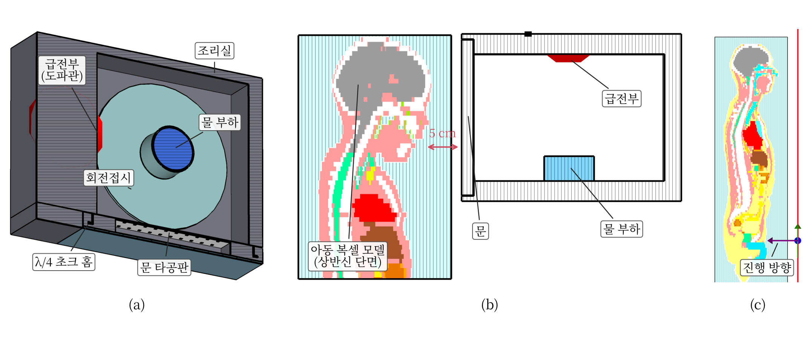
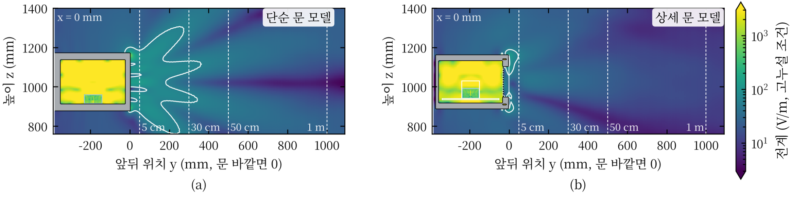
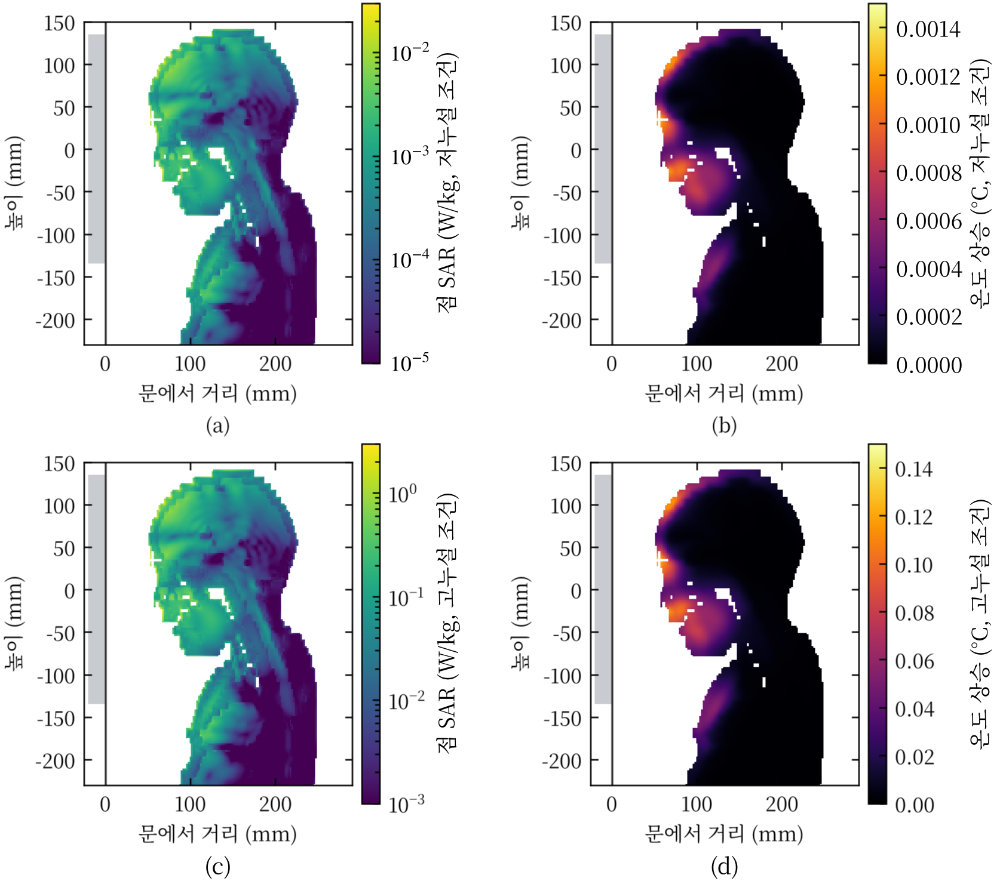
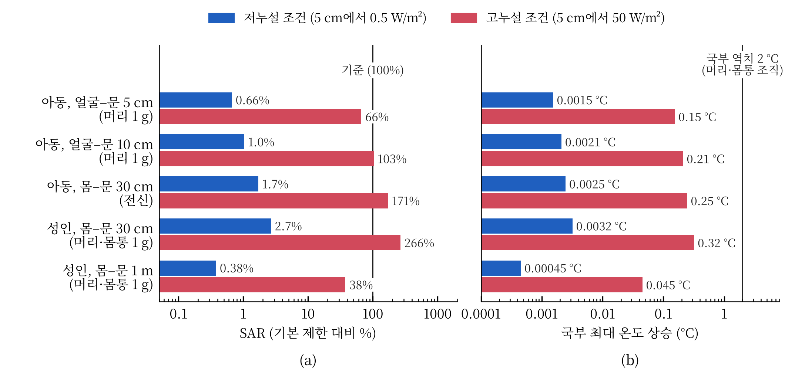

제1회 라이너 스콜라 연구공모전

장은성

작성일: 2026년 11월 2일

## 초록

전자레인지가 작동할 때 앞에 서 있으면 해롭다는 조언은 문틈으로 새는 전자파에 대한 우려에서 나온다. 이 글은 누설 측정 자료와 인체 흡수 연구를 비교하고, 거리별 흡수량과 온도 상승을 계산해 그 우려를 검토했다. 문에서 5 cm 떨어진 곳의 누설을 0.5 W/m²와 50 W/m²로 나누어, 평균 수준의 낮은 누설과 사용 중 허용 상한에 이르는 높은 누설을 비교했다. 저누설 조건에서 성인과 아동의 비흡수율(SAR)은 비교한 인체보호기준의 약 3% 이하였고, 국부 온도 상승은 0.004°C 미만이었다. 고누설 조건에서는 일부 가정의 SAR이 기준에 근접하거나 이를 넘었지만, 국부 온도 상승은 0.4°C 이하였다. 따라서 누설이 평균 수준인 제품 앞에 서 있는 것만으로 열적 위해가 생긴다고 보기는 어렵다. 높은 누설의 영향은 인체의 위치와 누설 분포에 따라 달라져 실제 사용 조건을 반영한 평가가 필요하다. 수치해석은 문헌의 노출값을 거리별 인체 흡수량으로 연결하기 위한 탐색적 계산으로 수행했다.

## 제1장 서론

### 제1절 연구의 배경과 목적

전자레인지로 음식을 데우다가 문 안을 들여다보면, 작동 중에는 앞에 서 있지 말라는 조언이 떠오른다. 음식을 데우는 전자파가 문틈으로 새어 나와 사람의 몸에도 영향을 줄 수 있다는 걱정이다. 이 조언이 타당한지 판단하려면 전자파가 얼마나 새는지, 사람이 그중 얼마나 흡수하는지, 그 에너지가 몸을 얼마나 데우는지 차례로 확인해야 한다.

전자레인지는 2.45 GHz 마이크로파로 음식을 가열한다. 제품 안전 규격은 외부로 새는 전자파의 양을 제한한다 [@FDA], [@IEC]. 인체보호기준은 몸 1 kg이 흡수하는 전력인 비흡수율(SAR, W/kg)을 제한한다 [@ICNIRP20], [@KOR]. 문 앞에서 측정한 누설값을 인체 흡수량으로 연결하는 과정이 이 질문의 핵심이다. 같은 제품도 사람이 서 있는 거리와 자세에 따라 노출이 달라지기 때문이다.

이 글은 문을 닫고 작동하는 가정용 전자레인지를 대상으로 두 가지를 확인한다. 먼저 문 앞 30 cm–1 m에 선 성인·아동과 문에 얼굴을 5–10 cm까지 가까이 댄 아동의 SAR을 인체보호기준과 비교한다. 이어서 그 에너지가 일으키는 온도 상승을 열적 영향의 판단 근거와 비교한다. 두 질문을 나눈 이유는 기본 제한값이 위해 수준에 안전 여유를 두어 정한 값이기 때문이다. 기준 준수 여부와 실제 가열의 영향을 각각 검토해야 통념에 답할 수 있다.

### 제2절 검토한 문헌과 방법

2026년 10월 19–22일 웹 검색엔진과 PubMed, IEEE Xplore, IOP 및 출판사 페이지에서 전자레인지 누설, 인체 흡수량, 온도 상승을 다룬 자료를 찾았다. 주요 검색어는 “microwave oven leakage survey”, “microwave oven leakage SAR”, “2.45 GHz whole-body SAR child plane wave”, “lens temperature 2.45 GHz”, “ICNIRP basic restriction rationale”, “전자레인지 전자파 누설”이었다. 가정용 제품의 누설을 측정·해석한 연구, 2.45 GHz 부근의 인체 흡수·온도 계산, 노출 기준과 그 근거 문헌을 검토 대상으로 골랐다.

10월 27일에는 라이너 스콜라의 심사 기능으로 연구 질문과 근거, 인용을 점검했다. 이후 10월 27–29일 최근 측정 자료와 상반된 근거를 추가로 탐색했다. 문헌 탐색과 서지 확인, 초안 작성에는 Claude도 사용했다. 인용 수치는 각 자료에서 직접 확인한 내용과 대조했으며, 표 1에 자료별 확인 수준을 표시했다.

문헌의 누설값을 사람이 받는 노출로 연결하기 위해 시간영역 유한적분법을 사용하는 상용 전자기장 시뮬레이터로 인체 흡수량을 계산했다 [@SIM]. Samsung 23 L 단독형 제품의 공개 사양 [@SPEC]을 참고해 문 둘레 전체에 틈을 둔 단순 문 모델과, 유리·타공판·초크 홈을 갖춘 상세 문 모델을 구성했다. 타공판은 작은 구멍을 뚫은 금속판이며, 초크 홈은 문 둘레의 누설을 줄이는 구조다. 그림 1은 두 모델의 구조와 인체 배치를 보여 준다.

그림 1. 해석 모델과 인체 배치. (a) 상세 문 모델의 외관과 (b) 내부 구조. 조리실에는 회전 접시와 물 275 mL를 두었고, 옆벽의 도파관으로 전자파를 공급했다. (c) 단순 문 앞 5 cm에 얼굴을 둔 아동 상반신과 (d) 평면파를 받는 성인 모델. 인체 색은 조직 종류를 나타낸다 [@SIM]. (출처: 본 연구 해석)

누설 크기는 물 275 mL를 넣고 문 외면에서 5 cm 떨어진 위치의 전력밀도를 기준으로 맞췄다. 약 25 cm²의 검출 면적으로 평균한 최댓값을 사용했다. 저누설 조건은 측정 자료의 평균 수준을 참고한 0.5 W/m², 고누설 조건은 사용 중 허용 상한인 50 W/m²로 정했다. 형상과 물성을 고정한 모델에서는 SAR과 온도 상승이 누설 전력에 비례하므로, 이 관계를 이용해 두 조건을 비교했다.

인체 모델은 시뮬레이터에 포함된 38세 성인 남성(176 cm)과 7세 여아(115 cm)의 해부학적 복셀 모델을 사용했다 [@SIM]. 거리는 문 바깥면과 몸 앞면 사이로 정의했다. 30 cm 이상에서는 평면파(한 방향으로 고르게 진행하는 전자파)를 인체에 쬐어 1 W/m²당 SAR을 계산한 뒤, 오븐 해석에서 얻은 몸 앞 전력밀도를 곱했다. 상세 문의 공간 평균을 정면에서 받는 조건과, 단순 문의 최댓값을 몸 전체에 적용하는 조건을 비교했다. 후자에서는 입사 방향을 ±30°까지 바꾸어 큰 값을 택했다. 전계의 방향은 키 방향으로 설정했다.

문에서 5–10 cm에 얼굴을 둔 아동은 오븐과 상반신을 함께 해석했다. SAR은 전신 평균과 1 g·10 g 평균으로 구했다. 머리·목의 국부 온도 상승은 Pennes 생체 열전달 방정식 [@PEN]을 3차원 정상상태로 풀었고, 심부 체온 상승은 30분간 열 손실이 없는 조건으로 추정했다.

## 제2장 주제별 분석

### 제1절 전자레인지의 누설 수준과 거리별 변화

전자레인지에 누설 기준을 도입하기 전에는 많은 전자파가 새는 제품도 있었다. 1970년 미국 아칸소주 조사에서는 일부 제품이 당시 업계 자율 기준인 100 W/m²를 넘었다 [@OATES]. 이후 미국은 문 외면에서 5 cm 이상 떨어진 곳의 누설을 판매 전 10 W/m², 판매 후 50 W/m²로 제한했다 [@FDA]. 국제 가전 안전 규격도 50 W/m²를 상한으로 정한다 [@IEC].

기준 도입 뒤의 조사에서는 대체로 상한보다 낮은 누설을 확인했다. 캐나다 보건부의 2000년 조사에서 판매 전 제품 60대는 모두 기준을 충족했고, 사용 중인 약 100대에서는 1대가 허용 상한을 넘었다 [@HC]. 팔레스타인 연구진은 가정용 오븐 115대의 5 cm·20 cm 누설을 조사해 일반인 기준보다 낮다고 보고했다 [@DAR]. 독일 연방방사선방호청(BfS)은 1997년 측정 자료를 바탕으로 평균 누설이 허용 상한의 약 1%이며, 30 cm에서는 표면 값의 5–10%로 줄어든다고 안내한다 [@BFS].

국내 국립전파연구원은 전자레인지에서 30 cm 떨어진 곳의 2.4 GHz 노출을 인체보호기준 대비 약 7.2%로 제시했다 [@RRA]. 다만 공개 안내문에는 전계와 전력밀도 중 어느 양의 비율인지 명시하지 않았다. 뒤의 계산에서는 두 해석을 모두 적용해 결과의 차이를 확인했다.

표 1. 누설 측정과 인체 해석 연구의 비교. 각 연구의 노출량은 거리, 측정 지표와 인체 모델에 따라 달라지므로 해당 조건과 함께 읽는다. (출처: 각 문헌)

| 자료 | 대상과 조건 | 주요 결과 | 확인한 자료와 해석 범위 |
|---|---|---|---|
| 미국 1970년 조사 [@OATES] | 기준 도입 전 사용 중 제품 | 일부 제품이 당시 기준 100 W/m² 초과 | 초록, 과거 제품의 누설 사례 |
| 캐나다 2000년 조사 [@HC] | 판매 전 60대, 사용 중 약 100대 | 사용 중 1대가 허용 상한 초과 | 기관 보고, 특정 지역·시기의 표본 |
| 팔레스타인 2014년 조사 [@DAR] | 가정용 115대, 5 cm·20 cm | 일반인 기준보다 낮은 누설 | 학술대회 초록 |
| 독일 BfS 안내 [@BFS] | 1997년 측정 자료 | 평균 누설은 허용 상한의 약 1% | 기관 안내, 기준점과 평균값의 대표성 확인 필요 |
| 국립전파연구원 안내 [@RRA] | 30 cm, 2.4 GHz | 인체보호기준 대비 약 7.2% | 기관 안내, 측정량의 정의 확인 필요 |
| ARPANSA 예비 측정 [@BANG] | 겉보기 손상이 없는 제품 포함 | 제품 방출 기준과 SAR 기준의 차이 제기 | 초록, 개별 측정 조건 확인 필요 |
| 접촉형 문 해석 [@TIAN] | 10 cm 이내의 흉부·심박조율기 모델 | 낮은 SAR·온도 상승과 기기 간섭 가능성 | 초록, 흉부·기기 모델에 해당 |
| 눈 해석 [@HIR00] | 50 W/m²의 ISM 대역 노출 | 최대 온도 상승 0.26°C, 5.8 GHz | 초록, 눈 모델의 계산값 |
| 아동 전신 해석 [@WANG], [@BAK] | 참고 수준의 평면파 | 일부 모델에서 전신 기본 제한 초과 | 초록, 모델·자세에 따른 차이 |

측정 자료에서 얻을 수 있는 첫 결론은 누설이 거리와 함께 줄어든다는 점이다. 이 글의 오븐 해석도 같은 경향을 보였다. 상세 문 모델에서 30 cm, 50 cm, 1 m의 최대 세기는 5 cm 값의 각각 6.5%, 2.9%, 1.1%였다. 단순 문 모델에서는 각각 26%, 13%, 3.9%로, 문 구조에 따라 멀리까지 남는 누설량이 달랐다. 고누설 조건에서 10 W/m²를 넘는 영역은 단순 문 앞 약 36 cm, 상세 문 앞 약 5–13 cm에 머물렀다(그림 2, 검출 면적 보정 전).

그림 2. 고누설 조건의 오븐 전면 전계 분포. (a) 단순 문과 (b) 상세 문 모델. 흰 실선은 전계로 환산한 전력밀도 10 W/m²의 경계이며, 점선은 문에서 5 cm, 30 cm, 50 cm, 1 m 위치다. 저누설 조건의 전력은 그림 값의 1/100이다. 검출 면적 보정을 적용하면 전계는 약 1.1배가 된다. (출처: 본 연구 해석)

5 cm의 측정값을 더 먼 거리로 환산할 때는 누설원의 분포를 고려해야 한다. 문틈 전체가 누설원인 단순 문 모델에 역제곱 법칙을 적용하면 30 cm–1 m의 노출을 10–15배 작게 추정했다. 또한 문 가까이에서는 전계와 자계의 비가 자유공간 값인 377 Ω과 달라, 전계로 환산한 전력밀도가 실제 전력 흐름보다 최대 1.9배 컸다. 이런 차이 때문에 누설 측정값과 인체 흡수량을 연결하는 계산이 필요하다.

### 제2절 인체 흡수량과 열적 영향의 비교 기준

인체보호기준은 전자파가 몸을 가열하는 영향을 근거로 삼는다. ICNIRP가 정리한 동물 실험에서는 쥐와 원숭이가 전신 평균 SAR 약 4 W/kg에서 학습 과제를 멈췄고, 심부 체온은 약 1°C 올랐다 [@ICNIRP98]. ICNIRP는 전신 기본 제한을 정할 때 감소계수 50을 적용해 일반인 기준을 0.08 W/kg으로 정했다 [@ICNIRP20], [@ICNIRP98]. 따라서 기본 제한은 건강영향을 평가할 때 안전 여유를 두는 기준값이다.

몸의 일부에 에너지가 집중될 때는 국부 SAR과 온도 상승을 확인한다. 국내 기준은 머리·몸통 1 g 평균 SAR 1.6 W/kg, ICNIRP는 10 g 평균 2 W/kg을 사용한다 [@ICNIRP20], [@KOR]. 이 글에서는 전신 0.08 W/kg과 국내 국부 기준 1.6 W/kg을 계산값의 비교 기준으로 삼았다. 두 국부 기준은 서로 다른 조직 질량에 걸쳐 평균하므로 각 기준의 정의에 맞게 해석해야 한다.

ICNIRP는 조직의 온도 특성에 따라 국부 온도 상승의 운영 역치를 5°C와 2°C로 구분한다 [@ICNIRP20]. 이 글은 국부 최대값을 비교할 때 더 낮은 2°C를 공통 비교값으로 사용했다. 눈의 열적 영향도 함께 검토했다. 토끼의 수정체 가열 실험 [@GUY]과 사람 눈 모델 연구 [@HIR00]는 눈의 온도를 별도로 평가할 근거를 제공한다. 사람 눈 모델 연구가 제시한 수정체 온도 상승 비교값은 약 3°C다. 비교에 사용한 값은 표 2에 정리했다.

표 2. 인체 흡수량과 온도 상승의 비교에 사용한 값. SAR 기본 제한에는 안전 여유가 포함된다. 제품 누설 기준과 인체 흡수 기준은 서로 다른 양을 제한한다. (출처: [@FDA]–[@KOR], [@HIR00], [@ICNIRP98])

| 구분 | 비교 대상 | 값 |
|---|---|---|
| 제품 누설 기준 [@FDA], [@IEC] | 문 외면에서 5 cm 이상 떨어진 곳의 전력밀도 | 50 W/m², 미국 판매 전 10 W/m² |
| 전신 SAR [@ICNIRP20], [@KOR] | 몸 전체 평균 | 0.08 W/kg |
| 국부 SAR [@ICNIRP20], [@KOR] | 머리·몸통의 평균 흡수량 | 국내 1 g 평균 1.6 W/kg, ICNIRP 10 g 평균 2 W/kg |
| 심부 체온 [@ICNIRP20], [@ICNIRP98] | 전신 가열에 따른 온도 상승 | 1°C |
| 국부 온도 [@ICNIRP20] | 조직별 운영 역치 | 1형 조직 5°C, 2형 조직 2°C |
| 수정체 온도 [@HIR00] | 눈 모델의 온도 상승 비교값 | 약 3°C |

암이나 자각 증상에 관한 자료는 연구별 노출 조건을 함께 읽어야 한다. IARC는 2011년 휴대전화 사용자의 신경교종 보고 등을 근거로 무선주파수 전자기장을 2B군으로 분류했다 [@IARC]. 2024년 WHO 의뢰 고찰은 인간 관찰연구의 주요 암 결과 [@KAR]와 단시간 유발 실험의 자각 증상 [@BOS]에서 관련성을 뒷받침하는 일관된 근거를 찾지 못했다. 2025년 동물 고찰은 장기 노출에 따른 신경교종·심장 신경초종 증가의 근거를 높게 평가했다 [@MEV]. 이 자료들은 주로 휴대전화나 동물의 장기 노출을 다루므로, 가정용 전자레인지의 짧은 저누설 노출과 비교하려면 노출량·시간·대상의 차이를 검토해야 한다. 이 글의 정량 평가는 직접 비교할 수 있는 SAR과 온도 상승에 초점을 맞췄다.

### 제3절 거리와 인체 배치에 따른 흡수량

앞의 측정 자료는 제품 밖으로 새는 전자파를 보여 준다. 인체 흡수 연구는 그 에너지가 몸에 들어온 뒤의 영향을 다룬다. 접촉형 문 연구에서는 10 cm 이내 흉부의 SAR과 온도 상승이 낮았고 [@TIAN], 눈 모델 연구에서는 50 W/m² 노출의 최대 온도 상승이 0.26°C였다 [@HIR00]. 후자의 최댓값은 5.8 GHz에서 나왔으며, 이번 연구의 2.45 GHz 계산과는 주파수가 다르다. 이를 바탕으로 이번 해석에서는 성인과 아동, 문 앞 거리와 얼굴 위치를 나누어 비교했다.

저누설 조건의 SAR은 검토한 배치에서 모두 기본 제한의 약 3% 이하였다(그림 4). 가장 큰 값은 문에서 30 cm 떨어진 성인의 머리·몸통 1 g SAR로, 단순 문의 최대 누설을 몸 전체에 적용했을 때 기준의 2.7%였다. 같은 조건에서 아동의 전신 SAR은 1.7%였다. 상세 문의 공간 평균을 사용하면 SAR은 이보다 약 10–20배 작았다.

같은 전력밀도에서도 성인과 아동은 에너지를 다르게 흡수했다. 이번 모델에서 아동의 전신 SAR은 성인의 1.6–1.7배였다. 아동의 체중당 체표면적이 큰 점은 GHz 대역의 흡수 차이를 설명하는 요인이다 [@HIR07], [@FLI]. 기존 연구에서도 일부 아동 모델은 참고 수준의 평면파에서 전신 기본 제한을 약 30–45% 초과했고, 모델과 자세에 따라 초과 폭이 달랐다 [@WANG], [@BAK], [@UUS], [@PIU]. ICNIRP 2020은 최근 표준 모델의 초과 폭과 아동의 열 방출 특성을 함께 검토해 참고 수준을 유지했다 [@ICNIRP20].

문에 얼굴을 가까이 댄 경우에는 노출 분포가 달라졌다. 아동의 머리 1 g SAR은 문에서 5 cm일 때 기준의 0.66%, 10 cm일 때 1.0%였다. 10 cm에서 값이 커진 이유는 거리에 따라 누설 빔이 퍼지면서 턱 쪽 노출이 커졌기 때문이다. SAR과 온도 상승은 이마·코·입·턱의 피부와 바로 아래 조직에 집중했고, 뇌 내부에서는 낮았다(그림 3). 같은 5 cm 누설을 평면파로 대신 계산하면 머리 1 g SAR은 7.4배, 피부 온도 상승은 4.1배 커졌다. 문 가까이에서는 오븐과 인체를 함께 해석하는 방법이 노출 분포를 더 구체적으로 보여 준다.

그림 3. 문 앞 5 cm에 얼굴을 둔 아동의 (a) 점 SAR과 (b) 온도 상승. 측면 단면이며, 왼쪽 회색 띠가 문이다. 두 누설 조건의 분포는 같고 크기만 100배 다르므로 고누설 조건 하나로 나타냈다. 저누설 조건의 값은 색 눈금 값의 1/100이다. 검출 면적 보정 전 결과로, 보정을 적용하면 약 1.23배가 된다. (출처: 본 연구 해석)

저누설 조건에서 국부 최대 온도 상승은 성인 0.0032°C, 아동 0.0025°C였다. 30분간 열이 빠져나가지 않는 조건의 심부 체온 상승은 0.0007°C 이하, 근접 아동의 수정체 온도 상승은 0.0008°C였다. 국내 안내의 7.2%를 전계비와 전력밀도비로 각각 해석하면 30 cm의 전력밀도는 0.052 W/m²와 0.72 W/m²가 된다. 더 큰 값인 0.72 W/m²를 몸 전체에 적용해도 SAR은 기본 제한의 9% 이하였다.

누설을 사용 중 허용 상한까지 높이면 일부 조건의 SAR은 기본 제한에 근접하거나 이를 넘었다. 근접 아동의 머리 1 g SAR은 기준의 66–103%였다. 30 cm에서 단순 문의 최대 누설을 적용한 성인의 국부 SAR은 266%, 아동의 전신 SAR은 171%였고, 상세 문의 공간 평균을 적용하면 각각 15%, 7.7%였다. 같은 누설 상한에서도 문 구조와 인체가 받는 공간 분포에 따라 결과가 크게 달랐다.

고누설 조건의 국부 온도 상승은 0.35°C 이하였다. 혈류가 열을 실어 나르는 정도(관류율)를 기본값보다 30% 낮게 잡아 열이 덜 빠져나가게 해도 0.4°C 이하였다. 심부 체온 상승은 30분 단열 조건에서 0.07°C 이하였다. 기본 제한값에는 안전 여유가 있으므로 SAR이 기준을 넘는 조건에서도 온도 상승은 운영 역치보다 낮게 나올 수 있다. 그림 4는 이처럼 서로 다른 두 비교 결과를 함께 보여 준다.

그림 4. 거리와 인체 배치에 따른 (a) 기본 제한 대비 SAR과 (b) 국부 최대 온도 상승. 파란색은 저누설 조건, 빨간색은 고누설 조건이다. 30 cm와 1 m는 단순 문의 최대 누설과 검토한 입사각 중 큰 값을 적용한 결과다. 온도 패널의 2°C 선은 ICNIRP 2형 조직의 운영 역치를 공통 비교값으로 표시한다. 두 패널의 가로축은 로그 눈금이며, 검출 면적 보정 후 값이다. (출처: 본 연구 해석)

## 제3장 논의

문틈에서 전자파가 샌다는 사실만으로 문 앞에 선 사람의 위해를 판단하기는 어렵다. 문헌의 누설 측정은 제품 밖의 전자파를 보여 주고, 인체 해석은 그중 몸이 흡수하는 양과 온도 변화를 연결한다. 검토한 측정 자료에서 누설은 대체로 허용 상한보다 낮았고, 이 수준의 누설을 넣은 해석에서 SAR은 기본 제한의 3% 이하, 국부 온도 상승은 2°C 역치의 약 1/600이었다. 이번에 확인한 계산 조건의 영향, 곧 인체 모델 차이(머리 1 g SAR 1.15배)와 관류율(최고 온도 최대 1.25배)을 더해도 기준과의 차이는 수십 배 이상 남는다. 따라서 누설이 측정 자료의 평균 수준인 제품 앞에 서 있는 것만으로 몸이 해를 입을 만큼 가열된다고 보기는 어렵다. 다만 이 판단은 실제 제품의 누설이 그 수준이라는 측정 자료에 기대므로, 누설이 큰 제품에는 그대로 적용되지 않는다.

높은 누설을 보이는 제품에서는 조건별 차이가 더 중요했다. 캐나다 조사에서는 사용 중 제품 일부가 누설 상한을 넘었고 [@HC], 문 실이나 이음새의 손상·오염은 누설을 늘릴 수 있다 [@BAG]. Silva 등은 높은 누설을 보인 제품의 수리 전후를 비교했다 [@SIL24]. ARPANSA의 예비 측정은 겉보기 손상이 없는 제품의 높은 누설과, 제품 방출 기준을 충족하는 조건에서도 SAR 기본 제한을 넘을 가능성을 제기했다 [@BANG]. 이 자료들은 제품 상태와 누설 분포를 확인할 필요성을 보여 준다.

이번 고누설 해석도 일부 배치에서 SAR 기본 제한을 넘었지만, 온도 상승은 비교값보다 낮았다. 이를 실제 제품의 열적 위해 여부로 연결하려면 모델 검증이 필요하다. 문 구조는 거리별 누설을 바꾸고, 인체 위치와 입사 방향은 흡수 부위를 바꾼다. 따라서 높은 누설을 평가할 때는 측정 지점의 최댓값과 인체가 받는 노출 분포를 함께 확인해야 한다.

이번 검토의 불확실성은 측정 자료와 인체 모델에서 나온다. 측정 자료는 특정 시기·지역의 제품을 다루며, BfS의 평균값은 현재 국내 제품의 누설 분포와 차이가 있을 수 있다. 최근 주거 환경의 오븐 50대를 다룬 연구 [@SIL25] 등은 측정 조건을 더 확인해 비교할 자료다. 표 1의 일부 연구는 초록과 기관 안내문에서 확인한 범위를 사용했다.

수치해석에서는 누설 전력의 크기와 공간 분포를 구분해야 한다. 두 누설 조건은 같은 모델의 전력을 조정해 만들었으므로, 고장으로 문 형상이나 누설 방향이 바뀌면 해당 구조로 다시 계산해야 한다. 오븐 형상은 하나이며, 근접 해석은 단순 문 모델과 얼굴 위치 하나만 다루었다. 30 cm 이상의 평면파 계산은 공간 분포와 오븐·인체 상호작용을 단순화한다. 여러 방향의 전파를 다룬 연구는 반사 환경이 전신 SAR에 영향을 준다고 설명한다 [@KIE].

인체 물성과 열해석에도 추가 확인이 필요하다. 아동 모델의 주 연조직에는 기본 설정의 지방 물성을 사용했고, 열해석의 조직 분포는 내보낸 자료에서 간접 복원했다. 또한 격자 수렴과 실측 검증을 거치지 않아 계산 오차를 정량화하지 못했다. 관류율을 ±30% 바꾸었을 때 최고 온도는 약 0.8–1.25배로 달라졌다. 이런 불확실성 때문에 기준 부근의 고누설 결과는 실제 제품의 평가를 시작할 조건으로 읽어야 한다.

별도로 구분할 위험도 있다. 인터록이 고장 나 문을 연 채 동작한 오븐에 손을 넣었을 때 통증이 생긴 사례 [@OLE]는 이번 문 닫힘 조건과 노출 양상이 다르다. 심박조율기의 간섭 가능성 [@TIAN] 역시 조직 가열과 다른 지표로 평가한다. 이 글은 문을 닫고 작동하는 제품의 누설에 따른 열적 영향을 중심으로 통념을 검토했다.

## 제4장 결론

전자레인지 앞에 서 있으면 해로운지 판단하려면 문틈으로 새는 양에서 출발해 인체 흡수량과 온도 상승까지 확인해야 한다. 검토한 누설 측정 자료와 저누설 조건의 해석에서 SAR은 기본 제한의 3% 이하, 온도 상승은 역치의 수백분의 일 수준이었다. 따라서 누설이 평균 수준인 제품 앞에 서 있는 것만으로 몸이 해를 입을 만큼 가열된다고 보기는 어렵다.

누설이 사용 중 허용 상한에 이르면 일부 인체 배치의 SAR은 기본 제한에 근접하거나 이를 넘었다. 높은 누설의 영향은 제품 구조와 사람이 받는 노출 분포에 따라 달라지므로 실제 사용 조건을 반영한 평가가 필요하다. 이번 계산은 그 차이를 살펴본 탐색적 결과이며, 정확한 예측을 위해 인체 물성과 해석 모델의 검증을 보완해야 한다. 장기 건강영향은 별도의 노출 조건과 근거를 바탕으로 검토할 과제다.

## 참고문헌

[@FDA] U.S. Food and Drug Administration. (n.d.). *21 CFR 1030.10 Microwave ovens*. Electronic Code of Federal Regulations. Retrieved October 20, 2026, from https://www.ecfr.gov/current/title-21/chapter-I/subchapter-J/part-1030/section-1030.10

[@IEC] International Electrotechnical Commission. (2024). *IEC 60335-2-25:2024 Household and similar electrical appliances – Safety – Part 2-25: Particular requirements for microwave ovens, including combination microwave ovens* (Ed. 8.0). https://webstore.iec.ch/en/publication/66759

[@ICNIRP20] International Commission on Non-Ionizing Radiation Protection. (2020). Guidelines for limiting exposure to electromagnetic fields (100 kHz to 300 GHz). *Health Physics, 118*(5), 483–524. https://doi.org/10.1097/HP.0000000000001210

[@KOR] 과학기술정보통신부. (2019). *전자파인체보호기준* (과학기술정보통신부고시 제2019-4호). 국가법령정보센터. https://www.law.go.kr/LSW//admRulInfoP.do?admRulSeq=2100000175532

[@KAR] Karipidis, K., et al. (2024). The effect of exposure to radiofrequency fields on cancer risk in the general and working population: A systematic review of human observational studies. *Environment International, 191*, 108983. https://doi.org/10.1016/j.envint.2024.108983

[@BOS] Bosch-Capblanch, X., et al. (2024). The effects of radiofrequency electromagnetic fields exposure on human self-reported symptoms: A systematic review of human experimental studies. *Environment International, 187*, 108612. https://doi.org/10.1016/j.envint.2024.108612

[@MEV] Mevissen, M., et al. (2025). Effects of radiofrequency electromagnetic field exposure on cancer in laboratory animal studies, a systematic review. *Environment International, 199*, 109482. https://doi.org/10.1016/j.envint.2025.109482

[@IARC] Baan, R., Grosse, Y., Lauby-Secretan, B., El Ghissassi, F., Bouvard, V., Benbrahim-Tallaa, L., Guha, N., Islami, F., Galichet, L., & Straif, K. (2011). Carcinogenicity of radiofrequency electromagnetic fields. *The Lancet Oncology, 12*(7), 624–626. https://doi.org/10.1016/S1470-2045(11)70147-4

[@SIM] 전자기장 시뮬레이터 제조사. (2019). *전자기장 시뮬레이터 사용자 설명서: 인체 모델 자료(Biological Data)* (버전 2019.7).

[@SPEC] Samsung Electronics. (n.d.). *MS23K3513AW SOLO MWO with Quick Defrost, 23L* [Product specifications]. Retrieved October 27, 2026, from https://www.samsung.com/ae/business/microwave-ovens/solo/microwave-oven-solo-ms23k3513aw-sg/

[@PEN] Pennes, H. H. (1948). Analysis of tissue and arterial blood temperatures in the resting human forearm. *Journal of Applied Physiology, 1*(2), 93–122. https://doi.org/10.1152/jappl.1948.1.2.93

[@ICNIRP98] International Commission on Non-Ionizing Radiation Protection. (1998). Guidelines for limiting exposure to time-varying electric, magnetic, and electromagnetic fields (up to 300 GHz). *Health Physics, 74*(4), 494–522. https://www.icnirp.org/cms/upload/publications/ICNIRPemfgdl.pdf

[@GUY] Guy, A. W., Lin, J. C., Kramar, P. O., & Emery, A. F. (1975). Effect of 2450-MHz radiation on the rabbit eye. *IEEE Transactions on Microwave Theory and Techniques, 23*(6), 492–498. https://doi.org/10.1109/TMTT.1975.1128603

[@HIR00] Hirata, A., Ushio, G., & Shiozawa, T. (2000). Calculation of temperature rises in the human eye exposed to EM waves in the ISM frequency bands. *IEICE Transactions on Communications, E83-B*(3), 541–548. https://global.ieice.org/en_transactions/communications/10.1587/e83-b_3_541/_p

[@OATES] Oates, W. H., Jr., Snellings, D. D., Jr., & Wilson, E. F. (1973). Microwave oven survey results in Arkansas during 1970. *American Journal of Public Health, 63*(3), 193–198. https://doi.org/10.2105/AJPH.63.3.193

[@HC] Health Canada. (2000). *Radiation leakage of before-sale and used microwave ovens*. Retrieved October 20, 2026, from https://www.canada.ca/en/health-canada/services/environmental-workplace-health/reports-publications/radiation/radiation-leakage-before-sale-used-microwave-ovens-health-canada-2000.html

[@DAR] Darawshe, M. F., Abu Jafar, M., & Abdelraziq, I. R. (2014). Electric and magnetic field radiation leakage from microwave ovens at homes in Palestine. *Fourth Palestinian Conference on Modern Trends in Mathematics and Physics (PCMTMP-IV)*, Al-Quds University. https://repository.najah.edu/handle/20.500.11888/8617

[@BFS] Bundesamt für Strahlenschutz. (n.d.). *Mikrowellenkochgeräte*. Retrieved October 20, 2026, from https://www.bfs.de/DE/themen/emf/hff/quellen/mikrowelle/mikrowelle_node.html

[@RRA] 국립전파연구원. (n.d.). *생활 속의 전자파 FAQ*. 2026년 10월 20일 검색, https://www.rra.go.kr/ko/license/D_e_faq.do?fa_type=a&fa_category=electronic

[@TIAN] Tian, R., Wei, J.-C., & Lu, M. (2025). The numerical assessment of RF human exposure to microwave ovens with contact-type doors. *Electronics, 14*(5), 873. https://doi.org/10.3390/electronics14050873

[@WANG] Wang, J., Fujiwara, O., Kodera, S., & Watanabe, S. (2006). FDTD calculation of whole-body average SAR in adult and child models for frequencies from 30 MHz to 3 GHz. *Physics in Medicine and Biology, 51*(17), 4119–4127. https://doi.org/10.1088/0031-9155/51/17/001

[@BAK] Bakker, J. F., Paulides, M. M., Christ, A., Kuster, N., & van Rhoon, G. C. (2010). Assessment of induced SAR in children exposed to electromagnetic plane waves between 10 MHz and 5.6 GHz. *Physics in Medicine and Biology, 55*(11), 3115–3130. https://doi.org/10.1088/0031-9155/55/11/009

[@UUS] Uusitupa, T., Laakso, I., Ilvonen, S., & Nikoskinen, K. (2010). SAR variation study from 300 to 5000 MHz for 15 voxel models including different postures. *Physics in Medicine and Biology, 55*(4), 1157–1176. https://doi.org/10.1088/0031-9155/55/4/017

[@PIU] Piuzzi, E., Bernardi, P., Cavagnaro, M., Pisa, S., & Lin, J. C. (2011). Analysis of adult and child exposure to uniform plane waves at mobile communication systems frequencies (900 MHz–3 GHz). *IEEE Transactions on Electromagnetic Compatibility, 53*(1), 38–47. https://doi.org/10.1109/TEMC.2010.2053376

[@HIR07] Hirata, A., Kodera, S., Wang, J., & Fujiwara, O. (2007). Dominant factors influencing whole-body average SAR due to far-field exposure in whole-body resonance frequency and GHz regions. *Bioelectromagnetics, 28*(6), 484–487. https://doi.org/10.1002/bem.20335

[@FLI] Flintoft, I. D., Robinson, M. P., Melia, G. C. R., Dawson, J. F., & Marvin, A. C. (2014). Average absorption cross-section of the human body measured at 1–12 GHz in a reverberant chamber: Results of a human volunteer study. *Physics in Medicine and Biology, 59*(13), 3297–3317. https://doi.org/10.1088/0031-9155/59/13/3297

[@OLE] Oleson, J., Samulski, T., Clegg, S., Das, S., & Grant, W. (1994). Heating rate modeling and measurements in phantom and in vivo of the human upper extremity in a defective 2450 MHz microwave oven. *Journal of Microwave Power and Electromagnetic Energy, 29*(2), 101–108. https://doi.org/10.1080/08327823.1994.11688237

[@SIL24] Silva, J. da L. A., de Sousa, V. A., Jr., Rodrigues, M. E. C., Pinheiro, F. S. R., da Silva, G. S., Mendonça, H. B., Galdino, F. E. S., & Silva, R. Q. de F. H. (2024). Analysis of measurements in a microwave oven with high level of non-ionizing radiation (NIR) before and after repair. *Journal of Communication and Information Systems, 39*(1), 160–163. https://doi.org/10.14209/jcis.2024.16

[@BANG] Bangay, M., & Zombolas, C. (2003). Advanced measurements of microwave oven leakage. *Radiation Protection in Australasia, 20*(2), 47–51. https://inis.iaea.org/records/t4ej4-h3210

[@BAG] Bundesamt für Gesundheit. (n.d.). *Faktenblatt Mikrowellenofen*. Retrieved October 20, 2026, from https://www.bag.admin.ch/dam/en/sd-web/JbnegZr3mAZv/faktenblatt-mikrowellenofen.pdf

[@SIL25] Silva, J. da L. A., et al. (2025). Measurement of non-ionizing radiation (NIR) from Wi-Fi access points and microwave ovens in residential environments. *Journal of Electromagnetic Waves and Applications, 39*(3), 268–289. https://doi.org/10.1080/09205071.2024.2449120

[@KIE] Kientega, T., et al. (2011). A surrogate model to assess the whole body SAR induced by multiple plane waves at 2.4 GHz. *Annals of Telecommunications, 66*, 419–428. https://doi.org/10.1007/s12243-011-0261-z
