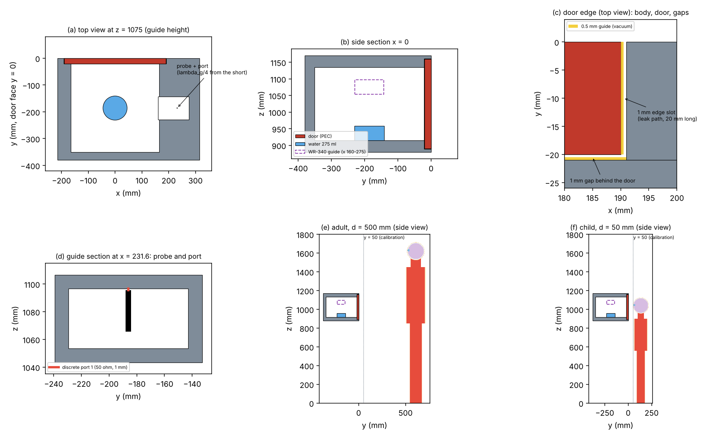
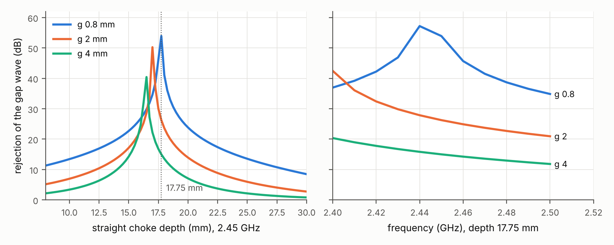
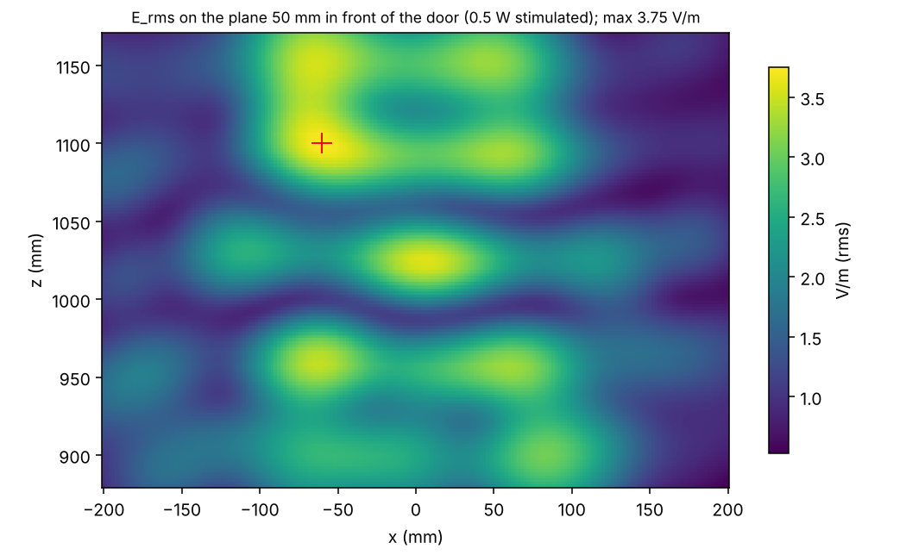
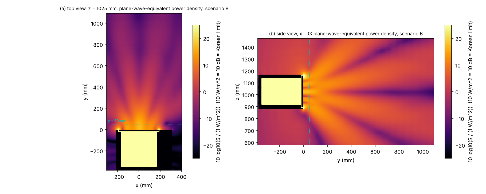
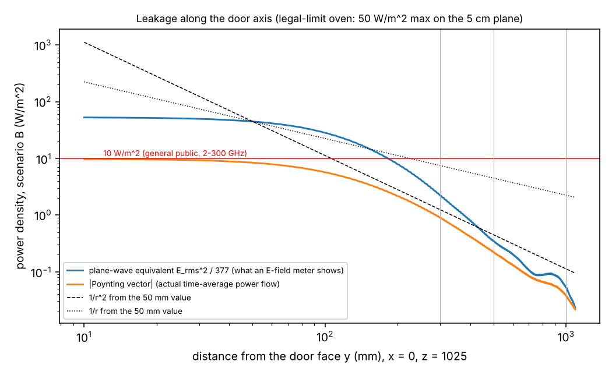
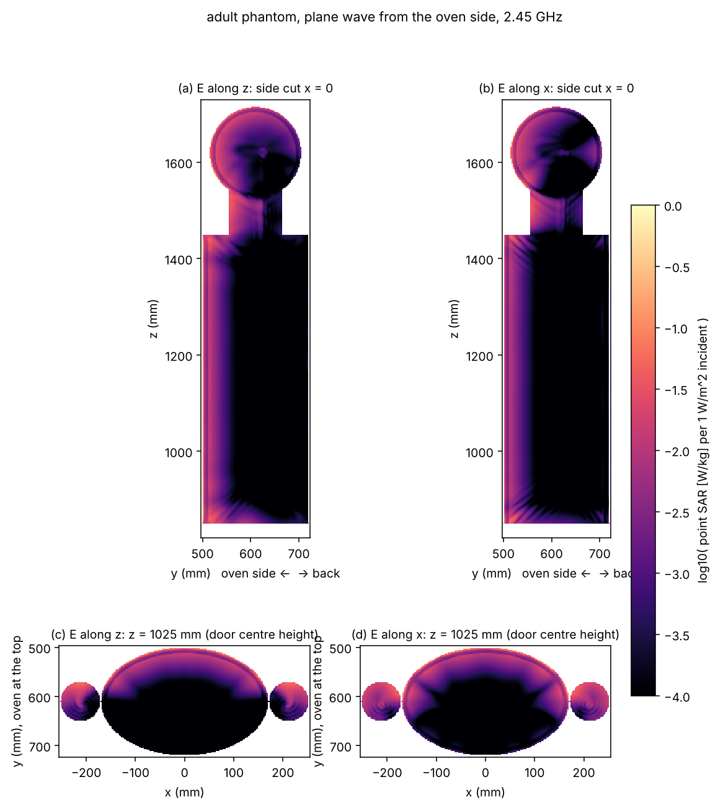
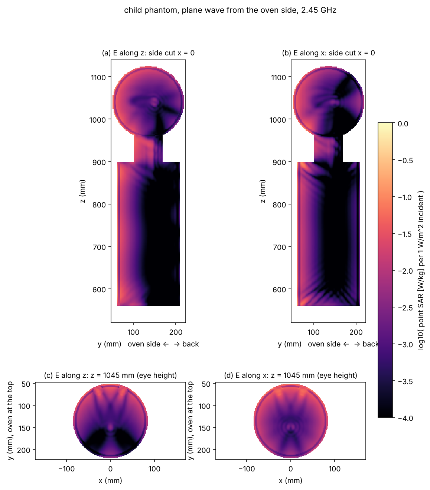
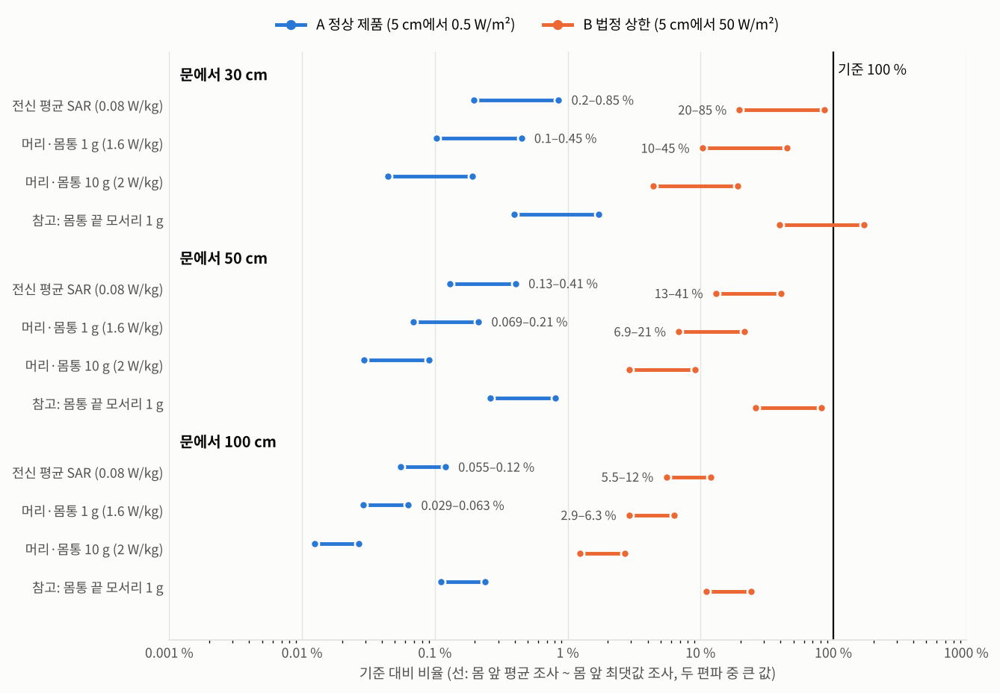

# 작동 중인 전자레인지 앞에 서 있으면 해로울까? 문 누설 전자파가 몸에 흡수되는 양의 전산 해석

> 초안. 공모전 공식 양식을 받으면 그 틀로 옮긴다. [결과 대기]는 CST 해석이 끝나면 채운다. [확인 필요]는 원문으로 확인한 뒤 인용한다(`references_verified.md`).

## 초록

"작동 중인 전자레인지 앞에 서 있으면 해롭다"는 통념을 전자기 해석으로 검증했다. 기존 근거는 두 갈래로 나뉜다. 제품 기준은 문에서 5 cm 떨어진 곳의 누설 전력밀도를 제한한다. 인체보호기준은 몸이 흡수하는 전력(비흡수율, SAR)을 제한한다. 두 기준은 측정 위치와 물리량이 달라 직접 비교할 수 없다. 5 cm는 2.45 GHz 반파장(약 6.1 cm)보다 가까워서 거리 제곱 법칙으로 환산할 수도 없다. 이 연구는 전자레인지 문 누설을 3차원 전자기 해석(CST Studio Suite 2019, 시간영역 유한적분법)으로 구하고, 성인(74 kg)과 아동(22 kg) 인체 모형이 흡수하는 SAR을 직접 계산했다. 누설 크기는 문 5 cm 평면의 최대 전계를 정상 제품 수준(0.05 mW/cm²)과 법정 상한(5 mW/cm²)에 맞춰 보정했다. 정상 제품 앞 30 cm–1 m에 선 성인의 SAR은 모든 지표에서 기준의 1% 미만이었다. 누설이 법정 상한인 제품이라도 30 cm에서 전신 평균 SAR은 기준의 18%(몸 전체를 최댓값으로 조사한 상한 78%), 머리·몸통 1 g 국부 SAR은 9%(상한 41%)였다. 성인의 전신 평균 SAR이 기준에 닿으려면 누설이 정상 제품의 117배 이상이어야 했다. 문 앞 5 cm의 전계 환산 전력밀도는 실제 에너지 흐름보다 최대 1.9배 컸고, 누설은 거리 제곱이 아니라 거리에 반비례하는 쪽에 가깝게 줄었다. 같은 입사 전력밀도에서 아동 모형의 전신 평균 SAR은 성인의 1.6–1.7배였다. [결과 대기: 문에 얼굴을 댄 아동(5 cm, 10 cm)의 SAR]

주제어: 전자레인지, 누설 전자파, 비흡수율(SAR), 인체보호기준, 근역장, 전산 전자기 해석

## 1. 서론

전자레인지는 2.45 GHz 마이크로파로 음식 속 물을 데운다. 내부 전력은 수백 와트에서 1 kW 수준이다. 문과 본체 사이 이음새로 극히 일부가 새어 나온다. 그래서 "작동 중인 전자레인지 앞에 서 있으면 해롭다"는 통념이 생겼다. 이 통념을 판단하는 근거는 두 갈래다.

첫째는 제품 방출 기준이다. 미국 연방규정 21 CFR 1030.10은 문 표면에서 5 cm 떨어진 곳의 누설 전력밀도를 판매 전 1 mW/cm², 사용 기간 중 5 mW/cm² 이하로 제한한다 [확인 필요]. 국제 가전 안전 표준 IEC 60335-2-25도 문에서 50 mm 이상 떨어진 곳에서 50 W/m²(5 mW/cm²)를 상한으로 둔다 [2차 인용]. 독일 연방방사선방호청(BfS)은 실제 제품의 누설이 평균적으로 이 상한의 약 1%이고, 30 cm에서는 표면 세기의 5–10%로 줄어든다고 안내한다 [2차 인용].

둘째는 인체 노출 기준이다. 국내 전자파인체보호기준(과학기술정보통신부고시 제2019-4호)은 일반인의 전신 평균 SAR을 0.08 W/kg, 머리와 몸통의 국부 SAR을 1.6 W/kg(1 g 평균) 이하로 정한다. 2–300 GHz 대역의 전력밀도 기준은 10 W/m²(1 mW/cm²)이다 [2차 인용, 고시 원문 확인 필요]. 국제비전리복사방호위원회(ICNIRP) 2020 지침은 전신 0.08 W/kg(30분 평균), 머리·몸통 국부 2 W/kg(10 g, 6분 평균)을 권고한다. 국부 SAR 시험 의무는 몸에 20 cm 이내로 쓰는 휴대용 무선기기에 적용되고, 전자레인지는 누설 기준으로 관리된다. 따라서 이 연구의 국부 SAR 비교는 법적 적합성 판정이 아니라 물리적 비교다.

두 기준을 나란히 놓으면 판단이 쉬워 보인다. 그러나 비교에는 세 가지 어려움이 있다. 첫째, 방출 기준은 문에서 5 cm 지점의 값이고, 사람은 그보다 멀리 서 있다. 둘째, 5 cm는 2.45 GHz 파장의 절반(약 6.1 cm)보다 가깝다. 이 근역장에서는 전력밀도가 거리 제곱에 반비례한다는 원거리 공식을 쓸 수 없다. 셋째, 몸이 흡수하는 양은 전력밀도만으로 정해지지 않는다. 몸의 크기, 자세, 조직의 전기적 성질, 오븐과 몸 사이의 다중 반사가 모두 영향을 준다.

이 연구는 이 빈틈을 전산 해석으로 메운다. 전자레인지 모형에서 문 누설을 계산하고, 그 앞에 선 성인과 아동 모형이 흡수하는 SAR을 직접 구한다. 누설 크기는 방출 기준의 측정 조건(문 5 cm 평면)에 맞춰 보정한다. 그래서 "정상 제품"과 "법정 상한 제품"의 인체 흡수량을 인체보호기준과 같은 단위로 비교할 수 있다. 연구 질문은 다음과 같다.

1. 법정 상한까지 누설하는 전자레인지 앞에서 성인과 아동의 SAR은 인체보호기준의 몇 %인가?
2. 정상 제품 수준의 누설에서는 몇 %인가? 기준에 도달하려면 누설이 정상 제품의 몇 배여야 하는가?
3. 문 앞 5 cm의 전력밀도 기준과 몸이 흡수하는 양 사이의 관계는 거리와 몸 크기에 따라 어떻게 달라지는가?

## 2. 이론적 배경과 선행연구

### 2.1 방출 기준과 노출 기준

전자레인지에 걸리는 기준은 제품에 대한 것과 사람에 대한 것으로 나뉜다(표 0).

제품 기준인 미국 21 CFR 1030.10은 "등가 평면파 전력밀도"를 제한한다. 이 값은 실효 전계의 제곱을 자유공간 임피던스(377 Ω)로 나눈 것이다. 측정점은 오븐 외면에서 5 cm 이상 떨어진 모든 점이다. 오븐은 최대 출력으로 작동하고, 조리실 중앙에 수돗물 275 ± 15 mL(초기 20 ± 5 °C)를 담은 비전도성 비커를 둔다. 상한은 판매 전 1 mW/cm²(10 W/m²), 판매 후 5 mW/cm²(50 W/m²)다. 계측기는 계단 입력에 대해 3초 안에 정상값의 90%에 도달해야 한다 [원문 발췌]. IEC 60335-2-25도 외면에서 50 mm 이상 떨어진 점에서 50 W/m²를 상한으로 둔다 [2차 인용].

사람 기준은 몸이 흡수하는 전력을 제한한다. 국내 전자파인체보호기준(과학기술정보통신부고시 제2019-4호)은 100 kHz–10 GHz에서 일반인의 전신 평균 SAR을 0.08 W/kg, 머리·몸통의 국부 SAR을 1.6 W/kg(임의 조직 1 g 평균의 최댓값), 사지를 4 W/kg(10 g 평균)로 정한다. 2–300 GHz의 전신 노출 전자파강도 기준은 전력밀도 10 W/m²(전계 61 V/m)다 [2차 인용]. ICNIRP(2020)는 전신 평균 SAR을 30분 평균 0.08 W/kg, 머리·몸통 국부 SAR을 10 g 정육면체·6분 평균 2 W/kg, 사지를 4 W/kg로 제한하고, 2 GHz 이상 전신 노출의 입사 전력밀도 기준레벨을 30분 평균 10 W/m²로 둔다 [원문 발췌, 일부 2차 인용]. 0.08 W/kg는 체심부 온도를 1 °C 올릴 수 있는 4 W/kg에 축소계수 50을 적용한 값이다.

표 0. 전자레인지에 관련된 두 종류의 기준

| 구분 | 기준 | 대상 | 물리량 | 위치·평균 | 상한 |
|---|---|---|---|---|---|
| 제품 방출 | 21 CFR 1030.10 | 오븐 | 등가 평면파 전력밀도 E_rms²/377 | 외면에서 5 cm 이상 모든 점, 물 부하 275 mL | 판매 전 10 W/m², 판매 후 50 W/m² |
| 제품 방출 | IEC 60335-2-25 | 오븐 | 같음 | 외면에서 50 mm 이상 | 50 W/m² [2차 인용] |
| 인체 노출 | 국내 고시 제2019-4호 | 사람 | 전신 평균 SAR / 국부 SAR | 몸 전체 / 1 g(머리·몸통), 10 g(사지) | 0.08 / 1.6 / 4 W/kg |
| 인체 노출 | 같음(별표 1) | 사람이 있을 공간 | 전력밀도 | 2–300 GHz 전신 노출 | 10 W/m² |
| 인체 노출 | ICNIRP 2020 | 사람 | 전신 평균 SAR / 국부 SAR | 30분 / 10 g 정육면체, 6분 | 0.08 / 2(머리·몸통), 4(사지) W/kg |

두 기준은 같은 단위(W/m²)를 쓰는 것처럼 보이지만 성격이 다르다. 제품 기준의 50 W/m²는 문에 바짝 붙은 한 점의 전계 환산값이다. 사람 기준의 10 W/m²는 사람이 서 있는 공간에서 몸 전체에 대해 평균한 값이고, 그 뒤에는 SAR이라는 기본 제한이 있다. 따라서 "법정 상한 50 W/m²가 사람 기준 10 W/m²의 5배이니 위험하다"는 비교는 성립하지 않는다. 국부 SAR의 측정 의무는 몸에서 20 cm 이내로 쓰는 휴대용 무선기기에 있다. 전자레인지는 누설 기준으로 관리되므로, 이 연구의 국부 SAR 비교는 법적 적합성 판정이 아니라 물리량의 비교다.

### 2.2 근역장과 거리 감쇠

2.45 GHz의 자유공간 파장은 122 mm다. 문 둘레 이음새처럼 작은 개구에서 새는 전자파는 개구 크기와 파장에 따라 근역장과 원거리장의 경계가 달라진다. 개구에서 반파장 안쪽은 반응성 근역장이다. 이곳에서는 전계와 자계의 비가 자유공간 임피던스(377 Ω)와 다르다. 따라서 전계로 환산한 전력밀도(S = E²/377)가 실제 에너지 흐름과 다를 수 있다. 방출 기준의 5 cm 측정값을 1 m 거리로 옮길 때 원거리 공식(거리 제곱 반비례)을 쓰면 오차가 생긴다. 이 연구는 거리별 장을 해석으로 직접 구해 이 차이를 보인다.

### 2.3 선행 측정과 해석 연구 비교

선행 연구는 측정 조사, 수치 해석, 사고·열 연구로 나눌 수 있다(표 0-2). 측정 조사는 문 앞 몇 cm의 전력밀도를 보고하고, 해석 연구는 특정 부위나 특정 문 구조를 다룬다.

표 0-2. 선행 연구 비교

| 문헌 | 방법 | 조건 | 주요 결과 | 이 연구와의 관계 |
|---|---|---|---|---|
| Oates 등(1973) | 측정 조사 | 1970년 아칸소, 연방 기준 시행 전 제품 | 일부가 당시 업계 기준 10 mW/cm² 초과, 1대가 인터록 시험 중 200 mW/cm² 초과 | 기준이 생긴 배경 |
| Health Canada(2000) | 측정 조사 | 판매 전 60대, 사용 중 약 100대 | 판매 전 초과 0대, 사용 중 1대 초과 | 정상 제품의 누설은 상한보다 낮다 |
| BfS 안내 | 측정 요약 | 1997년 측정 | 누설은 평균적으로 상한의 1%, 30 cm에서 표면 세기의 5–10% | 시나리오 A의 근거, 거리 감쇠 비교 |
| 국립전파연구원 FAQ | 측정 | 전자레인지 표본, 30 cm | 2.4 GHz 대역 노출이 인체보호기준의 약 7.2% | 물리량(전계 비/전력밀도 비) 미확인 |
| Lopez-Iturri 등(2015) | 전파 해석(CST) + 광선 추적 + 측정 | 실내 공간 | 가장 강한 전계는 문 앞 가까운 곳 | 누설 공간 분포를 다루지만 SAR은 없음 |
| Tian 등(2025) | 유한요소 해석(COMSOL) | 접촉형 문, 흉곽·심장·심박조율기, 거리 100 mm까지 | SAR10g와 온도 상승이 ICNIRP 한도보다 훨씬 낮음, 전극 유도 전압 5.3 mV | 가장 가까운 해석 연구, 몸통 국부만 다룸 |
| Hirata 등(2000) | 수치 해석 | 눈, 2.4 GHz 등 ISM 대역 | 2.4 GHz에서 안구 내 체액에 국부 집중, 5 mW/cm²에서 온도 상승은 백내장 문턱보다 훨씬 낮음 | 눈 SAR 비교 |
| Oleson 등(1994) | 측정 + 모형 | 인터록을 우회한 고장 오븐에 손을 넣음 | 손끝 통증이 5초 노출에 나타남 | 고장(문 열림) 상황, 이 연구의 범위 밖 |

확인한 범위에서, 방출 기준의 측정 조건(5 cm)에 누설 크기를 맞춘 뒤 서 있는 성인과 들여다보는 아동의 전신·국부·눈 SAR을 함께 계산한 연구는 찾지 못했다. 이 연구는 이 연결을 다룬다.

## 3. 연구 방법

### 3.0 모델 선택의 근거

해석 모델의 각 선택과 그 근거를 표 A에 모았다. [확인 필요]는 원문을 아직 열람하지 못한 항목으로, 최종본 전에 확인한다.

표 A. 모델 선택과 근거

| 항목 | 선택 | 근거 |
|---|---|---|
| 인체 모형 형상 | 피부·지방·근육·뼈·뇌·눈 층을 가진 원통·타원 기둥·구 모형 | 표면적을 맞춘 단순 형상은 GHz 대역 전신 평균 SAR을 보수적으로(크게) 준다(Hirata 등 2008). 피부·지방·근육 층은 근역장 흡수를 균질 모형과 다르게 만든다(Christ 등 2006) [서지만] |
| 해부학 모형 비교 | CST Voxel Family(Child 7세, Gustav 성인 남성)로 평면파 SAR 비교 [진행 중] | 해부학 모형이 전신·국부 SAR 연구의 표준이며, 아동 전신 SAR이 기준레벨 노출에서 기본 제한을 넘을 수 있다(Bakker 등 2010) |
| 조직 물성 | 2.45 GHz 유전율·도전율, 밀도 | Gabriel 등(1996) 매개변수 모형, IT'IS 데이터베이스 [확인 필요: 값 재추출] |
| 누설 시험 부하 | 물 275 mL(v1은 Ø90 × 43 mm 원기둥, v2는 21 CFR 비커 조건 Ø85 × 48.5 mm + 유리벽) | 21 CFR 1030.10(c): 275 ± 15 mL, 20 ± 5 °C, 내경 약 8.5 cm 600 mL 저형 비커, 조리실 중앙, 최대 출력 |
| 누설 기준 | 5 cm 이상에서 1 mW/cm²(출고 전), 5 mW/cm²(사용 중) | 21 CFR 1030.10(c)(1) |
| 오븐 구조(v2) | 삼성 MS23K3513AW급 23 L 단독형 치수, 유리–타공판–수지 적층 문, λ/4 초크 | 치수: 유통사 사양표 [확인 필요]. 타공판 구멍 0.6–1.8 mm, 두께 0.10–0.35 mm(US4051341A), 초크 깊이 약 20–35 mm(US8455803B2), 적층 문(US5973305A) |
| 마그네트론 출력 | 보정 모드는 출력과 무관, 물리 모드는 1 W당 결과에 700 / 800 / 1,000 / 1,200 W를 곱해 보고 | 누설 기준은 출력과 무관한 절대값이다. 해석은 선형이어서 누설 전력이 출력에 비례한다. 국내 단독형 출력 범위는 [확인 필요] |
| SAR 평균 | 1 g, 10 g 정육면체 평균 | IEC/IEEE 62704-1(CST SAR 후처리) |
| 기준값 | 전신 0.08 W/kg, 머리·몸통 1.6 W/kg(1 g), 2 W/kg(10 g), 전력밀도 10 W/m² | 전자파인체보호기준 고시, ICNIRP 2020(2.1절) |

### 3.1 전자레인지 모형

전자레인지는 단순화한 금속(완전도체) 상자로 모형화했다(그림 1). 조리실은 330 × 220 × 330 mm(가로 × 높이 × 깊이)이고 외함은 530 × 290 × 380 mm다. 조리대 높이를 반영해 외함 바닥을 바닥에서 880 mm, 조리실 중심을 1025 mm에 두었다. 마그네트론 급전은 WR-340 도파관(86.36 × 43.18 mm)으로 모형화했다. 도파관 끝 단락면에서 관내 파장의 1/4(43.4 mm) 떨어진 곳에 길이 30 mm, 반지름 2 mm의 탐침을 두었다. 탐침 끝과 도파관 윗벽 사이 1 mm 간극에 50 Ω 이산 포트를 넣어 마그네트론 출력을 대신했다. 조리실 바닥 중앙에는 미국 21 CFR 1030.10 누설 시험의 물 부하(275 ± 15 mL)에 해당하는 원통형 물(반지름 45 mm, 높이 43 mm, 약 275 mL)을 두었다. 물의 물성은 εr 77.5, σ 1.40 S/m로 두었다. 25 °C 단일 데바이 모형으로 계산한 값(εr 약 77, σ 약 1.25 S/m)보다 σ가 약간 크다.

문은 두께 20 mm의 금속판이다. 본체와 닿지 않게 문 뒤쪽과 네 가장자리에 1 mm 틈을 두었다. 문은 조리실 개구보다 사방 25 mm 크다. 따라서 누설 경로는 문 뒤의 1 mm 틈(겹침 길이 25 mm)과 가장자리의 1 mm × 20 mm 슬롯이다. 실제 제품의 초크 구조와 문 타공판은 모형에 넣지 않았다. 초크가 없으면 누설은 실제 제품보다 커진다. 그러나 이 연구는 누설 크기를 측정 기준에 맞춰 다시 보정하므로(3.4절), 모형의 누설 크기 자체는 결과에 들어가지 않는다. 모형에서 쓰는 것은 누설의 공간 분포다.

### 3.2 인체 모형

인체는 원통, 타원 기둥, 구로 단순화했다(그림 1). 성인 모형은 키 약 1.72 m, 질량 74.15 kg이다. 아동 모형은 키 약 1.13 m, 질량 22.28 kg이다. 각 모형은 피부(2 mm), 지방(2 mm), 근육, 뼈, 뇌, 눈(유리체, 수정체)의 층 구조를 갖는다. 머리는 피부·지방·뼈·뇌의 동심구, 몸통은 피부·지방·근육의 동심 타원 기둥, 팔다리는 피부·근육 원통이다. 질량은 2.45 GHz 조직 밀도와 모형 부피로 계산했다(표 1). 눈(유리체와 수정체)의 질량은 성인 14.5 g, 아동 11.1 g이다.

표 1. 2.45 GHz 조직 물성 (Gabriel 등 1996 Part III의 매개변수 모형 기반 대푯값 [일부 2차 인용, 원문 표 확인 필요])

| 조직 | 비유전율 εr | 도전율 σ (S/m) | 밀도 (kg/m³) |
|---|---|---|---|
| 피부 | 38.0 | 1.46 | 1109 |
| 지방 | 5.28 | 0.105 | 911 |
| 근육 | 52.7 | 1.74 | 1090 |
| 뼈(피질골) | 11.4 | 0.394 | 1908 |
| 뇌(회백질) | 48.9 | 1.81 | 1045 |
| 유리체 | 68.2 | 2.48 | 1005 |
| 수정체 | 48.1 | 1.53 | 1076 |

배치는 두 가지 상황을 다룬다. 성인은 전자레인지 정면에 서서 기다리는 상황이다. 문 바깥면에서 몸통 앞면까지의 거리 d를 300, 500, 1000 mm로 바꾸었다. 이때 문 중심 높이(1025 mm)는 성인의 복부와 가슴 사이에 온다. 아동은 문에 얼굴을 대고 들여다보는 상황이다. 눈 높이를 문 중심과 같게(1045 mm) 두고 얼굴 앞면까지의 거리를 50, 100 mm로 바꾸었다. 바닥과 조리대의 반사는 넣지 않았다.

그림 1. 해석 모형. 전자레인지(도파관 급전, 물 부하, 1 mm 문 틈)와 성인(문에서 몸통 앞면까지 d) · 아동(문에서 얼굴 앞면까지 d) 인체 모형의 배치.

### 3.3 수치 해석

해석에는 CST Studio Suite 2019(Version 2019.7, build 20190705)의 시간영역 솔버(유한적분법, 육면체 격자)를 썼다. 주파수 범위는 2.3–2.6 GHz, 해석 결과는 2.45 GHz의 장 모니터에서 얻었다. 해석 영역 경계는 개방 경계(완전정합층)로 두었다. 시간 적분은 계산 영역에 남은 에너지가 초기 대비 −40 dB 아래로 떨어질 때까지 진행했다.

격자는 다음과 같이 나누었다.
- 공기 중: 자유공간 파장의 1/15(약 8.2 mm) 이하
- 인체: 2 mm 이하, 눈과 수정체 1 mm 이하
- 물 부하: 0.9 mm 이하(물 속 파장의 1/15)
- 문 틈: 1 mm 틈 안에 0.5 mm 격자 두 칸(얇은 진공 블록으로 격자선을 고정)

조직 속 파장의 1/15로 격자를 나누면 근육에서 1.1 mm가 되어 성인 모형이 약 3억 개 격자로 커진다. 그래서 인체에는 2 mm 국부 격자를 적용했다. 근육 속 파장(약 16.9 mm) 대비 1/8 수준이다. 경우별 격자와 계산 시간은 표 1-2와 같다. 모든 해석은 계산 영역의 에너지가 −40 dB 아래로 떨어지는 정상상태 기준을 만족해 끝났다. 해석에 쓴 PC의 GPU(1개)는 약 5,000만 개 격자까지 담을 수 있어, 그보다 큰 아동 전체 모형은 CPU로 풀었다.

표 1-2. 해석 경우별 격자와 계산 시간

| 경우 | 격자 수 | 최소 격자 | 시간 간격 | 시간 단계 | 계산 장치 | 솔버 시간 |
|---|---|---|---|---|---|---|
| 오븐 단독 | 1,670만 | 0.43 mm | 1.212 ps | 371,910 | GPU | 2시간 2분 |
| 성인 평면파(수직 / 수평 편파) | 3,770만 | 0.40 mm | 1.417 ps | 5,832 / 5,589 | GPU | 15분 24초 / 16분 6초 |
| 아동 평면파(수직 / 수평 편파) | 1,455만 | 0.43 mm | 1.250 ps | 6,370 / 6,370 | GPU | 6분 47초 / 6분 39초 |
| 오븐 + 아동, 얼굴 50 mm | 6,478만 | 0.43 mm | [결과 대기] | [결과 대기] | CPU | [결과 대기] |
| 오븐 + 아동, 얼굴 100 mm | [결과 대기] | | | | | |

오븐이 있는 해석은 조리실 공진이 천천히 감쇠해 평면파 해석보다 시간 단계가 60배 이상 많다.

### 3.4 누설 크기 보정

해석 결과는 포트에 0.5 W(첨두 1 W)를 넣었을 때의 값이다. 실제 누설 크기는 모형의 초크·타공판 생략, 문 틈 크기, 마그네트론 출력에 따라 달라진다. 따라서 결과를 방출 기준의 측정 조건에 맞춰 보정했다.

1. 인체 없이 오븐만 해석한다.
2. 문 바깥면에서 5 cm 떨어진 평면(x ±200 mm, z 880–1170 mm)에서 전계 크기의 최댓값 E_peak를 찾는다. 실효값은 E_rms = E_peak/√2다.
3. 정상 제품 시나리오 A(0.05 mW/cm² = 0.5 W/m²)와 법정 상한 시나리오 B(5 mW/cm² = 50 W/m²)의 평면파 등가 전계는 각각 13.7 V/m, 137 V/m다.
4. 보정 계수 k_A = (13.7/E_rms)², k_B = (137/E_rms)²를 구한다. SAR과 전력밀도는 입력 전력에 비례하므로, 인체 해석의 결과에 k_A, k_B를 곱하면 각 시나리오의 값이 된다.

인체가 있으면 오븐 앞 장 분포가 바뀐다. 보정은 인체가 없는 오븐에서 한다. 실제 누설 시험도 사람 없이 측정하기 때문이다.

### 3.5 성인 노출: 평면파 등가 해석

오븐과 성인 모형을 함께 풀면 격자가 7,000만–1억 5,000만 개가 된다. 이 PC의 CPU로는 거리 하나에 40시간 이상 걸린다. 그런데 4.1절의 오븐 단독 해석에서 성인이 서는 30–100 cm는 이미 방사장이다. 포인팅 벡터와 E_rms²/377의 차이가 4% 이내이고, 몸 앞 전계의 69–91%가 수직(z) 성분이다. 그래서 성인은 오븐 없이 인체 모형만 두고, 오븐 쪽(+y 방향)에서 오는 수직 편파 평면파(E 1 V/m 첨두, 입사 전력밀도 1.327 mW/m²)를 비추어 풀었다(격자 3,770만 개, GPU 15분). 이렇게 하면 입사 전력밀도 1 W/m²당 SAR이 나온다. 이 값에 오븐 단독 해석의 거리별 몸 앞 전력밀도를 곱해 시나리오 A·B의 SAR을 구했다. 몸 앞 전력밀도로는 두 값을 썼다.
- 몸 앞 영역 평균: 몸통 앞(|x| ≤ 170 mm, z 850–1450 mm)의 평균. 전신 평균 SAR의 대표 추정에 쓴다.
- 몸 앞 최댓값: 그 평면의 최댓값. 몸 전체가 이 세기로 조사된다고 보는 보수적 상한이다.

이 방법은 인체에서 반사된 전자파가 오븐에 다시 반사되어 돌아오는 효과를 빼고, 누설장의 공간 분포를 균일하게 근사한다. 오븐과 몸 사이가 30 cm 이상이면 이 효과는 작다. 확인을 위해 수평 편파(E∥x)도 함께 풀었다. 얼굴이 문에서 5–10 cm인 아동은 반응성 근역장 안이므로 평면파로 대신할 수 없어, 오븐과 함께 전체 모형으로 풀었다.

### 3.6 산출 지표

| 지표 | 계산 | 비교 기준 |
|---|---|---|
| 전신 평균 SAR | 인체가 흡수한 전력 / 인체 질량 | 0.08 W/kg [확인 필요] |
| 국부 SAR 최댓값(1 g, 10 g) | CST SAR 후처리의 IEEE/IEC 62704-1 정육면체 평균 | 1 g 1.6 W/kg [확인 필요], 10 g 2 W/kg(ICNIRP) [확인 필요] |
| 눈 SAR | 유리체+수정체 흡수 전력 / 눈 질량 | 별도 기준 없음 |
| 몸 앞 전력밀도 | 인체 없는 해석, 사람이 설 위치의 평면 | 10 W/m² [확인 필요] |
| 기준 도달 배수 | 기준값 / 시나리오 A 결과 | |

SAR은 CST의 SAR 후처리로 계산했다. CST는 밀도가 있는 모든 물질을 조직으로 세므로, 오븐 안 물 부하를 빼기 위해 인체 영역만 담는 부분 체적에서 계산했다.

### 3.7 실제 문 구조 모형(v2) [진행 중]

3.1절의 모형(v1)은 문을 금속판 하나로 두었다. 실제 제품의 문은 유리, 금속 문틀, 창의 타공판, 수지 커버가 겹친 구조이고, 문 둘레에는 누설을 막는 λ/4 초크가 있다. 누설이 어디서 얼마나 나오는지는 이 구조가 정한다. 그래서 국내에서 팔리는 23 L 단독형(삼성 MS23K3513AW급)의 치수로 모형을 다시 만들었다(표 B). v1의 결과는 "단순한 문과 실제 문 구조의 차이"를 보는 비교로 남긴다.

표 B. 오븐 모형 v1과 v2의 차이

| 항목 | v1 | v2 |
|---|---|---|
| 외형 (가로 × 높이 × 깊이) | 530 × 290 × 380 mm | 489 × 275 × 374 mm [확인 필요: 유통사 사양표] |
| 조리실 | 330 × 220 × 330 mm | 330 × 211 × 324 mm |
| 본체 재질 | 완전도체 | 강판(손실 금속, σ 6 × 10⁶ S/m) [확인 필요] |
| 문 | 금속판 20 mm, 사방 1 mm 틈 | 두께 32 mm: 바깥 유리 4 mm(εr 6.5, σ 0.009 S/m), 강판 문틀(창 250 × 150 mm), 창의 타공판(등가 얇은 판), 안쪽 PP 커버 1 mm(εr 2.3) |
| 문 틈 | 1 mm | 0.8 mm(정상), 2 / 4 mm(헐거워진 문) |
| 초크 | 없음 | 문틀 안쪽 둘레의 λ/4 초크: 입구 폭 3 mm(개구 끝에서 8–11 mm), 직선 깊이 17.75 mm, 바깥쪽으로 8 mm 접힌 높이 4 mm 홈 |
| 조작부 | 없음(본체 오른쪽 150 mm) | 오른쪽 100 mm 강판 블록, 문과 1 mm 틈 |
| 회전접시 | 없음 | 붕규산 유리 Ø288 × 5 mm(εr 4.6), 바닥에서 15 mm 위 |
| 물 부하 | Ø90 × 43 mm 원기둥 | 21 CFR 비커 조건: 물 Ø85 × 48.5 mm(275 mL), 유리 비커 벽·바닥 2.5 mm, 회전접시 중앙 |
| 급전 | WR-340 + 탐침, 50 Ω 포트 | 같음 |

타공판과 초크는 그대로 넣으면 격자가 감당할 수 없을 만큼 작다. 창 하나에 구멍이 약 6,000개 있고, 초크 홈은 폭이 3 mm다. 그래서 두 부분은 작은 부분 모형으로 먼저 풀고, 그 결과를 전체 모형에 넣었다.

1. **타공판 단위 셀.** 구멍 지름 1.5 mm, 육각 배열 피치 2.5 mm, 두께 0.3 mm 강판의 주기 단위 셀(2.5 × 4.33 mm, 구멍 2개분)을 전기벽(x)과 자기벽(y) 사이에 두고 수직 입사 평면파로 풀었다. 이 경계 조건은 무한 배열에 수직으로 들어오는 평면파와 같다. 판 뒤 20 mm에서 투과 전계를 판이 없을 때와 비교해 차폐량 SE를 얻는다. 같은 SE를 주는 얇은 저항판의 면저항 Rs를 SE = 20 log₁₀(1 + Z₀/2Rs)로 정해 전체 모형의 창에 넣는다. [결과 대기: CST 단위 셀 SE, 면저항]
2. **문 실링과 초크 깊이.** 문 가장자리를 따라 구조가 같다고 보면, 문 틈은 두 금속면 사이의 평행판 선로이고 초크는 그 선로에 직렬로 달린 단락 스텁이다. 이 단면을 2차원 문제로 풀었다. 문 가장자리 방향 자계 Hx 하나에 대한 헬름홀츠 방정식을 0.05 mm 격자의 유한체적법으로 2.45 GHz에서 직접 풀었다. 금속면은 강판의 표면 임피던스(Leontovich 조건)로 두었고, 틈의 양 끝에는 TEM 정합 포트를 두었다. 틈으로 들어온 파가 문 끝까지 통과하는 비율 |S21|에서 초크의 차단량(−20 log₁₀|S21|)을 얻는다(그림 B).

그림 B. 문 실링 2차원 해석. 왼쪽: 2.45 GHz에서 초크 직선 깊이에 따른 차단량. 오른쪽: 깊이 17.75 mm에서 주파수에 따른 차단량. 강판 벽 손실 포함.

정상 틈 0.8 mm에서 차단량은 직선 깊이 17.75 mm에서 가장 크다(54 dB, 2.44–2.45 GHz에서 54–57 dB). 접힌 부분까지 합친 홈 길이는 약 30 mm로, 2.45 GHz의 λ/4(30.6 mm)와 맞는다. 특허의 초크 깊이 범위(20–35 mm)와도 맞는다. 공진은 날카로워서 깊이가 0.75 mm만 달라도 차단량이 35 dB로 줄어든다. 2.40–2.50 GHz 전 대역에서는 35 dB 이상이다. 같은 문에서 틈이 2 mm로 벌어지면 2.45 GHz 차단량은 28 dB, 4 mm면 15 dB로 떨어진다. 틈이 넓어지면 초크의 최적 깊이도 17.0 mm(2 mm 틈), 16.5 mm(4 mm 틈)로 옮겨 가기 때문이다. 전체 모형에서는 정상 틈에 맞춘 17.75 mm를 그대로 두고 틈만 바꾼다. 실제로 문이 헐거워져도 초크 홈의 치수는 바뀌지 않기 때문이다.

이 2차원 해석은 틈의 양 끝을 정합 선로로 두었다. 실제 문에서는 틈의 안쪽 끝이 조리실로, 바깥 끝이 실내로 열려 있고, 초크 홈은 문 모서리에서 꺾인다. 그래서 전체 오븐 모형의 누설 감소는 이 값보다 작게 나올 수 있다. 그 크기는 전체 모형에서 초크가 있을 때와 없을 때를 비교해 확인한다.

**전체 모형(v2 오븐 단독).** 위 두 결과를 넣은 오븐을 사람 없이 풀었다. 경우는 다섯 가지다. 정상 제품(틈 0.8 mm, 초크 있음), 초크를 뺀 경우(틈 0.8 mm), 헐거워진 문(틈 2 mm, 4 mm, 초크 있음), 창을 금속으로 막은 경우(틈 0.8 mm, 초크 있음)다. 마지막 경우는 문 둘레로 새는 양만 남기므로, 정상 제품과 비교하면 창으로 새는 양과 문 둘레로 새는 양을 나눌 수 있다. [결과 대기]

**두 가지 크기 모드.** v2에서는 누설 크기를 두 가지로 정한다.
- 보정 모드: v1과 같다(3.4절). 문 5 cm 평면의 최대 전계를 정상 제품 수준과 법정 상한에 맞춘다. 누설 기준은 마그네트론 출력과 상관없는 절대값이므로 이 모드의 결과는 출력과 무관하다.
- 물리 모드: 포트로 들어간 전력을 마그네트론 출력으로 둔다. 해석이 선형이므로 누설 전력은 출력에 비례한다. 그래서 1 W당 결과를 구하고 700 / 800 / 1,000 / 1,200 W를 곱한 값을 표의 행으로 보고한다(기준 제품은 800 W). 이 모드는 "이 구조의 정상 제품이 실제로 얼마나 새는가"를 모형만으로 예측한다. 측정값(정상 제품은 법정 상한의 약 1%) [확인 필요]과 비교해 모형을 검증한다.

## 4. 결과

### 4.1 오븐 단독 해석과 누설 보정

오븐 단독 해석은 1,670만 개 격자, 시간 간격 1.212 ps로 371,910 단계를 계산했다. 계산 영역의 에너지가 −40 dB 아래로 떨어진 시점(여기 신호 길이 23.7 ns의 19.0배)에 끝났다. GPU 1개로 2시간 2분 걸렸다. 조리실은 금속 벽에 손실이 없고 물 부하만 전력을 흡수하므로 공진이 길게 남는다. 그래서 같은 크기의 개방 구조보다 계산 단계가 많다.

2.45 GHz에서 포트에 0.5 W를 넣으면 포트가 받아들이는 전력은 0.189 W(S11 −2.06 dB)다. 그중 0.188 W(99.4%)를 물 부하가 흡수하고 0.00119 W(0.63%)가 문 틈으로 샌다. 문 바깥면에서 5 cm 떨어진 평면의 전계는 문 윗변과 아랫변, 문 중심 앞에서 강하다(그림 2). 최댓값은 x = −60 mm, z = 1100 mm(문 윗변 쪽)에서 E_rms 3.75 V/m다. 따라서 보정 계수는 k_A = (13.7/3.75)² = 13.3, k_B = (137/3.75)² = 1,334다. 시나리오 B(법정 상한)는 포트 수용 전력 252 W에 해당한다. 초크가 없는 이 모형에서는 마그네트론 출력의 약 1/3만으로도 5 cm 누설이 법정 상한에 닿는다. 그래서 실제 제품의 초크와 문 구조가 누설을 크게 줄인다는 점을 간접적으로 보여 준다.

그림 2. 오븐 단독 해석. 위: 문 바깥면에서 5 cm 떨어진 평면의 전계(실효값, 포트 0.5 W), + 표시가 최댓값. 아래: 시나리오 B로 보정한 평면파 등가 전력밀도의 위에서 본 단면(z = 1025 mm)과 옆 단면(x = 0). 10 dB가 일반인 기준 10 W/m².

그림 3. 문 중심 앞 거리별 전력밀도(시나리오 B). 전계 환산값(E_rms²/377)과 포인팅 벡터, 5 cm 값에서 출발한 1/r, 1/r² 추정.

표 2. 인체가 없을 때 문 앞 전력밀도 (시나리오 B, 법정 상한 제품. 시나리오 A는 1/100)

| 문에서 거리 | 평면 최댓값 E_rms²/377 (W/m²) | 포인팅 벡터 최댓값 (W/m²) | 몸 앞 영역 평균 (W/m²) | 일반인 기준 10 W/m² 대비 (평균 / 최대) |
|---|---|---|---|---|
| 5 cm | 49.8 | 42.5 | - | - |
| 30 cm | 12.8 | 13.4 | 3.0 | 30% / 128% |
| 50 cm | 6.4 | 6.4 | 2.0 | 20% / 64% |
| 100 cm | 1.9 | 1.9 | 0.85 | 8.5% / 19% |

몸 앞 영역은 성인 몸통이 차지하는 |x| ≤ 170 mm, z 850–1450 mm 범위다.

표 2에서 두 가지를 확인할 수 있다. 첫째, 5 cm에서는 전계로 환산한 전력밀도(E_rms²/377)가 실제 에너지 흐름(포인팅 벡터)보다 최대점에서 1.9배 크다. 문 앞 5 cm는 반응성 근역장이어서 전계와 자계의 비가 377 Ω이 아니기 때문이다. 누설 측정기는 대부분 전계(또는 그 환산 전력밀도)를 읽으므로, 5 cm 측정값은 실제로 사람 쪽으로 흐르는 전력을 과대평가하는 방향이다. 30 cm 이상에서는 두 값의 비가 0.96–1.04로 평면파와 같다.

둘째, 누설은 거리 제곱보다 천천히 줄어든다. 평면 최댓값은 5 cm 값 대비 30 cm에서 26%, 50 cm에서 13%, 1 m에서 3.9%다. 원거리 공식(거리 제곱 반비례)을 5 cm 값에 적용하면 2.8%, 1%, 0.25%가 되어 실제보다 10–15배 작게 예측한다. 실제 감쇠는 1/r(17%, 10%, 5%)에 가깝다. 문 중심축 위에서는 위아래 변에서 나온 누설이 엇갈려 50 cm 이후 골이 생기므로, 축 위 한 점만 보면 감쇠를 잘못 읽을 수 있다(그림 3). 이 모형은 문 네 변이 하나로 이어진 슬롯처럼 새기 때문에, 크기 약 38 × 27 cm의 개구로 볼 수 있다. 이런 개구의 원거리 경계(2D²/λ)는 약 3.6 m여서, 30 cm–1 m는 아직 방사 근역장이다. BfS는 30 cm에서 표면 세기의 5–10%로 줄어든다고 안내한다 [2차 인용]. 이 모형의 30 cm 최댓값은 5 cm 최댓값의 26%다. 실제 제품은 누설이 국부적인 점들에서 나오므로 이 모형보다 빨리 줄 수 있다. 따라서 이 모형의 30 cm–1 m 노출은 보수적인(큰) 추정이다.

이 결과만으로도 통념에 대한 첫 판단이 가능하다. 정상 제품(시나리오 A)이라면 30 cm 앞 몸 앞 영역 평균은 0.03 W/m²로 기준의 0.3%다. 반면 5 cm 누설이 법정 상한인 제품(시나리오 B)이라면 30 cm에서 몸 앞 평균은 기준의 30%, 국부 최댓값은 기준을 넘는다(128%). 전신 노출 기준은 몸 전체에 대한 공간 평균이므로 국부 최댓값이 기준을 넘는 것이 곧 기준 초과는 아니다. 실제 판단은 몸이 흡수하는 양(SAR)으로 해야 하며, 이것이 4.2절의 인체 해석이다.

### 4.2 인체 SAR

#### 성인 (평면파 등가)

입사 전력밀도 1 W/m²당 성인 모형의 흡수 전력은 0.352 W(수직 편파)다. 몸의 정면 단면적(약 0.85 m²)의 약 41%를 흡수하는 셈이다. CST SAR 후처리가 잡은 조직 질량은 74.16 kg으로 모형 질량(74.15 kg)과 같다. 입사 1 W/m²당 전신 평균 SAR은 4.75 × 10⁻³ W/kg, 눈(유리체+수정체 평균) SAR은 0.023 W/kg이다. 흡수는 몸 앞면(오븐 쪽) 표면 1–2 cm에 몰리고, 몸 뒤쪽은 앞면의 1/100 이하다(그림 4).

국부 SAR은 부위별 상자(머리, 몸통 가운데, 몸통 전체)를 따로 잡아 계산했다(표 3-1). 몸 전체에서 10 g 최댓값(0.047 W/kg)은 팔 아래 끝(사지)에서 나왔다. 머리·몸통에서는 몸통 위·아래 끝의 각진 모서리가 최댓값을 만들었다. 이 모형의 몸통은 끝면이 평평한 타원 기둥이고, 앞면이 다리보다 앞으로 튀어나와 있다. 그래서 몸통 아랫면 앞쪽과 어깨 윗면에 직각 모서리가 생긴다. 수평 전계는 이 모서리를 따라 흐르는 전류를 만들고, 1 g 정육면체가 모서리의 지방층에 걸린다. 수평 편파에서 이 모서리의 1 g 값(0.208 W/kg)은 몸통 가운데(끝면에서 50 mm 이상 떨어진 부분, 0.055 W/kg)의 3.8배다. 실제 몸에는 이런 직각 모서리가 없으므로 모서리 값은 모형 형상이 키운 값이다. 다만 몸통 가운데의 최댓값도 상자 끝(모서리 쪽)에서 나왔으므로, 실제 몸의 엉덩이·어깨 부위 값은 두 값 사이에 있을 수 있다. 아래에서는 몸통 가운데와 머리 중 큰 값을 머리·몸통 국부 SAR로 쓰고, 모서리 값은 따로 적는다.

표 3-1. 부위별 국부 SAR 최댓값 (평면파, 입사 1 W/m²당, W/kg, IEEE/IEC 62704-1 정육면체 평균)

| 모형 | 편파 | 전신 평균 | 머리 1 g | 머리 10 g | 몸통 가운데 1 g | 몸통 가운데 10 g | 몸통 끝 모서리 1 g | 몸 전체 10 g | 눈 평균 |
|---|---|---|---|---|---|---|---|---|---|
| 성인 | 수직 | 0.0047 | 0.034 | 0.022 | 0.050 | 0.025 | 0.059 | 0.047 (팔 끝) | 0.023 |
| 성인 | 수평 | 0.0052 | 0.045 | 0.027 | 0.055 | 0.029 | 0.208 | 0.062 (몸통 끝) | 0.030 |
| 아동 | 수직 | 0.0074 | 0.037 | 0.030 | 0.052 | 0.035 | 0.065 | 0.047 (팔 끝) | 0.025 |
| 아동 | 수평 | 0.0088 | 0.054 | 0.032 | 0.055 | 0.037 | 0.156 | 0.077 (몸통 끝) | 0.033 |

표 3-1에서 두 가지가 보인다. 첫째, 모서리를 빼면 머리·몸통의 1 g 값은 두 모형, 두 편파에서 모두 0.050–0.055 W/kg로 거의 같다. 2.45 GHz에서 흡수가 표면 1–2 cm에 몰리므로, 국부 SAR은 몸의 크기보다 표면에 들어오는 전력밀도로 정해진다. 둘째, 수평 편파가 수직 편파보다 큰 것은 대부분 모서리 때문이다(몸통 가운데에서는 1.1배, 모서리에서는 2.4–3.5배).

표 3. 성인의 SAR (평면파 등가, 수직 편파). 앞: 몸 앞 평균 조사, 괄호: 몸 앞 최댓값 조사(상한)

| 거리 | 시나리오 | 몸 앞 전력밀도 (W/m²) | 전신 평균 SAR (W/kg) | 머리·몸통 1 g (W/kg) | 몸 전체 10 g (W/kg) | 눈 SAR (W/kg) |
|---|---|---|---|---|---|---|
| 30 cm | A 정상 제품 | 0.030 (0.13) | 0.00014 (0.00062) | 0.0015 (0.0065) | 0.0014 (0.0062) | 0.0007 (0.0030) |
| 30 cm | B 법정 상한 | 3.0 (13.1) | 0.014 (0.062) | 0.15 (0.65) | 0.14 (0.62) | 0.070 (0.30) |
| 50 cm | A | 0.020 (0.062) | 0.00010 (0.00030) | 0.0010 (0.0031) | 0.0010 (0.0030) | 0.0005 (0.0014) |
| 50 cm | B | 2.0 (6.2) | 0.0096 (0.030) | 0.10 (0.31) | 0.095 (0.30) | 0.046 (0.14) |
| 1 m | A | 0.0085 (0.018) | 0.00004 (0.00009) | 0.0004 (0.0009) | 0.0004 (0.0009) | 0.0002 (0.0004) |
| 1 m | B | 0.85 (1.8) | 0.0040 (0.0088) | 0.042 (0.092) | 0.040 (0.088) | 0.020 (0.043) |

몸 앞 최댓값은 사람이 설 평면에서 +y 방향(몸 쪽) 전력 흐름의 최댓값이다. 기준(일반인): 전신 평균 0.08 W/kg, 국부 머리·몸통 1.6 W/kg(1 g, 국내) / 2 W/kg(10 g, ICNIRP), 사지 4 W/kg(10 g).

그림 4. 성인 모형의 점 SAR 분포(입사 1 W/m²당, 로그 눈금). 위: 몸 중심을 지나는 옆 단면, 아래: 문 중심 높이의 수평 단면. 왼쪽 수직 편파, 오른쪽 수평 편파.

정상 제품(A)은 모든 거리·지표에서 기준의 1% 미만이다. 법정 상한 제품(B)도 30 cm에서 전신 평균 SAR이 기준의 18%(최댓값 조사 상한 78%), 머리·몸통 1 g 국부 SAR이 9%(상한 41%), 몸 전체 10 g이 7%(상한 31%, 머리·몸통 기준 2 W/kg 대비)다. 거리가 50 cm, 1 m로 멀어지면 각각 약 2/3, 1/3로 준다. 문 앞 전계의 69–91%가 수직 성분이므로 표 3은 수직 편파로 계산했고, 수평 편파는 4.3절에서 상한으로 함께 본다.

#### 아동

아동 모형을 평면파로 조사하면(참고값, 입사 1 W/m²당) 전신 평균 SAR은 7.43–8.84 × 10⁻³ W/kg로 성인의 1.6–1.7배이고, 머리·몸통 1 g은 0.052–0.055 W/kg, 눈은 0.025–0.033 W/kg으로 성인과 비슷하다(표 3-1, 그림 5). 그러나 문에 얼굴을 대고 들여다보는 아동(얼굴이 문에서 5–10 cm)은 반응성 근역장 안에 있어 평면파로 대신할 수 없다. 이 경우는 오븐과 아동 모형을 함께 풀었다. [결과 대기: 얼굴 50 mm 해석 진행 중(6,478만 격자, CPU, 10/21 저녁 예상), 이어서 100 mm]

그림 5. 아동 모형의 점 SAR 분포(평면파, 입사 1 W/m²당). 아래는 눈 높이의 수평 단면.

### 4.3 기준 도달 배수

기준 도달 배수는 "누설이 정상 제품(시나리오 A)의 몇 배가 되어야 SAR이 기준에 닿는가"다. 시나리오 B(법정 상한)는 A의 100배이므로, 배수가 100보다 크면 법정 상한 제품도 그 지표에서 기준 아래다. 표 4는 수직·수평 편파 중 작은 쪽(불리한 쪽)이다.

표 4. 성인의 기준 도달 배수 (시나리오 A 대비, 두 편파 중 작은 값). 앞: 몸 앞 평균 조사, 뒤: 몸 앞 최댓값 조사(상한)

| 거리 | 전신 평균 0.08 W/kg | 머리·몸통 1 g 1.6 W/kg | 머리·몸통 10 g 2 W/kg | 참고: 몸통 끝 모서리 1 g 1.6 W/kg |
|---|---|---|---|---|
| 30 cm | 509 / 117 | 968 / 223 | 2,270 / 523 | 254 / 59 |
| 50 cm | 766 / 247 | 1,457 / 470 | 3,417 / 1,101 | 383 / 123 |
| 1 m | 1,810 / 834 | 3,443 / 1,586 | 8,077 / 3,721 | 904 / 417 |

성인에게 가장 먼저 닿는 기준은 전신 평균 SAR이다. 30 cm에서 전신 평균 SAR이 기준에 닿으려면 누설이 정상 제품의 117–509배, 즉 법정 상한의 1.2–5.1배여야 한다. 머리·몸통 국부 SAR은 223–968배로 여유가 더 크다. 표에서 100보다 작은 값은 모형의 몸통 끝 모서리를 넣은 1 g 값의 59배 하나다. 이 경우 법정 상한 제품의 1 g 국부 SAR은 2.7 W/kg로 1.6 W/kg를 넘는다. 그러나 이 값은 네 가지 보수적 가정이 겹친 결과다. (1) 누설이 정상 제품의 100배인 법정 상한이고, (2) 몸 전체가 평면의 최댓값(평균의 4.3배)으로 조사되며, (3) 문 앞 전계에서 9–31%인 수직 외 성분이 전부 수평 편파로 온다고 보고, (4) 1 g 정육면체가 실제 몸에 없는 직각 모서리에 걸려 있다. 몸 앞 평균 조사로 바꾸면 같은 경우가 0.63 W/kg(기준의 39%)이고, 모서리를 빼면 0.72 W/kg(45%)다.

그림 6. 성인의 SAR을 기준 대비 비율로 나타낸 것(로그 눈금). 각 선의 왼쪽 끝은 몸 앞 평균 조사, 오른쪽 끝은 몸 앞 최댓값 조사이고, 두 편파 중 큰 값이다. 파랑은 정상 제품(A), 주황은 법정 상한 제품(B). 검은 세로선이 기준(100%)이다. 맨 아래 줄(몸통 끝 모서리)은 모형의 직각 모서리가 키운 참고값이다. [결과 대기: 아동 50 mm, 100 mm의 배수]

## 5. 논의

### 5.1 통념에 대한 답

정상 제품 앞에 서 있는 성인은 30 cm–1 m에서 모든 지표가 기준의 1% 미만이다(표 3). 이 결론은 이 연구의 보수적 가정(초크 없는 연속 슬롯 누설, 몸 앞 최댓값 조사)을 모두 적용해도 바뀌지 않는다. 누설이 법정 상한인 제품이라도 30 cm에서 전신 평균 SAR은 기준의 18%(상한 78%), 머리·몸통 1 g 국부 SAR은 9%(상한 41%)다. 즉 "작동 중인 전자레인지 앞에 서 있으면 해롭다"는 통념은 정상 제품과 성인에 대해서는 근거가 없다. 문에 얼굴을 대고 들여다보는 아동은 [결과 대기].

이 판단은 BfS의 안내("기술적으로 문제없는 기기는 임산부와 어린아이를 포함해 건강 위험이 없다")와 같은 방향이다. 다른 점은 근거다. 기존 안내는 측정된 누설이 상한보다 낮다는 사실에 기댄다. 이 연구는 누설이 상한에 닿는 경우까지 몸이 흡수하는 양으로 계산해, 판단이 누설 크기에 얼마나 여유를 갖는지(표 4의 배수)를 보인다.

### 5.2 문 앞 5 cm 측정값을 사람 위치로 옮길 때

5 cm 측정값을 그대로 사람의 노출로 읽으면 두 방향의 오류가 생긴다. 첫째, 5 cm는 반응성 근역장이어서 전계 환산 전력밀도가 실제 에너지 흐름의 최대 1.9배다(표 2). 측정값은 실제 노출보다 크게 읽힌다. 둘째, 거리 제곱 법칙으로 30 cm–1 m 값을 추정하면 이 모형에서 실제보다 10–15배 작게 나온다. 문 둘레처럼 긴 누설 경로는 큰 개구처럼 행동해 1/r에 가깝게 감쇠하기 때문이다. 흔히 쓰는 설명("거리의 제곱에 반비례해 금방 줄어든다")은 방향은 맞지만 양을 과장한다.

이 모형의 30 cm 최댓값은 5 cm 최댓값의 26%로, BfS가 안내하는 5–10%보다 크다. 실제 제품은 초크와 문 타공판이 누설을 대부분 막고, 남은 누설은 국부적인 점에서 나와 더 빨리 줄어든다. 따라서 이 모형은 거리 감쇠에 대해 보수적이다. 국립전파연구원 FAQ의 "30 cm에서 2.4 GHz 대역 노출이 기준의 약 7.2%"는 측정 표본의 값이다. 이 비율이 전계 비라면 전력밀도로 0.52%(0.052 W/m²), 전력밀도 비라면 0.72 W/m²다. 앞의 값은 이 연구의 시나리오 A(30 cm 몸 앞 평균 0.030 W/m², 최대 0.13 W/m²)와 같은 크기이고, 뒤의 값은 A와 B 사이다.

### 5.3 전력밀도 기준과 SAR 기본 제한

입사 1 W/m²당 전신 평균 SAR은 성인 4.75–5.19 × 10⁻³ W/kg, 아동 모형 7.43–8.84 × 10⁻³ W/kg다. 일반인 기준레벨 10 W/m²로 몸 전체가 조사되면 성인은 0.047–0.052 W/kg로 기본 제한(0.08 W/kg)의 59–65%다. 아동 모형은 0.074–0.088 W/kg로 93–110%다. 작은 몸은 질량에 비해 전자파를 받는 표면이 넓어 같은 전력밀도에서 전신 평균 SAR이 크다. 2.45 GHz에서 근육의 전계 침투 깊이는 약 2.2 cm(전력 기준 1.1 cm)여서 흡수가 표면 가까이에서 일어나므로, 흡수 전력은 대략 몸의 단면적에, 평균은 질량에 비례한다. 아동 모형과 성인 모형의 체중당 체표면적 비는 약 1.5배(Du Bois 식)이고, 흡수 전력을 체표면적으로 나눈 값은 두 모형에서 0.19–0.24로 비슷하다. GHz 대역의 전신 흡수가 체표면적에 좌우된다는 선행 연구(Hirata 등 2007; Flintoft 등 2014)와 같은 결과다. 성인의 정면 흡수 단면적 0.35–0.39 m²는 성인 60명의 측정값(모든 방향 평균 0.15–0.4 m², Flintoft 등 2014)의 위쪽 끝으로, 정면 입사이므로 자연스럽다. 수평 편파가 수직 편파보다 전신 SAR이 큰 것(성인 +9%, 아동 +19%)도 2 GHz 이상에서 보고된 경향과 같다(Hirata 등 2009; Uusitupa 등 2010).

아동 모형이 기준레벨에서 기본 제한에 닿거나 넘는 것은 해부학적 인체 모형으로 계산한 선행 연구와 같은 방향이다. 성인은 기준레벨에서 기본 제한 아래이고(Piuzzi 등 2011), 작은 아동은 2 GHz 부근에서 기본 제한을 넘을 수 있다는 보고가 여럿 있다(Wang 등 2006; Uusitupa 등 2010; Bakker 등 2010; Piuzzi 등 2011). 보고된 초과 폭(최대 약 20–45%)보다 이 연구의 초과 폭(최대 10%)이 작은 것은, 선행 연구의 최댓값이 여러 입사 방향·편파와 기준레벨이 가장 엄격해지는 2 GHz 부근을 포함한 반면 이 연구는 2.45 GHz 정면 입사 하나만 계산했기 때문으로 보인다. 이 결과는 전자레인지와 별개로 의미가 있다. 아동에게는 전력밀도 기준레벨이 기본 제한보다 보수적이지 않을 수 있다. 다만 전자레인지 누설은 기준레벨보다 훨씬 낮으므로 이 차이가 이 연구의 결론을 바꾸지는 않는다.

### 5.4 한계

- 인체 모형: 원통·타원 기둥·구로 단순화했고 자세는 선 자세 하나다. 전신 평균 SAR은 몸의 크기와 표면적에 주로 좌우되어 단순 모형에서도 선행 연구와 같은 경향을 보였지만(5.3절), 피부·지방 층의 처리가 GHz 대역 전신 SAR을 바꾼다는 보고가 있고(Flintoft 등 2014), 국부 최댓값은 몸의 굴곡과 모서리에 민감하다(4.2절의 수평 편파 1 g 값). 입사 방향도 정면 하나다. 2.4 GHz에서 여러 평면파가 동시에 오는 경우 전신 SAR이 약 ±25% 달라진다는 보고가 있다(Kientega 등 2011).
- 격자: 인체 격자 2 mm는 근육 속 파장의 1/8이다. 전신 평균과 10 g 평균은 영향이 작지만, 1 g 최댓값과 눈 SAR은 격자에 따라 달라질 수 있다.
- 오븐 모형: 초크와 문 타공판이 없고, 누설은 문 둘레 슬롯 전체에서 나온다. 누설 크기는 보정했지만 공간 분포는 실제 제품과 다르다. 이 차이는 거리 감쇠를 느리게 만들어 결과를 보수적으로 만든다.
- 환경: 바닥, 조리대, 벽의 반사를 넣지 않았다.
- 성인의 평면파 등가: 오븐과 몸 사이 다중 반사를 빼고 누설장을 균일하게 근사했다. 몸 앞 평균과 최댓값 두 경우로 범위를 보였다.
- 주파수와 시간: 2.45 GHz 단일 주파수, 정상상태 연속 노출로 계산했다. 실제 마그네트론은 교류 반 주기마다 켜지고 주파수가 흔들린다. 기준의 시간 평균(6분, 30분)과 누설 측정의 시간 응답(3초)을 고려하면 연속 노출 가정은 보수적이다.
- 물성: 일부 조직(피질골, 유리체, 수정체)의 2.45 GHz 물성은 원 출처 표를 확인하지 못했다(표 1).
- 열 해석: SAR까지만 계산했고 온도 상승은 계산하지 않았다. 기준은 SAR로 정해져 있으므로 판단에는 충분하지만, 눈의 온도 상승은 별도 연구가 필요하다(Hirata 등 2000; Oizumi 등 2013).
- 고장 상황: 인터록 고장으로 문이 열린 채 작동하는 경우(Oleson 등 1994)는 이 연구의 범위 밖이다. 이 경우의 위험은 누설이 아니라 조리실 내부 장에 직접 노출되는 것이다.

## 6. 결론

전자레인지 문 누설을 3차원 전자기 해석으로 구하고, 누설 크기를 방출 기준의 측정 조건(문 5 cm 평면)에 맞춘 뒤 성인과 아동이 흡수하는 SAR을 계산했다. 연구 질문에 대한 답은 다음과 같다.

1. 법정 상한(5 cm에서 50 W/m²)까지 누설하는 제품 앞 30 cm에서 성인의 전신 평균 SAR은 기준의 18%(몸 앞 최댓값 조사 상한 78%), 머리·몸통 1 g 국부 SAR은 9%(상한 41%)다. 아동은 [결과 대기].
2. 정상 제품 수준(상한의 1%)에서는 성인의 모든 지표가 기준의 1% 미만이다. 30 cm에서 전신 평균 SAR이 기준에 닿으려면 누설이 정상 제품의 117–509배(법정 상한의 1.2–5.1배)여야 한다.
3. 문 앞 5 cm의 전계 환산 전력밀도는 실제 에너지 흐름보다 최대 1.9배 크고, 누설은 거리 제곱보다 느리게(1/r에 가깝게) 줄어든다. 같은 입사 전력밀도에서 작은 몸(아동 모형)의 전신 평균 SAR은 성인보다 1.6–1.7배 크다.

따라서 정상 제품 앞에 서 있는 것은 해롭지 않다. 판단에 필요한 여유는 누설 크기로 두 자릿수 이상이다. 위험은 문 실이나 인터록이 고장 나 누설이 상한을 크게 넘는 경우에 생기므로, 문이 휘거나 이음새가 손상된 제품을 쓰지 않는 것이 실제적인 대응이다.

## 참고문헌

국내 법령·기관 자료
1. 과학기술정보통신부 (2019). 전자파인체보호기준(과학기술정보통신부고시 제2019-4호, 2019. 1. 16. 일부개정). 국가법령정보센터. https://www.law.go.kr/LSW//admRulInfoP.do?admRulSeq=2100000175532
2. 국립전파연구원. 전자파 흡수율(SAR) 기준. https://www.rra.go.kr/ko/license/D_b_benchmark.do [접속일 기재]
3. 국립전파연구원. 생활 속의 전자파 FAQ. https://www.rra.go.kr/ko/license/D_e_faq.do?fa_type=a&fa_category=electronic [접속일 기재]

해외 법령·표준·기관 자료
4. Bundesamt für Strahlenschutz (BfS). Mikrowellenkochgeräte. https://www.bfs.de/DE/themen/emf/hff/quellen/mikrowelle/mikrowelle_node.html [접속일 기재]
5. Health Canada (2000). Radiation leakage of before-sale and used microwave ovens. https://www.canada.ca/en/health-canada/services/environmental-workplace-health/reports-publications/radiation/radiation-leakage-before-sale-used-microwave-ovens-health-canada-2000.html
6. IEC (2024). IEC 60335-2-25:2024 Household and similar electrical appliances – Safety – Part 2-25: Particular requirements for microwave ovens, including combination microwave ovens (Ed. 8.0). Geneva: IEC.
7. IEC, IEEE (2017). IEC/IEEE 62704-1:2017 Determining the peak spatial-average specific absorption rate (SAR) in the human body from wireless communications devices, 30 MHz to 6 GHz – Part 1: General requirements for using the finite-difference time-domain (FDTD) method for SAR calculations (Ed. 1.0).
8. International Commission on Non-Ionizing Radiation Protection (ICNIRP) (2020). Guidelines for limiting exposure to electromagnetic fields (100 kHz to 300 GHz). Health Physics, 118(5), 483–524. https://doi.org/10.1097/HP.0000000000001210
9. U.S. Food and Drug Administration. 21 CFR 1030.10 Microwave ovens. Electronic Code of Federal Regulations. https://www.ecfr.gov/current/title-21/chapter-I/subchapter-J/part-1030/section-1030.10

학술 문헌
10. Foster, K. R., & Adair, E. R. (2004). Modeling thermal responses in human subjects following extended exposure to radiofrequency energy. BioMedical Engineering OnLine, 3, 4. https://doi.org/10.1186/1475-925X-3-4
11. Gabriel, S., Lau, R. W., & Gabriel, C. (1996). The dielectric properties of biological tissues: III. Parametric models for the dielectric spectrum of tissues. Physics in Medicine and Biology, 41(11), 2271–2293.
12. Bakker, J. F., Paulides, M. M., Christ, A., Kuster, N., & van Rhoon, G. C. (2010). Assessment of induced SAR in children exposed to electromagnetic plane waves between 10 MHz and 5.6 GHz. Physics in Medicine and Biology, 55(11), 3115–3130. https://doi.org/10.1088/0031-9155/55/11/009 (Corrigendum: 56, 2883, 2011)
13. Christ, A., Samaras, T., Klingenböck, A., & Kuster, N. (2006). Characterization of the electromagnetic near-field absorption in layered biological tissue in the frequency range from 30 MHz to 6,000 MHz. Physics in Medicine and Biology, 51(19), 4951–4965. [본문 미열람]
14. Flintoft, I. D., Robinson, M. P., Melia, G. C. R., Dawson, J. F., & Marvin, A. C. (2014). Average absorption cross-section of the human body measured at 1–12 GHz in a reverberant chamber: results of a human volunteer study. Physics in Medicine and Biology, 59(13), 3297–3317. https://doi.org/10.1088/0031-9155/59/13/3297
15. Hirata, A., Kodera, S., Wang, J., & Fujiwara, O. (2007). Dominant factors influencing whole-body average SAR due to far-field exposure in whole-body resonance frequency and GHz regions. Bioelectromagnetics, 28(6), 484–487. https://doi.org/10.1002/bem.20335
16. Hirata, A., Ito, N., & Fujiwara, O. (2009). Influence of electromagnetic polarization on the whole-body averaged SAR in children for plane-wave exposures. Physics in Medicine and Biology, 54(4), N59–N65. https://doi.org/10.1088/0031-9155/54/4/N02
17. Hirata, A., Ito, N., Fujiwara, O., Nagaoka, T., & Watanabe, S. (2008). Conservative estimation of whole-body-averaged SARs in infants with a homogeneous and simple-shaped phantom in the GHz region. Physics in Medicine and Biology, 53(24), 7215–7223. https://doi.org/10.1088/0031-9155/53/24/014
18. Hirata, A., Ushio, G., & Shiozawa, T. (2000). Calculation of temperature rises in the human eye exposed to EM waves in the ISM frequency bands. IEICE Transactions on Communications, E83-B(3), 541–548.
19. Kientega, T., Conil, E., Hadjem, A., Richalot, E., Gati, A., et al. (2011). A surrogate model to assess the whole body SAR induced by multiple plane waves at 2.4 GHz. Annals of Telecommunications, 66, 419–428. https://doi.org/10.1007/s12243-011-0261-z [나머지 저자 확인 필요]
20. Lopez-Iturri, P., de Miguel-Bilbao, S., Aguirre, E., Azpilicueta, L., Falcone, F., & Ramos, V. (2015). Estimation of radiofrequency power leakage from microwave ovens for dosimetric assessment at nonionizing radiation exposure levels. BioMed Research International, 2015, 603260. https://doi.org/10.1155/2015/603260
21. Oates, W. H., Jr., Snellings, D. D., Jr., & Wilson, E. F. (1973). Microwave oven survey results in Arkansas during 1970. American Journal of Public Health, 63(3), 193–198. https://doi.org/10.2105/AJPH.63.3.193
22. Oizumi, T., Laakso, I., Hirata, A., et al. (2013). FDTD analysis of temperature elevation in the lens of human and rabbit models due to near-field and far-field exposures at 2.45 GHz. Radiation Protection Dosimetry, 155(3), 284–291. [전체 저자, DOI 확인 필요]
23. Oleson, J., Samulski, T., Clegg, S., Das, S., & Grant, W. (1994). Heating rate modeling and measurements in phantom and in vivo of the human upper extremity in a defective 2450 MHz microwave oven. Journal of Microwave Power and Electromagnetic Energy, 29(2), 101–108. https://doi.org/10.1080/08327823.1994.11688237
24. Piuzzi, E., Bernardi, P., Cavagnaro, M., Pisa, S., & Lin, J. C. (2011). Analysis of adult and child exposure to uniform plane waves at mobile communication systems frequencies (900 MHz–3 GHz). IEEE Transactions on Electromagnetic Compatibility, 53(1), 38–47. https://doi.org/10.1109/TEMC.2010.2053376
25. Tian, R., Wei, J.-C., & Lu, M. (2025). The numerical assessment of RF human exposure to microwave ovens with contact-type doors. Electronics, 14(5), 873. https://doi.org/10.3390/electronics14050873
26. Uusitupa, T., Laakso, I., Ilvonen, S., & Nikoskinen, K. (2010). SAR variation study from 300 to 5000 MHz for 15 voxel models including different postures. Physics in Medicine and Biology, 55(4), 1157–1176. https://doi.org/10.1088/0031-9155/55/4/017
27. Wang, J., Fujiwara, O., Kodera, S., & Watanabe, S. (2006). FDTD calculation of whole-body average SAR in adult and child models for frequencies from 30 MHz to 3 GHz. Physics in Medicine and Biology, 51(17), 4119–4127. https://doi.org/10.1088/0031-9155/51/17/001

특허
28. US 4,051,341 A. Microwave oven door screen. [특허 요약 확인]
29. US 8,455,803 B2. Wave choke device for a microwave oven door. [특허 요약 확인]
30. US 5,973,305 A. 전자레인지 문 적층 구조 [특허 요약 확인, 정확한 명칭 확인 필요]

소프트웨어
31. Dassault Systèmes (2019). CST Studio Suite 2019, Version 2019.7 (build 20190705), Time Domain Solver.
