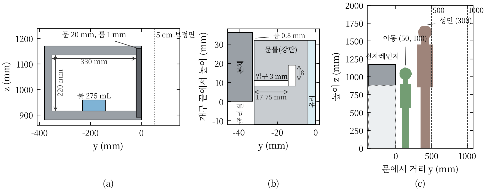
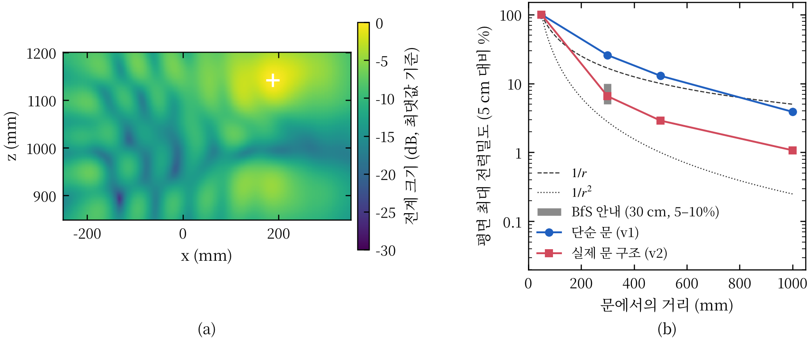
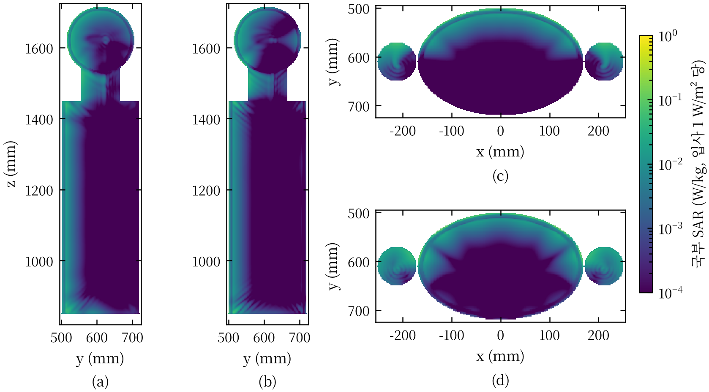
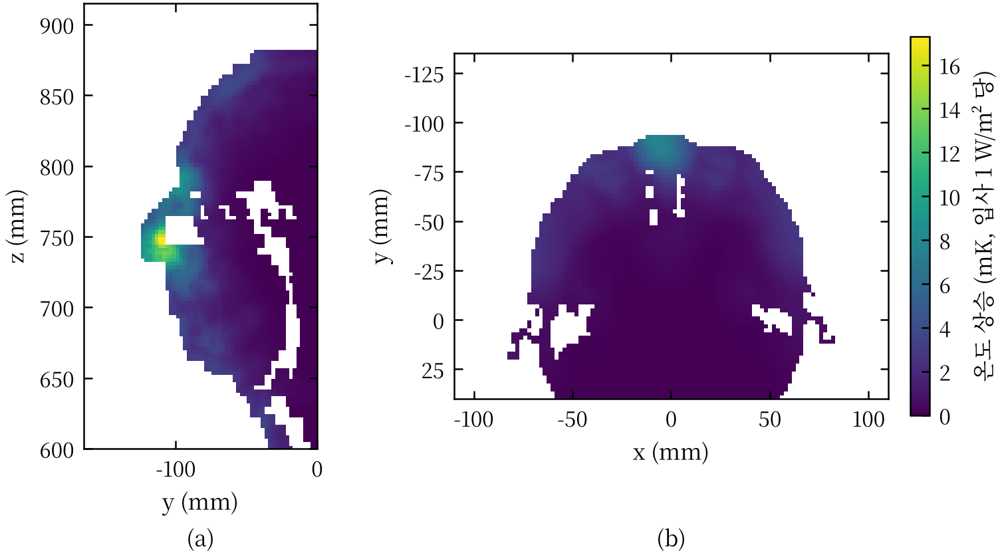

가정용 전자레인지 문 누설 전자파에 의한 인체 비흡수율과 온도 상승의 수치 평가

Numerical Assessment of Specific Absorption Rate and Temperature Rise in Humans Exposed to Door Leakage of Household Microwave Ovens

장은성

아주대학교 RF 시스템 기술 연구실 · jangstar@ajou.ac.kr

<b><i>요약</i>—</b>"작동 중인 전자레인지 앞에 서 있으면 해롭다"는 통념을 인체보호기준의 생리학적 근거인 열적 영향의 관점에서 정량적으로 검토하였다. 제품 방출 기준은 문 외면 5 cm에서의 전력밀도를, 인체보호기준은 인체의 비흡수율(SAR)을 규정하므로 두 기준은 직접 비교할 수 없다. 이에 3차원 시간영역 전자기 해석으로 2.45 GHz 문 누설장을 계산하고, 누설 크기를 방출 기준의 측정 조건에 따라 정상 제품 수준(0.5 W/m²)과 방출 상한(50 W/m²)으로 보정한 뒤, 해부학적 인체 모델(성인, 7세 아동)의 SAR과 생체 열전달(Pennes) 방정식에 의한 온도 상승을 산출하였다. 초크와 타공판을 포함한 실제 문 구조 모델에서 누설장은 30 cm에서 5 cm 값의 6.5%로 감쇠하여 측정 기반 보고값(5–10%)과 일치하였다. 정상 제품 전방 30–100 cm에 위치한 성인의 전신 평균 SAR은 기본 제한의 0.014–0.90%, 머리·몸통 국부 1 g SAR은 0.026–1.6%였으며, 국부 최대 온도 상승은 0.0024 °C, 심부 체온 상승은 0.00037 °C 이하로 산출되었다. 전신 평균 SAR이 기본 제한에 도달하려면 누설이 정상 제품 대비 112–6,999배 증가해야 한다. 따라서 정상적으로 동작하는 전자레인지 전방에서의 노출은 열적 영향 문턱보다 세 자릿수 이상 낮다. 다만 방출 상한 수준의 누설과 가장 보수적인 조사 가정이 동시에 성립하면 안면 돌출부의 국부 SAR이 기본 제한을 초과할 수 있다. 오븐과 아동 모델을 함께 해석한 근역장 평가에서는 문 외면 5–10 cm에 안면을 둔 7세 아동도 방출 상한 누설에서 머리 1 g SAR이 기본 제한의 54–84%, 최대 온도 상승이 0.20 °C 이하였다. 근역장에서 국부 SAR은 거리에 대해 단조 감소하지 않았으며, 5 cm 값을 평면파로 가정하면 근접 노출을 약 4–24배 과대평가하였다.

<b><i>주제어</i>—</b>비흡수율(SAR), 생체 열전달, 인체 노출 평가, 전자레인지, 근역장, 누설 전자파, 유한적분법

::: {.cols}

# I. 서론

가정용 전자레인지는 2.45 GHz 대역 마그네트론의 수백 W–1 kW급 출력으로 조리실 내 수분을 가열한다. 조리실은 금속 공동이지만 문과 본체 사이의 이음새와 관측창을 통해 극히 일부의 전력이 외부로 누설된다. 이 때문에 "작동 중인 전자레인지 앞에 서 있으면 해롭다"는 통념이 널리 퍼져 있다.

누설에 관한 규제는 두 계통으로 존재한다. 제품 방출 기준은 오븐 외면에서 5 cm 이상 떨어진 모든 점에서 등가 평면파 전력밀도를 판매 전 10 W/m², 사용 중 50 W/m² 이하로 제한한다 [1], [2]. 인체보호기준은 인체가 흡수하는 전력, 즉 비흡수율(specific absorption rate, SAR)을 전신 평균 0.08 W/kg, 국부 1.6 W/kg(1 g)으로 제한한다 [3], [4]. 두 기준은 측정 위치와 물리량이 다르다. 5 cm는 2.45 GHz 반파장(약 6.1 cm)보다 가까운 반응성 근역장이어서 거리 역제곱 법칙으로 사람의 위치까지 외삽할 수 없다. 또한 흡수 전력은 인체의 크기와 조직 구성에 의존한다. 따라서 방출 기준의 충족만으로는 인체 노출이 인체보호기준의 어느 수준에 있는지 알 수 없다.

선행 연구는 이 연결의 일부를 다루었다(표 I). 측정 조사는 문 근방의 누설 전력밀도를 보고하였고 [5]–[8], 수치 연구는 실내 누설 분포 [9], 접촉형 문 전방의 흉부 국부 SAR [10], 안구의 온도 상승 [11]을 개별적으로 다루었다. 누설장에서 출발하여 전신·국부 SAR과 온도 상승까지 일관되게 평가하고, 그 결과를 노출 기준의 생리학적 근거와 대조한 연구는 찾지 못하였다.

본 논문은 다음 세 질문에 답한다. 첫째, 방출 상한 수준과 정상 제품 수준의 누설에서 성인과 아동이 흡수하는 SAR과 그에 따른 온도 상승은 기준의 어디에 위치하는가. 둘째, 기준에 도달하려면 누설이 얼마나 증가해야 하는가. 셋째, 문 외면 5 cm의 측정값은 인체가 실제로 받는 노출과 어떻게 다른가. 이를 위해 Ⅱ장에서 노출 기준의 생리학적 근거를 정리하고, Ⅲ장에서 해석 방법을, Ⅳ장에서 결과를, Ⅴ장에서 고찰을 기술한다.

::: {.widetab}

표 I 선행 연구 비교

| 문헌 | 방법 | 대상·조건 | 주요 결과 |
|---|---|---|---|
| [5] | 측정 조사 | 1970년, 연방 기준 시행 전 제품 | 일부 제품이 당시 기준 100 W/m² 초과 |
| [6] | 측정 조사 | 판매 전 60대, 사용 중 약 100대 | 사용 중 1대만 방출 상한 초과 |
| [7] | 측정 요약 | 가정용 제품 | 평균 누설은 상한의 약 1%, 30 cm에서 표면값의 5–10% |
| [9] | 전자기 해석·광선추적·측정 | 실내 공간 | 누설 공간 분포, SAR 미산출 |
| [10] | 유한요소 해석 | 접촉형 문, 흉부, 100 mm 이내 | 국부 SAR(10 g)과 온도 상승이 기준보다 매우 낮음 |
| [11] | FDTD·열 해석 | 안구, ISM 대역 | 50 W/m²에서 수정체 온도 상승은 백내장 문턱보다 매우 낮음 |
| [12] | 측정·모델 | 인터록 고장 오븐에 손 삽입 | 5초 노출에 통증, 고장 상황 |
:::

# II. 노출 기준의 생리학적 근거

2.45 GHz 광자의 에너지는 약 10⁻⁵ eV로 화학 결합을 끊기에 부족하다. 따라서 이 주파수 대역에서 확립된 유해 기전은 조직 가열이며, 인체보호기준은 가열에 의한 건강 영향을 방지하도록 설정되었다 [3], [13]. 가열을 수반하지 않는 수준에서의 영향(암, 자각 증상 등)은 최근 세계보건기구 의뢰 체계적 문헌고찰에서도 일관되게 확인되지 않았다 [14], [15].

전신 노출의 문턱은 동물 행동 실험에서 유래한다. 학습 과제를 수행하는 설치류와 영장류에 전자파를 조사하였을 때 전신 평균 SAR 약 4 W/kg에서 과제 수행이 중단되었고, 이때 심부 체온은 약 1 °C 상승하였다 [13]. ICNIRP는 이를 건강 영향 문턱으로 보고, 작업자에 1/10, 일반인에 1/50의 감소 계수를 적용하여 기본 제한을 각각 0.4 W/kg, 0.08 W/kg으로 정하였다 [3]. 국부 노출은 조직 온도 상승의 허용 한도로부터 국부 SAR 한도를 정한다 [3]. 안구에 대해서는 2.45 GHz를 100분간 조사한 토끼에서 수정체 온도가 약 41 °C에 도달할 때(유리체 SAR 약 138 W/kg) 백내장이 유발되었다는 보고가 있다 [16].

참고로 성인의 안정 시 대사 열생산은 약 80 W, 체중당 약 1.1 W/kg이다 [17]. 일반인 전신 기본 제한 0.08 W/kg은 그 약 7%에 해당한다. 표 II는 전자레인지에 관련된 두 계통의 기준을 정리한 것이다. 제품 방출 기준의 50 W/m²는 문 외면 근방 한 점의 전계 환산값이고, 인체보호기준의 전력밀도 10 W/m²는 사람이 점유하는 공간에서 전신에 대해 평균한 참고 수준이므로, 두 값을 직접 비교할 수 없다. 본 연구는 기준이 직접 규정하는 양인 SAR과, 기준이 방지하려는 결과인 온도 상승으로 노출을 평가한다.

::: {.widetab}

표 II 전자레인지 누설과 관련된 기준

| 구분 | 근거 | 물리량 | 위치·평균 | 한도 |
|---|---|---|---|---|
| 제품 방출 | 21 CFR 1030.10 [1] | 등가 평면파 전력밀도 | 외면 5 cm 이상, 물 부하 275 mL | 판매 전 10, 사용 중 50 W/m² |
| 제품 방출 | IEC 60335-2-25 [2] | 동일 | 외면 50 mm 이상 | 50 W/m² |
| 인체 노출 | 국내 고시 [4] | 전신 평균 / 국부 SAR | 전신 / 1 g(머리·몸통) | 0.08 / 1.6 W/kg |
| 인체 노출 | 국내 고시 [4] | 전력밀도(참고 수준) | 2–300 GHz, 전신 | 10 W/m² |
| 인체 노출 | ICNIRP 2020 [3] | 전신 평균 / 국부 SAR | 30분 / 10 g, 6분 | 0.08 / 2 W/kg |
| 생리 문턱 | ICNIRP [3], [13] | 전신 평균 SAR | 30분 | 4 W/kg (심부 체온 약 +1 °C) |
:::

# III. 해석 방법

## A. 전자레인지 모델

해석에는 CST Studio Suite 2019의 시간영역 솔버(유한적분법, 육면체 격자)를 사용하였다 [18]. 전자레인지는 두 가지로 모델링하였다(그림 1). 단순 문 모델(v1)은 330 × 220 × 330 mm 조리실, WR-340 도파관과 탐침 급전, 조리실 중앙의 물 부하 275 mL로 구성되며, 문은 본체와 1 mm 간극을 둔 금속판이다. 초크와 타공판이 없으므로 누설이 문 둘레 전체에서 발생하여 실제 제품보다 크고 공간적으로 넓게 분포한다. 실제 문 구조 모델(v2)은 국내 판매 23 L 단독형 제품의 치수(외형 489 × 275 × 374 mm, 조리실 330 × 211 × 324 mm; 유통사 공개 사양 기준 [확인 필요])를 따랐으며, 강판 외함(도전율 6 × 10⁶ S/m 가정), 유리–타공판–수지 적층 문, 문 둘레의 λ/4 초크(직선 깊이 17.75 mm), 붕규산 회전판, 21 CFR 1030.10 조건의 비커 물 부하를 포함한다 [1], [19]–[21]. 타공판(두께 0.3 mm, 구멍 1.5 mm, 피치 2.5 mm)은 단위 셀 해석으로 차폐 효과 47.5 dB, 투과 위상 +89°를 얻고, 같은 투과 특성을 갖는 거친 개구 배열(정사각 5.55 mm, 피치 22.5 mm)로 대체하였다.

<figure class="wide">

<figcaption>그림 1. 해석 모델. (a) 인체 해석에 사용한 단순 문 모델(v1)의 시상 단면(x = 0): 조리실 330 × 220 × 330 mm, 1 mm 간극을 둔 20 mm 금속 문, 물 부하 275 mL, 보정 평면(문 외면 5 cm, 점선). (b) 실제 문 구조 모델(v2)의 문 상단 단면: 강판 문틀, 외부 유리, 0.8 mm 간극, 입구 3 mm·직선 깊이 17.75 mm·8 × 4 mm 절곡부를 갖는 λ/4 초크. (c) 인체 배치: 아동은 안면이 문에서 50 mm(및 100 mm), 성인은 몸통 전면이 300 mm(파선: 500, 1000 mm).</figcaption>
</figure>

## B. 누설 크기의 보정

모델의 누설 크기는 초크 형상, 문 간극, 마그네트론 출력에 따라 달라지므로 절대값을 그대로 사용하지 않고 방출 기준의 측정 조건으로 보정하였다. 인체가 없는 상태에서 문 외면 5 cm 평면(v1: x ±200 mm, z 880–1170 mm; v2: 조작부 간극을 포함하도록 x −250–350 mm, z 850–1200 mm)의 전계 실효값 최댓값 $E_{\mathrm{rms}}$를 구하고, 등가 평면파 전력밀도가 시나리오 A(정상 제품, 0.5 W/m², 방출 상한의 1%) [7]와 시나리오 B(방출 상한, 50 W/m²) [1]가 되도록 하는 보정 계수 $k = (E_{\mathrm{target}}/E_{\mathrm{rms}})^2$을 적용하였다. 해석이 선형이므로 같은 계수를 SAR에 곱한다. 보정 모드의 결과는 마그네트론 출력과 무관하다.

## C. 인체 모델과 노출 해석

인체 모델로는 CST Voxel Family의 해부학적 모델 Gustav(성인 남성, 조직 질량 73.97 kg)와 Child(7세, 23.85 kg) [확인 필요: 원자료의 나이·신장]를 사용하였다 [18]. voxel 해상도는 Gustav 2.08 × 2.08 × 2 mm, Child 1.54 × 1.54 × 1.6 mm이며, 인체를 덮는 영역의 격자 간격은 각각 2.5 mm, 2.0 mm 이하로 두었다. 각 조직의 유전 상수는 Gabriel 4-Cole-Cole 매개변수 모델로 2.45 GHz 값을 계산하여 고정하였다 [22](표 III). 결과의 모델 의존성을 확인하기 위해 피부·지방·근육·뼈·뇌·안구로 구성된 층상 기하 모델(성인 1.72 m, 74.2 kg; 아동 1.13 m, 22.3 kg)과 MakeHuman [23] 기반의 실제 체형 균질 모델(성인, 7세, 3세)을 같은 조건으로 해석하였다(Ⅳ-F). 표면적을 일치시킨 단순 형상 모델은 GHz 대역 전신 평균 SAR을 보수적으로 평가하는 것으로 알려져 있다 [24].

성인은 문 외면에서 몸통 전면까지의 거리 d = 30, 50, 100 cm에 정면으로 선 상황을 가정하였다. 오븐 단독 해석에서 이 영역은 포인팅 벡터와 $E_{\mathrm{rms}}^2/377$의 차이가 4% 이내인 방사장이었으므로, 인체 모델에 정면 평면파(수직 및 수평 편파)를 조사하여 입사 전력밀도 1 W/m²당 SAR을 구하고, 오븐 단독 해석의 거리별 신체 전면 전력밀도를 곱하였다. 신체 전면 전력밀도로는 몸통 투영 영역의 평균과 최댓값을 사용하였으며, 하한은 v2 모델의 평균, 상한은 v1 모델의 최댓값(전신이 최댓값으로 조사된다는 가정)으로 두었다. 지표마다 두 편파 중 큰 값을 취하였다. 문에 안면을 근접시킨 아동(안면 5, 10 cm)은 반응성 근역장 안에 있으므로 v1 오븐과 Child 모델을 함께 해석하였다. 격자 수를 GPU 메모리 안에 두기 위해 Child 모델은 머리끝부터 눈 아래 300 mm까지(9.94 kg, 뇌·안구·폐·심장 전체 포함)만 사용하였고, 누설 크기에는 오븐 단독 해석의 보정 계수를 그대로 적용하였다. 안면 최전방점과 문 외면 사이 거리는 52 mm와 102 mm(설계 50, 100 mm), 눈 높이는 문 중심보다 20 mm 위였으며, 모델 절단 과정에서 안면 중심이 문 중심에서 수평으로 14 mm 벗어났다. 이 해석의 전신 평균 SAR은 절단 모델의 흡수 전력을 아동 전체 질량(23.85 kg)으로 나눈 값으로, 하반신 흡수가 빠진 하한이다.

격자는 공기 중 자유공간 파장의 1/15 이하, 안구 1 mm 이하, 물 부하 0.9 mm 이하, 문 간극 0.5 mm로 두었고, 모든 해석은 계산 영역 에너지가 −40 dB 이하로 감쇠할 때까지 수행하였다(표 IV). SAR은 IEC/IEEE 62704-1의 정육면체 평균(1 g, 10 g)으로 산출하였다 [25]. 안구 SAR은 안구와 수정체의 흡수 전력을 그 질량으로 나눈 평균값이다.

표 III 주요 조직의 2.45 GHz 물성

| 조직 | εr | σ (S/m) | ρ (kg/m³) | k (W/m·K) | 관류 (mL/min/kg) |
|---|---|---|---|---|---|
| 피부 | 38.0 | 1.46 | 1109 | 0.37 | 106 |
| 지방 | 5.28 | 0.105 | 911 | 0.21 | 33 |
| 근육 | 52.7 | 1.74 | 1090 | 0.49 | 37 |
| 피질골 | 11.4 | 0.394 | 1908 | 0.32 | 10 |
| 회백질 | 48.9 | 1.81 | 1045 | 0.55 | 763 |
| 유리체 | 68.2 | 2.48 | 1005 | 0.59 | 0 |
| 수정체 | 48.1 | 1.53 | 1076 | 0.43 | 0 |

유전 물성은 [22], 열 물성은 [26]의 대푯값.

표 IV 해석 조건

| 해석 | 격자 수 | 최소 격자 | 시간 단계 | 장치 | 시간 |
|---|---|---|---|---|---|
| 오븐 단독 (v1) | 1,670만 | 0.43 mm | 371,910 | GPU | 2 h 2 min |
| 오븐 단독 (v2) | 2,060만 | 0.40 mm | 177,523 | GPU | 1 h 16 min |
| Gustav 평면파 | 4,448만 | 2.08 mm (voxel) | – | GPU | 약 15 min |
| Child 평면파 | 3,519만 | 1.54 mm (voxel) | – | GPU | 약 14 min |
| 오븐 + Child, 5 cm | 4,080만 | 0.39 mm | 362,656 | GPU | 4 h 33 min |
| 오븐 + Child, 10 cm | 4,164만 | 0.39 mm | 362,656 | GPU | 4 h 32 min |

## D. 온도 상승

국부 온도 상승 $\Delta T$는 SAR 해석의 손실 밀도 $P_l$을 열원으로 하여 정상상태 Pennes 생체 열전달 방정식 [27]

$$-\nabla\cdot(k\nabla \Delta T) + \rho\, w\, \rho_b c_b\, \Delta T = P_l$$

을 유한체적법으로 풀어 구하였다. 해석 단면은 안면 돌출부를 지나는 시상 단면과 안구 높이 수평 단면이며, 각 단면의 조직 분포는 $\kappa = 2P_l/|E|^2$로부터 voxel 조직의 2.45 GHz 도전율에 대응시켜 얻었다. 열 물성은 IT'IS 데이터베이스 값을 사용하였다 [26]. 피부–공기 경계는 열전달 계수 h = 5, 10 W/m²·K의 대류 조건으로 두고 큰 쪽을 취하였다. 2차원 해석은 단면 수직 방향의 열 확산을 무시하므로 3차원 값보다 큰 상한을 준다. 평탄한 신체 전면에서의 1차원 해석해(흡수 0.4 W/m²/($h + \sqrt{k\rho w \rho_b c_b}$) ≈ 0.009 K per W/m²)는 층상 모델의 2차원 결과(0.007–0.009 K)와 일치하였다.

Pennes 방정식은 혈액 온도를 고정하므로 심부 체온 상승을 줄 수 없다. 심부 체온은 두 방식으로 추정하였다. 하한 추정은 문턱(4 W/kg에서 +1 °C) [3]에 대한 비례이고, 상한 추정은 열 손실이 전혀 없다고 가정한 30분 노출의 단열 상승 $\Delta T = \mathrm{SAR}\cdot t/c$ (c = 3500 J/kg·K)이다.

# IV. 결과

## A. 누설장과 거리 감쇠

v1 모델에서 포트 수용 전력의 99.4%가 물 부하에 흡수되고 0.63%가 문 간극으로 누설되었다. 문 외면 5 cm에서 $E_{\mathrm{rms}}^2/377$은 실제 포인팅 벡터보다 최대 1.9배 컸다. 이는 반응성 근역장에서 전계와 자계의 비가 자유공간 임피던스와 다르기 때문이며, 전계 탐침에 기반한 누설 측정값이 인체 방향 전력 흐름을 과대평가함을 의미한다.

5 cm 값으로 정규화한 평면 최댓값은 v2에서 30, 50, 100 cm에 각각 6.5%, 2.9%, 1.1%로 감쇠하였다(그림 2). 이는 측정에 근거한 보고값(30 cm에서 5–10%) [7]과 일치한다. v2에서 누설은 문 우상단의 조작부 측 간극 부근에 국한되어 소형 개구처럼 거동하였다. 반면 v1은 문 둘레 전체가 연속 슬롯으로 작용하여 26%, 13%, 3.9%로 1/r에 가깝게 감쇠하였다. 따라서 v1으로 산출한 성인 노출은 신체 전면 전력밀도 기준으로 v2보다 2.9–5.0배 큰 보수적 값이다.

<figure class="wide">

<figcaption>그림 2. 누설장. (a) v2 문 외면 5 cm 평면의 전계 크기(최댓값 기준 dB, +는 최댓값). 누설은 조작부 측 간극에 인접한 문 우상단에 집중된다. (b) 평면 최댓값 $E_{\mathrm{rms}}^2/377$의 거리 감쇠(5 cm 값 대비). 파선과 점선은 5 cm에서 출발한 1/r, 1/r², 회색 구간은 측정 기반 보고값(30 cm에서 5–10%) [7].</figcaption>
</figure>

## B. 비흡수율

입사 1 W/m²당 전신 평균 SAR은 Gustav 4.6–5.5 × 10⁻³ W/kg, Child 7.9–8.7 × 10⁻³ W/kg이었다(표 V). 흡수는 오븐 쪽 체표 1–2 cm에 집중되었고(그림 3), 머리 1 g 최댓값은 코(수직 편파)와 귀 주변(수평 편파) 같은 안면 돌출부에 나타났다. 이는 해부학적 모델에서 국부 최댓값이 신체 돌출부에 나타난다는 보고와 일치한다 [28]. 안구 평균 SAR은 0.024–0.034 W/kg per W/m²로 머리 1 g 최댓값의 13–40%였다. 전신 10 g 최댓값은 두 모델 모두 사지(발)에서 나타났다.

<figure class="wide">

<figcaption>그림 3. 오븐 측에서 입사하는 1 W/m² 평면파에 대한 Gustav 모델의 점 SAR(로그 척도). (a), (b) 코를 지나는 시상 단면, (c), (d) 안구 높이 수평 단면. (a), (c) 전계 z 방향, (b), (d) 전계 x 방향.</figcaption>
</figure>

::: {.widetab}

표 V 정면 평면파 조사 시 입사 전력밀도 1 W/m²당 SAR (W/kg)

| 모델·편파 | 전신 평균 | 머리 1 g | 머리 10 g | 몸통 1 g | 사지 10 g | 안구 평균 |
|---|---|---|---|---|---|---|
| Gustav·수직 | 0.0046 | 0.197 | 0.087 | 0.065 | 0.090 | 0.025 |
| Gustav·수평 | 0.0055 | 0.076 | 0.050 | 0.067 | 0.089 | 0.024 |
| Child·수직 | 0.0079 | 0.084 | 0.046 | 0.056 | 0.073 | 0.034 |
| Child·수평 | 0.0087 | 0.128 | 0.040 | 0.086 | 0.075 | 0.031 |
:::

보정된 시나리오의 성인(Gustav) 노출을 그림 4(a)와 표 VI에 나타내었다. 정상 제품(시나리오 A)에서 전신 평균 SAR은 모든 거리에서 기본 제한의 0.90% 이하, 머리·몸통 국부 1 g SAR은 1.6% 이하, 사지 10 g SAR은 0.30% 이하였다. 30 cm에서 전신 흡수 전력은 4.3–53 mW로 안정 시 대사 열생산의 1/1,500 이하이다. 방출 상한(시나리오 B)에서 전신 평균 SAR은 30 cm에서 기본 제한의 7.2–90%였다.

<figure class="wide">

<figcaption>그림 4. (a) 성인(Gustav)의 전신 평균 SAR과 생리 기준선. 각 막대의 하단(○)은 실제 문 구조(v2)와 신체 전면 평균 조사, 상단(■)은 단순 문(v1)과 신체 전면 최댓값 조사이며, 두 편파 중 큰 값이다. (b) 기본 제한 도달 배수. 시나리오 A의 누설을 1로 하였으며, 시나리오 B는 100에 해당한다.</figcaption>
</figure>

## C. 기준 도달 배수

기본 제한에 도달하는 데 필요한 누설 증가 배수를 그림 4(b)에 나타내었다. 전신 평균 SAR은 30 cm에서 112–1,385배, 100 cm에서 793–6,999배였다. 머리·몸통 국부 1 g SAR은 30 cm에서 62–766배였다. 하한 62배는 방출 상한(100배)보다 작으므로, 방출 상한 제품의 안면 돌출부 국부 SAR이 기본 제한을 초과할 수 있음을 뜻한다(표 VI, 162%). 그러나 이 값은 v1 문 모델, 전신이 문 전방 평면의 최댓값으로 조사된다는 가정, 성인의 두부(1.55–1.72 m)가 문 높이(0.89–1.16 m)의 누설장에 노출된다는 가정이 동시에 성립할 때의 상한이며, 실제 문 구조(v2)와 신체 전면 평균 조사에서는 13%였다.

::: {.widetab}

표 VI 성인(Gustav) 노출 평가 결과 (하한–상한)

| 거리 | 시나리오 | 전신 평균 SAR (%) | 머리·몸통 1 g (%) | 사지 10 g (%) | 안구 SAR (W/kg) | 심부 ΔT (°C) | 국부 최대 ΔT (°C) |
|---|---|---|---|---|---|---|---|
| 30 cm | A | 0.072–0.90 | 0.13–1.6 | 0.024–0.30 | 0.00027–0.0033 | 0.000014–0.00037 | 0.00019–0.0024 |
| 30 cm | B | 7.2–90 | 13–162 | 2.4–30 | 0.027–0.33 | 0.0014–0.037 | 0.019–0.24 |
| 50 cm | A | 0.041–0.43 | 0.074–0.77 | 0.014–0.14 | 0.00015–0.0016 | 0.0000082–0.00018 | 0.00011–0.0011 |
| 50 cm | B | 4.1–43 | 7.4–77 | 1.4–14 | 0.015–0.16 | 0.00082–0.018 | 0.011–0.11 |
| 100 cm | A | 0.014–0.13 | 0.026–0.23 | 0.0047–0.042 | 0.000053–0.00047 | 0.0000029–0.000052 | 0.000038–0.00034 |
| 100 cm | B | 1.4–13 | 2.6–23 | 0.47–4.2 | 0.0053–0.047 | 0.00029–0.0052 | 0.0038–0.034 |

%는 각 기본 제한(전신 0.08, 머리·몸통 1 g 1.6, 사지 10 g 4 W/kg) 대비. 하한은 v2·신체 전면 평균, 상한은 v1·신체 전면 최댓값 조사이며, 지표마다 불리한 편파. 심부 ΔT는 문턱 비례(하한)–30분 단열(상한). 국부 ΔT는 2차원 Pennes 해석의 상한값.

:::

## D. 온도 상승

입사 1 W/m²당 국부 최대 온도 상승은 Gustav에서 0.0183 K(코 피부), Child에서 0.0104 K(코 피부)였다. 조직별 최댓값은 Gustav 기준 안구 0.0043 K, 수정체 0.0036 K, 뇌 0.0016 K로 피부보다 작았다(그림 6). 시나리오별 결과를 그림 5와 표 VI에 나타내었다. 정상 제품 전방 30 cm에서 국부 최대 온도 상승은 0.0024 °C, 심부 체온 상승은 30분 단열 상한으로도 0.00037 °C 이하였다. 국부 값은 임상 체온계의 분해능(0.1 °C)의 약 1/40, 열적 영향 문턱(1 °C)의 약 1/400이다. 방출 상한에서도 심부 체온 상승은 0.037 °C 이하였다.

<figure class="wide">

<figcaption>그림 5. (a) 30분 노출 시 성인(Gustav)의 심부 체온 상승. 하한은 문턱(4 W/kg에서 +1 °C)에 대한 비례, 상한은 열 손실이 없다고 가정한 단열 상승이다. (b) 국부 최대 온도 상승(코 피부). 2차원 Pennes 해석의 상한값이다.</figcaption>
</figure>

<figure class="wide">

<figcaption>그림 6. 입사 1 W/m²당 정상상태 온도 상승(CST 손실 밀도를 열원으로 한 Pennes 해석, 2차원 단면, 상한). (a) Gustav 시상 단면(전계 z 방향), (b) Child 안구 높이 수평 단면(전계 z 방향).</figcaption>
</figure>

## E. 아동

같은 입사 전력밀도에서 Child의 전신 평균 SAR은 Gustav의 1.6–1.7배였다. 질량에 비해 체표면적이 크기 때문이며, GHz 대역 전신 흡수가 체표면적에 지배된다는 보고와 일치한다 [29], [30]. 오븐과 Child 상반신을 함께 해석한 근역장 결과를 표 VII에 나타내었다. 안면을 문 외면 5 cm에 둔 경우, 방출 상한 누설(시나리오 B)에서도 머리 1 g 최댓값은 0.861 W/kg(입·턱, 문 중심 아래 20 mm)으로 기본 제한의 54%, 10 g 최댓값은 0.499 W/kg(이마)으로 25%였다. 안구 평균 SAR은 0.281 W/kg으로 토끼 백내장 유발 조건(유리체 약 138 W/kg) [16]의 약 1/500이었고, 수정체 평균은 0.130 W/kg이었다. 안면이 10 cm 거리에 있을 때 전신 평균과 안구 SAR은 감소하였으나(안구 0.198 W/kg), 머리 1 g 최댓값은 1.35 W/kg(턱 아래, 문 중심 아래 44 mm)으로 오히려 증가하여 기본 제한의 84%였다. 누설 빔은 문 중심 높이에서 나와 거리에 따라 위아래로 퍼진다. 이마 앞 10 mm 평면의 최대 전력밀도는 5 cm에서 10 cm로 갈 때 77 W/m²에서 36 W/m²로 줄었으나, 턱 높이 안면 전방의 전력밀도는 9–12 W/m²에서 14–19 W/m²로 커졌고, 국부 최댓값의 위치도 입·턱에서 턱 아래로 이동하였다. 즉 근역장에서 국부 SAR은 거리에 대해 단조 감소하지 않으며, 근접 노출의 평가는 여러 거리에서 수행해야 한다. 정상 제품(시나리오 A)에서는 모든 값이 이의 1/100이다.

이 값을 평면파 가정과 비교하였다. 문 외면 5 cm 평면의 최대 전력밀도(시나리오 B, 49.8 W/m²)로 Child 전신을 정면 조사한다고 가정하면 전신 평균 0.43 W/kg, 머리 1 g 6.4 W/kg, 안구 1.67 W/kg, 피부 최대 온도 상승 0.52 °C가 산출된다. 실제 근역장 값은 이보다 전신 약 21–24배, 머리 1 g 7.4배, 안구 5.9배, 피부 온도 상승 4.1배 낮았다. 누설장이 문 간극 근방에 국한되어 머리의 일부만 조사되고, 5 cm 최댓값은 그 국한된 영역의 값이기 때문이다. 따라서 5 cm 측정값을 평면파 노출로 해석하는 것은 근접 노출에 대해서도 매우 보수적이다. 같은 조건의 층상 기하 모델(전신 포함)은 voxel 모델보다 1.0–1.4배 큰 값을 주어(1 g 0.881, 10 g 0.666, 안구 0.395 W/kg) 보수적인 방향으로 일치하였다.

방출 상한에서 국부 최대 온도 상승은 5 cm에서 0.14 °C(눈 위 14 mm 단면, 콧등 피부 아래 뼈), 10 cm에서 0.20 °C(턱 아래 턱뼈, 표면에서 약 22 mm; 피부 0.17 °C)였다. 안구는 0.043 °C와 0.028 °C, 수정체는 0.023 °C와 0.018 °C, 뇌는 0.038 °C와 0.033 °C였다. 수정체 온도 상승은 열적 영향 문턱(1 °C)의 1/40 이하이며, 정상 제품에서는 국부 최대도 0.0020 °C 이하이다.

표 VII 오븐과 Child 상반신의 근역장 해석 결과 (시나리오 B)

| 항목 | 안면 5 cm | 안면 10 cm | 평면파 가정 (5 cm) |
|---|---|---|---|
| 전신 SAR | ≥ 0.0179 (≥ 22%) | ≥ 0.0169 (≥ 21%) | 0.43 |
| 머리 1 g SAR | 0.861 (54%) | 1.35 (84%) | 6.4 |
| 10 g SAR | 0.499 (25%) | 0.543 (27%) | – |
| 안구 SAR | 0.281 | 0.198 | 1.67 |
| 수정체 SAR | 0.130 | 0.083 | – |
| 국부 최대 ΔT | 0.14 | 0.20 | 0.52 |
| 안구 ΔT | 0.043 | 0.028 | – |
| 수정체 ΔT | 0.023 | 0.018 | – |

SAR은 W/kg(괄호는 기본 제한 대비), ΔT는 °C. 시나리오 A(정상 제품)는 모든 값이 B의 1/100. 전신은 절단 모델(9.94 kg)의 흡수 전력을 아동 전체 질량 23.85 kg으로 나눈 하한. 기본 제한은 전신 0.08, 머리·몸통 1 g 1.6, 10 g 2 W/kg. 평면파 가정은 문 외면 5 cm 최대 전력밀도(49.8 W/m²)로 Child 전신을 정면 조사한 값(불리한 편파, ΔT는 피부). ΔT는 2차원 Pennes 해석의 상한이며, 10 cm의 국부 최대는 정중선에서 15 mm 떨어진 시상 단면 값(수평 단면 최대 0.12 °C).

## F. 모델 의존성

표 VIII은 같은 조건에서 세 종류의 인체 모델을 비교한 것이다. 전신 평균 SAR은 해부학적 모델 대비 22% 이내로 일치하였다. 반면 머리 1 g 최댓값은 안면 돌출부가 있는 해부학적·실제 체형 모델에서 층상 기하 모델보다 1.7–6.7배 컸다. 따라서 전신 평가는 모델 형상에 둔감하지만 국부 평가는 해부학적 형상이 필요하다. 실제 체형 모델 중 성인(수직 편파)의 머리 1 g은 0.226 W/kg per W/m²(턱·입 부근)로 Gustav보다 15% 컸으며, 이를 적용하면 30 cm 국부 1 g 도달 배수의 하한은 62배에서 54배로 낮아진다. 실제 체형 모델의 안구 SAR이 낮은 것은 균질 근육과 구형 안구로 모델링하였기 때문이다.

::: {.widetab}

표 VIII 인체 모델에 따른 입사 1 W/m²당 SAR (W/kg; 전신 평균 / 머리 1 g / 안구 평균)

| 대상·편파 | 층상 기하 모델 | 실제 체형 모델 (MakeHuman) | 해부학적 모델 (Voxel) |
|---|---|---|---|
| 성인·수직 | 0.0048 / 0.034 / 0.023 | 0.0044 / 0.226 / 0.011 | 0.0046 / 0.197 / 0.025 |
| 성인·수평 | 0.0052 / 0.045 / 0.030 | 0.0047 / 0.129 / 0.0086 | 0.0055 / 0.076 / 0.024 |
| 아동·수직 | 0.0074 / 0.037 / 0.025 | 0.0068 / 0.129 / 0.013 | 0.0079 / 0.084 / 0.034 |
| 아동·수평 | 0.0088 / 0.054 / 0.033 | 0.0069 / 0.107 / 0.0053 | 0.0087 / 0.128 / 0.031 |

아동의 실제 체형 모델은 7세. 해부학적 모델은 Gustav(성인)와 Child(7세).

:::

# V. 고찰

## A. 통념에 대한 평가

정상적으로 동작하는 전자레인지 전방 30–100 cm에 위치한 성인의 노출은 전신·국부 SAR 모두 기본 제한의 2% 미만이며, 온도 상승은 측정 불가능한 수준이다. 이 결론은 누설을 과대평가하는 단순 문 모델과 전신 최댓값 조사라는 보수적 가정을 함께 적용하여도 유지된다. 가장 보수적인 상한에서도 정상 제품의 전신 평균 SAR(7.2 × 10⁻⁴ W/kg)은 열적 영향 문턱(4 W/kg)의 약 1/5,600이다. 이는 기술적으로 결함이 없는 기기는 건강 위험이 없다는 기관 안내 [7]와 같은 결론이다. 본 연구는 이를 누설이 방출 상한에 이르는 경우까지 확장하여, 결론이 누설 크기에 대해 갖는 여유를 정량화하였다.

## B. 문 외면 5 cm 측정값의 해석

5 cm 측정값을 인체 노출로 직접 해석하면 두 방향의 오차가 발생한다. 근역장에서 전계 환산 전력밀도는 실제 전력 흐름보다 최대 1.9배 크다. 반면 연속 슬롯형 누설은 역제곱보다 완만하게 감쇠하므로, 5 cm 값으로부터 역제곱 법칙을 적용하면 30 cm–1 m의 노출을 v1에서 10–15배 과소평가한다. 실제 문 구조에서는 누설이 국소화되어 감쇠가 빠르다. 따라서 방출 기준 충족 여부와 인체 노출의 관계는 문 구조에 의존하며, 본 연구와 같은 SAR 기반 평가가 필요하다.

## C. 아동과 전력밀도 참고 수준

Child 모델에 일반인 참고 수준(10 W/m²)을 전신 조사하면 전신 평균 SAR은 기본 제한의 109%에 이른다(머리 1 g은 80%). 작은 체격에서는 참고 수준이 기본 제한보다 보수적이지 않을 수 있다는 해부학적 모델 연구들과 같은 경향이다 [28], [31]–[33]. 본 연구의 초과 폭(9%)이 선행 연구(20–45%)보다 작은 것은 2.45 GHz 정면 입사만을 다루었기 때문으로 보인다. 전자레인지 누설은 참고 수준보다 훨씬 낮으므로 이 차이가 본 연구의 결론을 바꾸지는 않는다.

## D. 한계

첫째, 성인 노출의 상한은 누설을 과대평가하는 v1 모델로 산출하였고, v2의 3차원 초크 차단량은 2차원 설계값보다 작아 누설 절대값은 보정 모드로만 사용하였다. 둘째, 인체는 선 자세와 정면 입사만 고려하였으며, 다중 평면파 입사 시 전신 SAR은 약 ±25% 변할 수 있다 [34]. 셋째, 국부 SAR은 모델 형상에 민감하여 실제 체형 모델에서 Gustav보다 15% 큰 값이 나왔다(Ⅳ-F). 넷째, Child 모델의 주 연조직(근육·지방 평균 조직)에는 CST 재질 대응에 따라 지방 물성이 지정되었다. 전신 SAR은 다른 모델과 10% 이내로 일치하였으나 국부 값에는 영향이 있을 수 있다. 또한 근역장 해석은 상반신만 포함하였고, 안면이 문 중심에서 수평으로 14 mm 벗어나 있었다. 다섯째, 국부 온도 상승은 2차원 해석의 상한이며 3차원 열 해석으로 보완할 수 있다 [35]. 여섯째, 바닥·조리대·벽의 반사와 마그네트론의 간헐 동작은 고려하지 않았으며, 연속 노출 가정은 보수적이다. 일곱째, 실제 제품의 누설을 측정하지 않았다. 끝으로, 인터록 고장으로 문이 열린 채 동작하는 경우 [12]는 본 연구의 범위 밖이다.

# VI. 결론

전자레인지 문 누설장을 3차원 전자기 해석으로 계산하고, 누설 크기를 방출 기준의 측정 조건으로 보정하여 해부학적 인체 모델의 SAR과 온도 상승을 산출하였다. 정상 제품 전방에 위치한 성인의 SAR은 전신·국부 모두 기본 제한의 2% 미만이었고, 국부 온도 상승은 2차원 해석의 상한으로도 0.0024 °C로 열적 영향 문턱(1 °C)의 약 1/400이었다. 전신 평균 SAR이 기본 제한에 도달하려면 누설이 정상 제품의 112배 이상 증가해야 한다. 또한 문 외면 5 cm의 측정값은 근역장 효과로 실제 전력 흐름을 최대 1.9배 과대평가하며, 실제 문 구조에서 누설은 30 cm에서 5 cm 값의 6.5%로 감쇠하였다. 따라서 정상적으로 동작하는 전자레인지 앞에 서 있는 것은 인체에 유의한 열적 영향을 주지 않는다. 문 외면 5–10 cm에 안면을 둔 아동도 방출 상한 누설에서 머리 1 g SAR이 기본 제한의 54–84%, 최대 온도 상승이 0.20 °C 이하였고, 정상 제품에서는 각각 0.84% 이하, 0.002 °C 이하였다. 주의가 필요한 경우는 문이나 이음새가 손상되어 누설이 방출 상한을 크게 넘는 제품이다.

:::

::: {.refs}

# 참고문헌

[1] U.S. Food and Drug Administration, *Performance Standards for Microwave and Radio Frequency Emitting Products: Microwave Ovens*, 21 CFR 1030.10.

[2] *Household and Similar Electrical Appliances—Safety—Part 2-25: Particular Requirements for Microwave Ovens, Including Combination Microwave Ovens*, IEC 60335-2-25:2024, Ed. 8.0.

[3] International Commission on Non-Ionizing Radiation Protection, "Guidelines for limiting exposure to electromagnetic fields (100 kHz to 300 GHz)," *Health Phys.*, vol. 118, no. 5, pp. 483–524, 2020.

[4] 과학기술정보통신부, 「전자파인체보호기준」, 과학기술정보통신부고시 제2019-4호, 2019.

[5] W. H. Oates Jr., D. D. Snellings Jr., and E. F. Wilson, "Microwave oven survey results in Arkansas during 1970," *Amer. J. Public Health*, vol. 63, no. 3, pp. 193–198, 1973.

[6] Health Canada, "Radiation leakage of before-sale and used microwave ovens," 2000.

[7] Bundesamt für Strahlenschutz, "Mikrowellenkochgeräte." [Online]. Available: https://www.bfs.de

[8] 국립전파연구원, "생활 속의 전자파 FAQ." [Online]. Available: https://www.rra.go.kr

[9] P. Lopez-Iturri *et al.*, "Estimation of radiofrequency power leakage from microwave ovens for dosimetric assessment at nonionizing radiation exposure levels," *BioMed Res. Int.*, vol. 2015, Art. no. 603260, 2015.

[10] R. Tian, J.-C. Wei, and M. Lu, "The numerical assessment of RF human exposure to microwave ovens with contact-type doors," *Electronics*, vol. 14, no. 5, Art. no. 873, 2025.

[11] A. Hirata, G. Ushio, and T. Shiozawa, "Calculation of temperature rises in the human eye exposed to EM waves in the ISM frequency bands," *IEICE Trans. Commun.*, vol. E83-B, no. 3, pp. 541–548, 2000.

[12] J. Oleson, T. Samulski, S. Clegg, S. Das, and W. Grant, "Heating rate modeling and measurements in phantom and in vivo of the human upper extremity in a defective 2450 MHz microwave oven," *J. Microw. Power Electromagn. Energy*, vol. 29, no. 2, pp. 101–108, 1994.

[13] International Commission on Non-Ionizing Radiation Protection, "Guidelines for limiting exposure to time-varying electric, magnetic, and electromagnetic fields (up to 300 GHz)," *Health Phys.*, vol. 74, no. 4, pp. 494–522, 1998.

[14] K. Karipidis *et al.*, "The effect of exposure to radiofrequency fields on cancer risk in the general and working population: A systematic review of human observational studies," *Environ. Int.*, vol. 191, Art. no. 108983, 2024.

[15] X. Bosch-Capblanch *et al.*, "The effects of radiofrequency electromagnetic fields exposure on human self-reported symptoms: A systematic review of human experimental studies," *Environ. Int.*, vol. 187, Art. no. 108612, 2024.

[16] A. W. Guy, J. C. Lin, P. O. Kramar, and A. F. Emery, "Effect of 2450-MHz radiation on the rabbit eye," *IEEE Trans. Microw. Theory Techn.*, vol. MTT-23, no. 6, pp. 492–498, Jun. 1975.

[17] [확인 필요: 성인 안정 시 대사율 약 80 W의 출처(생리학 교과서 또는 문헌)]

[18] Dassault Systèmes, *CST Studio Suite 2019*, Version 2019.7, 2019.

[19] "Microwave oven door screen," U.S. Patent 4 051 341.

[20] "Wave choke device for a microwave oven door," U.S. Patent 8 455 803.

[21] "Microwave oven door having a microwave shielding structure," U.S. Patent 5 973 305.

[22] S. Gabriel, R. W. Lau, and C. Gabriel, "The dielectric properties of biological tissues: III. Parametric models for the dielectric spectrum of tissues," *Phys. Med. Biol.*, vol. 41, no. 11, pp. 2271–2293, 1996.

[23] MakeHuman Community, *MakeHuman 1.x base mesh and targets* (MPFB2 assets, CC0). [Online]. Available: https://github.com/makehumancommunity/mpfb2

[24] A. Hirata, N. Ito, O. Fujiwara, T. Nagaoka, and S. Watanabe, "Conservative estimation of whole-body-averaged SARs in infants with a homogeneous and simple-shaped phantom in the GHz region," *Phys. Med. Biol.*, vol. 53, no. 24, pp. 7215–7223, 2008.

[25] *Determining the Peak Spatial-Average Specific Absorption Rate (SAR) in the Human Body From Wireless Communications Devices, 30 MHz to 6 GHz—Part 1: General Requirements for Using the Finite-Difference Time-Domain (FDTD) Method for SAR Calculations*, IEC/IEEE 62704-1:2017.

[26] P. A. Hasgall *et al.*, "IT'IS database for thermal and electromagnetic parameters of biological tissues," IT'IS Foundation. [확인 필요: 버전]

[27] H. H. Pennes, "Analysis of tissue and arterial blood temperatures in the resting human forearm," *J. Appl. Physiol.*, vol. 1, no. 2, pp. 93–122, 1948.

[28] J. F. Bakker, M. M. Paulides, A. Christ, N. Kuster, and G. C. van Rhoon, "Assessment of induced SAR in children exposed to electromagnetic plane waves between 10 MHz and 5.6 GHz," *Phys. Med. Biol.*, vol. 55, no. 11, pp. 3115–3130, 2010.

[29] A. Hirata, S. Kodera, J. Wang, and O. Fujiwara, "Dominant factors influencing whole-body average SAR due to far-field exposure in whole-body resonance frequency and GHz regions," *Bioelectromagnetics*, vol. 28, no. 6, pp. 484–487, 2007.

[30] I. D. Flintoft, M. P. Robinson, G. C. R. Melia, J. F. Dawson, and A. C. Marvin, "Average absorption cross-section of the human body measured at 1–12 GHz in a reverberant chamber: Results of a human volunteer study," *Phys. Med. Biol.*, vol. 59, no. 13, pp. 3297–3317, 2014.

[31] J. Wang, O. Fujiwara, S. Kodera, and S. Watanabe, "FDTD calculation of whole-body average SAR in adult and child models for frequencies from 30 MHz to 3 GHz," *Phys. Med. Biol.*, vol. 51, no. 17, pp. 4119–4127, 2006.

[32] T. Uusitupa, I. Laakso, S. Ilvonen, and K. Nikoskinen, "SAR variation study from 300 to 5000 MHz for 15 voxel models including different postures," *Phys. Med. Biol.*, vol. 55, no. 4, pp. 1157–1176, 2010.

[33] E. Piuzzi, P. Bernardi, M. Cavagnaro, S. Pisa, and J. C. Lin, "Analysis of adult and child exposure to uniform plane waves at mobile communication systems frequencies (900 MHz–3 GHz)," *IEEE Trans. Electromagn. Compat.*, vol. 53, no. 1, pp. 38–47, Feb. 2011.

[34] T. Kientega *et al.*, "A surrogate model to assess the whole body SAR induced by multiple plane waves at 2.4 GHz," *Ann. Telecommun.*, vol. 66, pp. 419–428, 2011.

[35] T. Oizumi, I. Laakso, A. Hirata *et al.*, "FDTD analysis of temperature elevation in the lens of human and rabbit models due to near-field and far-field exposures at 2.45 GHz," *Radiat. Prot. Dosimetry*, vol. 155, no. 3, pp. 284–291, 2013.

:::
