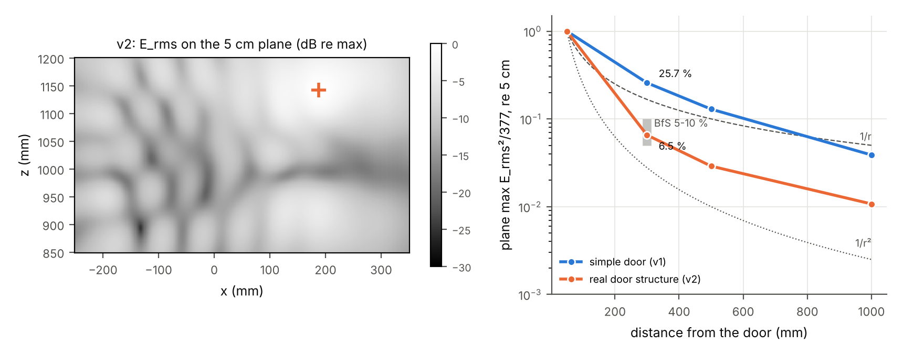
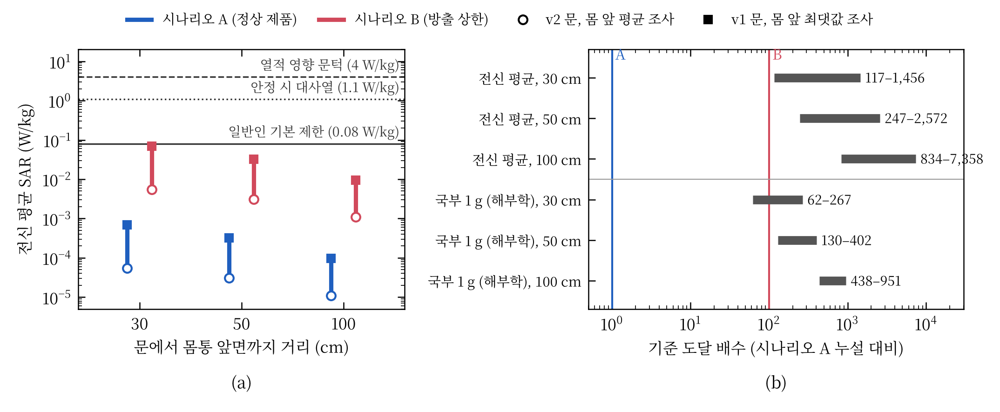
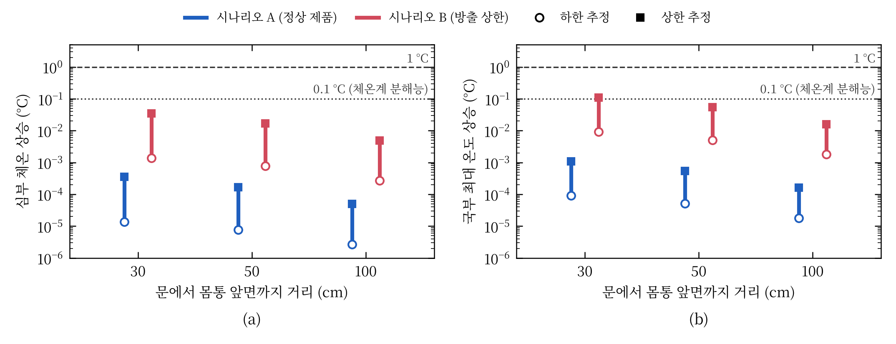
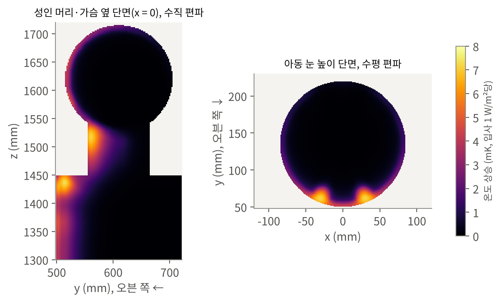

가정용 전자레인지 문 누설 전자파에 의한 인체 비흡수율과 온도 상승의 수치 평가

Numerical Assessment of Specific Absorption Rate and Temperature Rise in Humans Exposed to Door Leakage of Household Microwave Ovens

장은성

아주대학교 RF 시스템 기술 연구실 · jangstar@ajou.ac.kr

<b><i>요약</i>—</b>"작동 중인 전자레인지 앞에 서 있으면 해롭다"는 통념을 인체보호기준의 생리학적 근거인 열적 영향의 관점에서 정량적으로 검토하였다. 제품 방출 기준은 문 외면 5 cm에서의 전력밀도를, 인체보호기준은 인체의 비흡수율(SAR)을 규정하므로 두 기준은 직접 비교할 수 없다. 이에 3차원 시간영역 전자기 해석으로 2.45 GHz 문 누설장을 계산하고, 누설 크기를 방출 기준의 측정 조건에 따라 정상 제품 수준(0.5 W/m²)과 방출 상한(50 W/m²)으로 보정한 뒤, 성인·아동 인체 모델의 SAR과 생체 열전달(Pennes) 방정식에 의한 온도 상승을 산출하였다. 초크와 타공판을 포함한 실제 문 구조 모델에서 누설장은 30 cm에서 5 cm 값의 6.5%로 감쇠하여 측정 기반 보고값(5–10%)과 일치하였다. 정상 제품 전방 30–100 cm에 위치한 성인의 전신 평균 SAR은 기본 제한의 0.014–0.85%, 해부학적 모델의 국부 1 g SAR은 0.11–1.6%였으며, 국부 최대 온도 상승은 0.0011 °C, 심부 체온 상승은 0.00035 °C 이하로 산출되었다. 전신 평균 SAR이 기본 제한에 도달하려면 누설이 정상 제품 대비 117–7,358배 증가해야 한다. 따라서 정상적으로 동작하는 전자레인지 전방에서의 노출은 열적 영향 문턱보다 세 자릿수 이상 낮다. 다만 방출 상한 수준의 누설과 가장 보수적인 조사 가정이 동시에 성립하면 안면 돌출부의 국부 SAR이 기본 제한에 근접할 수 있으며, 문에 안면을 근접시킨 아동에 대한 근역장 평가는 별도로 제시한다.

<b><i>주제어</i>—</b>비흡수율(SAR), 생체 열전달, 인체 노출 평가, 전자레인지, 근역장, 누설 전자파, 유한적분법

::: {.cols}

# I. 서론

가정용 전자레인지는 2.45 GHz 대역 마그네트론의 수백 W–1 kW급 출력으로 조리실 내 수분을 가열한다. 조리실은 금속 공동이지만 문과 본체 사이의 이음새와 관측창을 통해 극히 일부의 전력이 외부로 누설된다. 이 때문에 "작동 중인 전자레인지 앞에 서 있으면 해롭다"는 통념이 널리 퍼져 있다.

누설에 관한 규제는 두 계통으로 존재한다. 제품 방출 기준은 오븐 외면에서 5 cm 이상 떨어진 모든 점에서 등가 평면파 전력밀도를 판매 전 10 W/m², 사용 중 50 W/m² 이하로 제한한다 [1], [2]. 인체보호기준은 인체가 흡수하는 전력, 즉 비흡수율(specific absorption rate, SAR)을 전신 평균 0.08 W/kg, 국부 1.6 W/kg(1 g)으로 제한한다 [3], [4]. 두 기준은 측정 위치와 물리량이 다르다. 5 cm는 2.45 GHz 반파장(약 6.1 cm)보다 가까운 반응성 근역장이어서 거리 역제곱 법칙으로 사람의 위치까지 외삽할 수 없다. 또한 흡수 전력은 인체의 크기와 조직 구성에 의존한다. 따라서 방출 기준의 충족만으로는 인체 노출이 인체보호기준의 어느 수준에 있는지 알 수 없다.

선행 연구는 이 연결의 일부를 다루었다(표 I). 측정 조사는 문 근방의 누설 전력밀도를 보고하였고 [5]–[8], 수치 연구는 실내 누설 분포 [9], 접촉형 문 전방의 흉부 국부 SAR [10], 안구의 온도 상승 [11]을 개별적으로 다루었다. 누설장에서 출발하여 전신·국부 SAR과 온도 상승까지 일관되게 평가하고, 그 결과를 노출 기준의 생리학적 근거와 대조한 연구는 찾지 못하였다.

본 논문은 다음 세 질문에 답한다. 첫째, 방출 상한 수준과 정상 제품 수준의 누설에서 성인과 아동이 흡수하는 SAR과 그에 따른 온도 상승은 기준의 어디에 위치하는가. 둘째, 기준에 도달하려면 누설이 얼마나 증가해야 하는가. 셋째, 문 외면 5 cm의 측정값은 인체가 실제로 받는 노출과 어떻게 다른가. 이를 위해 Ⅱ장에서 노출 기준의 생리학적 근거를 정리하고, Ⅲ장에서 해석 방법을, Ⅳ장에서 결과를, Ⅴ장에서 고찰을 기술한다.

::: {.widetab}

표 I 선행 연구 비교

| 문헌 | 방법 | 대상·조건 | 주요 결과 |
|---|---|---|---|
| [5] | 측정 조사 | 1970년, 연방 기준 시행 전 제품 | 일부 제품이 당시 기준 100 W/m² 초과 |
| [6] | 측정 조사 | 판매 전 60대, 사용 중 약 100대 | 사용 중 1대만 방출 상한 초과 |
| [7] | 측정 요약 | 가정용 제품 | 평균 누설은 상한의 약 1%, 30 cm에서 표면값의 5–10% |
| [9] | 전자기 해석·광선추적·측정 | 실내 공간 | 누설 공간 분포, SAR 미산출 |
| [10] | 유한요소 해석 | 접촉형 문, 흉부, 100 mm 이내 | 국부 SAR(10 g)과 온도 상승이 기준보다 매우 낮음 |
| [11] | FDTD·열 해석 | 안구, ISM 대역 | 50 W/m²에서 수정체 온도 상승은 백내장 문턱보다 매우 낮음 |
| [12] | 측정·모델 | 인터록 고장 오븐에 손 삽입 | 5초 노출에 통증, 고장 상황 |
:::

# II. 노출 기준의 생리학적 근거

2.45 GHz 광자의 에너지는 약 10⁻⁵ eV로 화학 결합을 끊기에 부족하다. 따라서 이 주파수 대역에서 확립된 유해 기전은 조직 가열이며, 인체보호기준은 가열에 의한 건강 영향을 방지하도록 설정되었다 [3], [13]. 가열을 수반하지 않는 수준에서의 영향(암, 자각 증상 등)은 최근 세계보건기구 의뢰 체계적 문헌고찰에서도 일관되게 확인되지 않았다 [14], [15].

전신 노출의 문턱은 동물 행동 실험에서 유래한다. 학습 과제를 수행하는 설치류와 영장류에 전자파를 조사하였을 때 전신 평균 SAR 약 4 W/kg에서 과제 수행이 중단되었고, 이때 심부 체온은 약 1 °C 상승하였다 [13]. ICNIRP는 이를 건강 영향 문턱으로 보고, 작업자에 1/10, 일반인에 1/50의 감소 계수를 적용하여 기본 제한을 각각 0.4 W/kg, 0.08 W/kg으로 정하였다 [3]. 국부 노출은 조직 온도 상승의 허용 한도로부터 국부 SAR 한도를 정한다 [3]. 안구에 대해서는 2.45 GHz를 100분간 조사한 토끼에서 수정체 온도가 약 41 °C에 도달할 때(유리체 SAR 약 138 W/kg) 백내장이 유발되었다는 보고가 있다 [16].

참고로 성인의 안정 시 대사 열생산은 약 80 W, 체중당 약 1.1 W/kg이다 [17]. 일반인 전신 기본 제한 0.08 W/kg은 그 약 7%에 해당한다. 표 II는 전자레인지에 관련된 두 계통의 기준을 정리한 것이다. 제품 방출 기준의 50 W/m²는 문 외면 근방 한 점의 전계 환산값이고, 인체보호기준의 전력밀도 10 W/m²는 사람이 점유하는 공간에서 전신에 대해 평균한 참고 수준이므로, 두 값을 직접 비교할 수 없다. 본 연구는 기준이 직접 규정하는 양인 SAR과, 기준이 방지하려는 결과인 온도 상승으로 노출을 평가한다.

::: {.widetab}

표 II 전자레인지 누설과 관련된 기준

| 구분 | 근거 | 물리량 | 위치·평균 | 한도 |
|---|---|---|---|---|
| 제품 방출 | 21 CFR 1030.10 [1] | 등가 평면파 전력밀도 | 외면 5 cm 이상, 물 부하 275 mL | 판매 전 10, 사용 중 50 W/m² |
| 제품 방출 | IEC 60335-2-25 [2] | 동일 | 외면 50 mm 이상 | 50 W/m² |
| 인체 노출 | 국내 고시 [4] | 전신 평균 / 국부 SAR | 전신 / 1 g(머리·몸통) | 0.08 / 1.6 W/kg |
| 인체 노출 | 국내 고시 [4] | 전력밀도(참고 수준) | 2–300 GHz, 전신 | 10 W/m² |
| 인체 노출 | ICNIRP 2020 [3] | 전신 평균 / 국부 SAR | 30분 / 10 g, 6분 | 0.08 / 2 W/kg |
| 생리 문턱 | ICNIRP [3], [13] | 전신 평균 SAR | 30분 | 4 W/kg (심부 체온 약 +1 °C) |
:::

# III. 해석 방법

## A. 전자레인지 모델

해석에는 CST Studio Suite 2019의 시간영역 솔버(유한적분법, 육면체 격자)를 사용하였다 [18]. 전자레인지는 두 가지로 모델링하였다(그림 1). 단순 문 모델(v1)은 330 × 220 × 330 mm 조리실, WR-340 도파관과 탐침 급전, 조리실 중앙의 물 부하 275 mL로 구성되며, 문은 본체와 1 mm 간극을 둔 금속판이다. 초크와 타공판이 없으므로 누설이 문 둘레 전체에서 발생하여 실제 제품보다 크고 공간적으로 넓게 분포한다. 실제 문 구조 모델(v2)은 국내 판매 23 L 단독형 제품의 치수(외형 489 × 275 × 374 mm, 조리실 330 × 211 × 324 mm)를 따랐으며, 강판 외함, 유리–타공판–수지 적층 문, 문 둘레의 λ/4 초크(직선 깊이 17.75 mm), 붕규산 회전판, 21 CFR 1030.10 조건의 비커 물 부하를 포함한다 [1], [19]–[21]. 타공판(두께 0.3 mm, 구멍 1.5 mm, 피치 2.5 mm)은 단위 셀 해석으로 차폐 효과 47.5 dB, 투과 위상 +89°를 얻고, 같은 투과 특성을 갖는 거친 개구 배열(정사각 5.55 mm, 피치 22.5 mm)로 대체하였다.

<figure class="wide">

<figcaption>그림 1. 해석 모델. 전자레인지(도파관 급전, 물 부하, 문 간극)와 성인(문에서 몸통 전면까지 d), 아동(문에서 안면까지 d) 인체 모델의 배치.</figcaption>
</figure>

## B. 누설 크기의 보정

모델의 누설 크기는 초크 형상, 문 간극, 마그네트론 출력에 따라 달라지므로 절대값을 그대로 사용하지 않고 방출 기준의 측정 조건으로 보정하였다. 인체가 없는 상태에서 문 외면 5 cm 평면(x ±200 mm, z 880–1170 mm)의 전계 실효값 최댓값 $E_{\mathrm{rms}}$를 구하고, 등가 평면파 전력밀도가 시나리오 A(정상 제품, 0.5 W/m², 방출 상한의 1%) [7]와 시나리오 B(방출 상한, 50 W/m²) [1]가 되도록 하는 보정 계수 $k = (E_{\mathrm{target}}/E_{\mathrm{rms}})^2$을 적용하였다. 해석이 선형이므로 같은 계수를 SAR에 곱한다. 보정 모드의 결과는 마그네트론 출력과 무관하다.

## C. 인체 모델과 노출 해석

성인(신장 1.72 m, 74.2 kg)과 아동(1.13 m, 22.3 kg) 모델은 피부·지방·근육·뼈·뇌·유리체·수정체로 구성된 층상 기하 모델이다(표 III). 표면적을 일치시킨 단순 형상 모델은 GHz 대역 전신 평균 SAR을 보수적으로 평가하는 것으로 알려져 있다 [22]. 모델의 대표성은 CST Voxel Family의 해부학적 모델(Child, Gustav)로 확인하였다.

성인은 문 외면에서 몸통 전면까지의 거리 d = 30, 50, 100 cm에 정면으로 선 상황을 가정하였다. 오븐 단독 해석에서 이 영역은 포인팅 벡터와 $E_{\mathrm{rms}}^2/377$의 차이가 4% 이내인 방사장이었으므로, 인체 모델에 정면 평면파(수직 및 수평 편파)를 조사하여 입사 전력밀도 1 W/m²당 SAR을 구하고, 오븐 단독 해석의 거리별 신체 전면 전력밀도를 곱하였다. 신체 전면 전력밀도는 몸통 투영 영역의 평균(대표값)과 최댓값(전신이 최댓값으로 조사된다는 상한)의 두 값을 사용하였다. 문에 안면을 근접시킨 아동(안면 5, 10 cm)은 반응성 근역장 안에 있으므로 오븐과 인체를 함께 해석하였다.

격자는 공기 중 자유공간 파장의 1/15 이하, 인체 2 mm 이하, 안구 1 mm 이하, 물 부하 0.9 mm 이하, 문 간극 0.5 mm로 두었고, 모든 해석은 계산 영역 에너지가 −40 dB 이하로 감쇠할 때까지 수행하였다(표 IV). SAR은 IEC/IEEE 62704-1의 정육면체 평균(1 g, 10 g)으로 산출하였으며 [23], 조직 유전 상수는 Gabriel 매개변수 모델에 따랐다 [24].

표 III 2.45 GHz 조직 물성

| 조직 | εr | σ (S/m) | ρ (kg/m³) | k (W/m·K) | 관류 (mL/min/kg) |
|---|---|---|---|---|---|
| 피부 | 38.0 | 1.46 | 1109 | 0.37 | 106 |
| 지방 | 5.28 | 0.105 | 911 | 0.21 | 33 |
| 근육 | 52.7 | 1.74 | 1090 | 0.49 | 37 |
| 피질골 | 11.4 | 0.394 | 1908 | 0.32 | 10 |
| 회백질 | 48.9 | 1.81 | 1045 | 0.55 | 763 |
| 유리체 | 68.2 | 2.48 | 1005 | 0.59 | 0 |
| 수정체 | 48.1 | 1.53 | 1076 | 0.43 | 0 |

유전 물성은 [24], 열 물성은 [25]의 대푯값.

표 IV 해석 조건

| 해석 | 격자 수 | 최소 격자 | 시간 단계 | 장치 | 시간 |
|---|---|---|---|---|---|
| 오븐 단독 (v1) | 1,670만 | 0.43 mm | 371,910 | GPU | 2 h 2 min |
| 오븐 단독 (v2) | 2,060만 | 0.40 mm | 177,523 | GPU | 1 h 16 min |
| 성인 평면파 | 3,770만 | 0.40 mm | 5,832 | GPU | 15 min |
| 아동 평면파 | 1,455만 | 0.43 mm | 6,370 | GPU | 7 min |
| 해부학 모델 평면파 | 3,519만–4,448만 | 2 mm (체적) | – | GPU | 14 min |
| 오븐 + 아동 (안면 5 cm) | 6,478만 | 0.43 mm | [결과 대기] | CPU | [결과 대기] |

## D. 온도 상승

국부 온도 상승 $\Delta T$는 SAR 해석의 손실 밀도 $P_l$을 열원으로 하여 정상상태 Pennes 생체 열전달 방정식 [26]

$$-\nabla\cdot(k\nabla \Delta T) + \rho\, w\, \rho_b c_b\, \Delta T = P_l$$

을 유한체적법으로 풀어 구하였다. 피부–공기 경계는 열전달 계수 h = 10 W/m²·K(비교 5 W/m²·K)의 대류 조건으로 두었다. 해석은 인체 중심 단면과 안구 높이 단면에서의 2차원 해석이므로 단면 수직 방향의 열 확산을 무시하여 3차원 값보다 큰 상한을 준다. 1차원 해석해(흡수 0.4 W/m²/($h + \sqrt{k\rho w \rho_b c_b}$) ≈ 0.009 K per W/m²)와 2차원 결과(0.007–0.009 K)는 일치하였다.

Pennes 방정식은 혈액 온도를 고정하므로 심부 체온 상승을 줄 수 없다. 심부 체온은 두 방식으로 추정하였다. 하한 추정은 문턱(4 W/kg에서 +1 °C) [3]에 대한 비례이고, 상한 추정은 열 손실이 전혀 없다고 가정한 30분 노출의 단열 상승 $\Delta T = \mathrm{SAR}\cdot t/c$ (c = 3500 J/kg·K)이다.

# IV. 결과

## A. 누설장과 거리 감쇠

v1 모델에서 포트 수용 전력의 99.4%가 물 부하에 흡수되고 0.63%가 문 간극으로 누설되었다. 문 외면 5 cm에서 $E_{\mathrm{rms}}^2/377$은 실제 포인팅 벡터보다 최대 1.9배 컸다. 이는 반응성 근역장에서 전계와 자계의 비가 자유공간 임피던스와 다르기 때문이며, 전계 탐침에 기반한 누설 측정값이 인체 방향 전력 흐름을 과대평가함을 의미한다.

5 cm 값으로 정규화한 평면 최댓값은 v2에서 30, 50, 100 cm에 각각 6.5%, 2.9%, 1.1%로 감쇠하였다(그림 2). 이는 측정에 근거한 보고값(30 cm에서 5–10%) [7]과 일치한다. v2에서 누설은 문 우상단의 조작부 측 간극 부근에 국한되어 소형 개구처럼 거동하였다. 반면 v1은 문 둘레 전체가 연속 슬롯으로 작용하여 26%, 13%, 3.9%로 1/r에 가깝게 감쇠하였다. 따라서 v1으로 산출한 성인 노출은 신체 전면 전력밀도 기준으로 v2보다 2.9–5.0배 큰 보수적 값이다.

<figure class="wide">

<figcaption>그림 2. 실제 문 구조(v2)의 누설장. (a) 문 외면 5 cm 평면의 전계 분포(최댓값 기준 dB, +는 최댓값). (b) 평면 최댓값의 거리 감쇠(5 cm 값 대비). 회색 구간은 측정 기반 보고값(30 cm에서 5–10%) [7].</figcaption>
</figure>

## B. 비흡수율

입사 1 W/m²당 전신 평균 SAR은 성인 4.7–5.2 × 10⁻³ W/kg, 아동 7.4–8.8 × 10⁻³ W/kg이었다(표 V). 흡수는 오븐 쪽 피부 1–2 cm에 집중되었다(그림 3). 해부학적 모델의 전신 평균 SAR은 단순 모델과 1–8% 이내에서 일치하였으나, 국부 최댓값은 코와 귀 등 돌출부에서 1.2–5.9배 컸다. 이는 해부학적 모델에서 신체 돌출부에 국부 최댓값이 나타난다는 보고와 일치한다 [27]. 단순 모델 몸통 끝단의 직각 모서리에서는 수평 편파 1 g 값이 몸통 중앙의 3.8배로 커졌는데, 이는 실제 인체에 없는 형상에 기인하므로 별도로 구분하였다. 이에 따라 국부 SAR 평가는 해부학적 모델 값을 사용하였다.

<figure class="wide">

<figcaption>그림 3. 성인 모델의 SAR 분포(입사 1 W/m²당, 로그 척도). (a), (b) 인체 중심의 시상 단면, (c), (d) 문 중심 높이의 수평 단면. 좌: 수직 편파, 우: 수평 편파.</figcaption>
</figure>

::: {.widetab}

표 V 정면 평면파 조사 시 입사 전력밀도 1 W/m²당 SAR (W/kg)

| 모델·편파 | 전신 평균 | 머리 1 g | 머리 10 g | 몸통 1 g | 전신 최대 10 g |
|---|---|---|---|---|---|
| 성인(단순)·수직 | 0.0047 | 0.034 | 0.022 | 0.050 | 0.047 |
| 성인(단순)·수평 | 0.0052 | 0.045 | 0.027 | 0.055 | 0.062 |
| Gustav·수직 | 0.0046 | 0.197 | 0.087 | 0.065 | 0.090 |
| Gustav·수평 | 0.0055 | 0.076 | 0.050 | 0.067 | 0.089 |
| 아동(단순)·수직 | 0.0074 | 0.037 | 0.030 | 0.052 | 0.047 |
| 아동(단순)·수평 | 0.0088 | 0.054 | 0.032 | 0.055 | 0.077 |
| Child·수직 | 0.0080 | 0.084 | 0.046 | 0.056 | 0.073 |
| Child·수평 | 0.0087 | 0.128 | 0.040 | 0.086 | 0.075 |

단순 모델의 몸통 1 g은 끝단 모서리를 제외한 몸통 중앙 값.

:::

보정된 시나리오의 성인 노출을 그림 4(a)와 표 VI에 나타내었다. 정상 제품(시나리오 A)에서 전신 평균 SAR은 모든 거리에서 기본 제한의 0.85% 이하였다. 전신 흡수 전력은 30 cm에서 4–51 mW로, 안정 시 대사 열생산의 1/1,500 이하이다. 방출 상한(시나리오 B)에서도 전신 평균 SAR은 30 cm에서 기본 제한의 6.9–85%였다.

<figure class="wide">

<figcaption>그림 4. (a) 성인의 전신 평균 SAR과 생리 기준선. 각 막대의 하단(○)은 실제 문 구조(v2)와 신체 전면 평균 조사, 상단(■)은 단순 문(v1)과 신체 전면 최댓값 조사이며, 두 편파 중 큰 값이다. (b) 기본 제한 도달 배수. 시나리오 A의 누설을 기준(1)으로 하였으며, 시나리오 B는 100에 해당한다.</figcaption>
</figure>

## C. 기준 도달 배수

기본 제한에 도달하는 데 필요한 누설 증가 배수를 그림 4(b)에 나타내었다. 전신 평균 SAR은 30 cm에서 117–1,456배, 100 cm에서 834–7,358배였다. 해부학적 모델의 국부 1 g SAR은 30 cm에서 62–267배였다. 하한 62배는 방출 상한(100배)보다 작으며, 이 조건에서는 방출 상한 제품의 안면 돌출부 국부 SAR이 기본 제한을 초과할 수 있음을 뜻한다. 그러나 이 값은 v1 문 모델, 전신이 문 전방 평면의 최댓값으로 조사된다는 가정, 그리고 성인의 두부(1.55–1.72 m)가 문 높이(0.89–1.16 m)에 있다는 가정이 동시에 성립할 때의 상한이다. 신체 전면 평균 조사에서는 267배였다.

::: {.widetab}

표 VI 성인 노출 평가 결과 (하한–상한)

| 거리 | 시나리오 | 전신 평균 SAR (기본 제한 대비 %) | 국부 1 g SAR, 해부학 (%) | 심부 체온 상승 (°C) | 국부 최대 온도 상승 (°C) |
|---|---|---|---|---|---|
| 30 cm | A | 0.069–0.85 | 0.37–1.6 | 0.000014–0.00035 | 0.000091–0.0011 |
| 30 cm | B | 6.9–85 | 37–161 | 0.0014–0.035 | 0.0091–0.11 |
| 50 cm | A | 0.039–0.40 | 0.25–0.77 | 0.0000078–0.00017 | 0.000051–0.00054 |
| 50 cm | B | 3.9–40 | 25–77 | 0.00078–0.017 | 0.0051–0.054 |
| 100 cm | A | 0.014–0.12 | 0.11–0.23 | 0.0000027–0.000049 | 0.000018–0.00016 |
| 100 cm | B | 1.4–12 | 11–23 | 0.00027–0.0049 | 0.0018–0.016 |

전신 평균은 하한 v2·평균 조사, 상한 v1·최댓값 조사. 국부 1 g은 v1 기준 평균–최댓값 조사. 심부 체온은 문턱 비례(하한)–30분 단열(상한). 국부 온도는 2차원 Pennes 해석의 상한값에 평균–최댓값 조사를 적용.

:::

## D. 온도 상승

입사 1 W/m²당 국부 최대 온도 상승은 성인 피부에서 0.0057–0.0086 K, 아동 유리체에서 0.0042–0.0077 K, 뇌에서 0.001–0.004 K였다(그림 6). 혈류가 없는 유리체도 피부와 같은 수준으로 상승하였는데, 흡수가 안구 전면에 집중되어 각막 표면으로 방열되기 때문이다. 시나리오별 결과를 그림 5와 표 VI에 나타내었다. 정상 제품 전방 30 cm에서 국부 최대 온도 상승은 0.0011 °C, 심부 체온 상승은 30분 단열 상한으로도 0.00035 °C 이하였다. 이는 임상 체온계의 분해능(0.1 °C)의 약 1/90, 열적 영향 문턱(1 °C)의 약 1/900 이하이다. 방출 상한에서도 심부 체온 상승은 0.035 °C 이하였다.

<figure class="wide">

<figcaption>그림 5. (a) 30분 노출 시 성인의 심부 체온 상승. 하한은 문턱(4 W/kg에서 +1 °C)에 대한 비례, 상한은 열 손실이 없다고 가정한 단열 상승이다. (b) 국부 최대 온도 상승(피부). 2차원 Pennes 해석의 상한값이다.</figcaption>
</figure>

<figure class="wide">

<figcaption>그림 6. 입사 1 W/m²당 온도 상승 분포(mK). (a) 성인 두부·흉부 시상 단면, (b) 아동 안구 높이 수평 단면.</figcaption>
</figure>

## E. 아동

같은 입사 전력밀도에서 아동 모델의 전신 평균 SAR은 성인의 1.6–1.7배였다. 질량에 비해 체표면적이 크기 때문이며, GHz 대역 전신 흡수가 체표면적에 지배된다는 보고와 일치한다 [28], [29]. 문에 안면을 근접시킨 아동의 근역장 결과는 [결과 대기: 안면 5 cm, 10 cm].

# V. 고찰

## A. 통념에 대한 평가

정상적으로 동작하는 전자레인지 전방 30–100 cm에 위치한 성인의 노출은 전신·국부 SAR 모두 기본 제한의 2% 미만이며, 온도 상승은 측정 불가능한 수준이다. 이 결론은 누설을 과대평가하는 단순 문 모델과 전신 최댓값 조사라는 보수적 가정을 함께 적용하여도 유지된다. 가장 보수적인 상한을 적용하여도 정상 제품의 전신 평균 SAR(6.8 × 10⁻⁴ W/kg)은 열적 영향 문턱(4 W/kg)의 약 1/5,800이다. 이는 기술적으로 결함이 없는 기기는 건강 위험이 없다는 기관 안내 [7]와 같은 결론이다. 다만 본 연구는 이를 누설이 방출 상한에 이르는 경우까지 확장하여, 결론이 누설 크기에 대해 갖는 여유를 정량화하였다.

## B. 문 외면 5 cm 측정값의 해석

5 cm 측정값을 인체 노출로 직접 해석하면 두 방향의 오차가 발생한다. 근역장에서 전계 환산 전력밀도는 실제 전력 흐름보다 최대 1.9배 크다. 반면 연속 슬롯형 누설은 역제곱보다 완만하게 감쇠하므로, 5 cm 값으로부터 역제곱 법칙을 적용하면 30 cm–1 m의 노출을 v1에서 10–15배 과소평가한다. 실제 문 구조에서는 누설이 국소화되어 감쇠가 빠르다. 따라서 방출 기준 충족 여부와 인체 노출의 관계는 문 구조에 의존하며, 본 연구와 같은 SAR 기반 평가가 필요하다.

## C. 아동과 전력밀도 참고 수준

아동 모델에 일반인 참고 수준(10 W/m²)을 전신 조사하면 전신 평균 SAR은 기본 제한의 93–110%에 이른다. 작은 체격에서는 참고 수준이 기본 제한보다 보수적이지 않을 수 있다는 해부학적 모델 연구들과 같은 경향이다 [27], [30]–[32]. 본 연구의 초과 폭(최대 10%)이 선행 연구(20–45%)보다 작은 것은 2.45 GHz 정면 입사만을 다루었기 때문으로 보인다. 전자레인지 누설은 참고 수준보다 훨씬 낮으므로 이 차이가 본 연구의 결론을 바꾸지는 않는다.

## D. 한계

첫째, 성인의 SAR은 누설을 과대평가하는 v1 모델로 산출하였고 v2는 거리 감쇠 검증에 사용하였다. v2에서도 3차원 초크 차단량이 2차원 설계값보다 작아 누설 절대값은 보정 모드로만 사용하였다. 둘째, 인체 모델은 선 자세와 정면 입사만 고려하였으며, 다중 평면파 입사 시 전신 SAR은 약 ±25% 변할 수 있다 [33]. 셋째, 국부 온도 상승은 2차원 해석의 상한이며, 3차원 해석과 해부학적 모델 열 해석으로 보완할 수 있다 [34]. 넷째, 바닥·조리대·벽의 반사와 마그네트론의 간헐 동작은 고려하지 않았으며, 연속 노출 가정은 보수적이다. 다섯째, 실제 제품의 누설을 측정하지 않았다. 5 cm와 30 cm–1 m에서의 누설 측정으로 감쇠 비율을 직접 검증할 수 있다. 끝으로, 인터록 고장으로 문이 열린 채 동작하는 경우 [12]는 본 연구의 범위 밖이다.

# VI. 결론

전자레인지 문 누설장을 3차원 전자기 해석으로 계산하고, 누설 크기를 방출 기준의 측정 조건으로 보정하여 인체의 SAR과 온도 상승을 산출하였다. 정상 제품 전방에 위치한 성인의 SAR은 기본 제한의 2% 미만이었고, 국부 온도 상승은 2차원 해석의 상한으로도 0.0011 °C로 열적 영향 문턱(1 °C)의 약 1/900 이하였다. 전신 평균 SAR이 기본 제한에 도달하려면 누설이 정상 제품의 117배 이상 증가해야 한다. 또한 문 외면 5 cm의 측정값은 근역장 효과로 실제 전력 흐름을 최대 1.9배 과대평가하며, 실제 문 구조에서 누설은 30 cm에서 5 cm 값의 6.5%로 감쇠하였다. 따라서 정상적으로 동작하는 전자레인지 앞에 서 있는 것은 인체에 유의한 열적 영향을 주지 않는다. 주의가 필요한 경우는 문이나 이음새가 손상되어 누설이 방출 상한을 크게 넘는 제품과 문에 안면을 근접시킨 아동이며, 후자의 근역장 평가는 [결과 대기].

:::

::: {.refs}

# 참고문헌

[1] U.S. Food and Drug Administration, *Performance Standards for Microwave and Radio Frequency Emitting Products: Microwave Ovens*, 21 CFR 1030.10.

[2] *Household and Similar Electrical Appliances—Safety—Part 2-25: Particular Requirements for Microwave Ovens, Including Combination Microwave Ovens*, IEC 60335-2-25:2024, Ed. 8.0.

[3] International Commission on Non-Ionizing Radiation Protection, "Guidelines for limiting exposure to electromagnetic fields (100 kHz to 300 GHz)," *Health Phys.*, vol. 118, no. 5, pp. 483–524, 2020.

[4] 과학기술정보통신부, 「전자파인체보호기준」, 과학기술정보통신부고시 제2019-4호, 2019.

[5] W. H. Oates Jr., D. D. Snellings Jr., and E. F. Wilson, "Microwave oven survey results in Arkansas during 1970," *Amer. J. Public Health*, vol. 63, no. 3, pp. 193–198, 1973.

[6] Health Canada, "Radiation leakage of before-sale and used microwave ovens," 2000.

[7] Bundesamt für Strahlenschutz, "Mikrowellenkochgeräte." [Online]. Available: https://www.bfs.de

[8] 국립전파연구원, "생활 속의 전자파 FAQ." [Online]. Available: https://www.rra.go.kr

[9] P. Lopez-Iturri *et al.*, "Estimation of radiofrequency power leakage from microwave ovens for dosimetric assessment at nonionizing radiation exposure levels," *BioMed Res. Int.*, vol. 2015, Art. no. 603260, 2015.

[10] R. Tian, J.-C. Wei, and M. Lu, "The numerical assessment of RF human exposure to microwave ovens with contact-type doors," *Electronics*, vol. 14, no. 5, Art. no. 873, 2025.

[11] A. Hirata, G. Ushio, and T. Shiozawa, "Calculation of temperature rises in the human eye exposed to EM waves in the ISM frequency bands," *IEICE Trans. Commun.*, vol. E83-B, no. 3, pp. 541–548, 2000.

[12] J. Oleson, T. Samulski, S. Clegg, S. Das, and W. Grant, "Heating rate modeling and measurements in phantom and in vivo of the human upper extremity in a defective 2450 MHz microwave oven," *J. Microw. Power Electromagn. Energy*, vol. 29, no. 2, pp. 101–108, 1994.

[13] International Commission on Non-Ionizing Radiation Protection, "Guidelines for limiting exposure to time-varying electric, magnetic, and electromagnetic fields (up to 300 GHz)," *Health Phys.*, vol. 74, no. 4, pp. 494–522, 1998.

[14] K. Karipidis *et al.*, "The effect of exposure to radiofrequency fields on cancer risk in the general and working population: A systematic review of human observational studies," *Environ. Int.*, vol. 191, Art. no. 108983, 2024.

[15] X. Bosch-Capblanch *et al.*, "The effects of radiofrequency electromagnetic fields exposure on human self-reported symptoms: A systematic review of human experimental studies," *Environ. Int.*, vol. 187, Art. no. 108612, 2024.

[16] A. W. Guy, J. C. Lin, P. O. Kramar, and A. F. Emery, "Effect of 2450-MHz radiation on the rabbit eye," *IEEE Trans. Microw. Theory Techn.*, vol. MTT-23, no. 6, pp. 492–498, Jun. 1975.

[17] [확인 필요: 성인 안정 시 대사율 약 80 W의 출처(생리학 교과서 또는 문헌)]

[18] Dassault Systèmes, *CST Studio Suite 2019*, Version 2019.7, 2019.

[19] "Microwave oven door screen," U.S. Patent 4 051 341.

[20] "Wave choke device for a microwave oven door," U.S. Patent 8 455 803.

[21] "Microwave oven door having a microwave shielding structure," U.S. Patent 5 973 305.

[22] A. Hirata, N. Ito, O. Fujiwara, T. Nagaoka, and S. Watanabe, "Conservative estimation of whole-body-averaged SARs in infants with a homogeneous and simple-shaped phantom in the GHz region," *Phys. Med. Biol.*, vol. 53, no. 24, pp. 7215–7223, 2008.

[23] *Determining the Peak Spatial-Average Specific Absorption Rate (SAR) in the Human Body From Wireless Communications Devices, 30 MHz to 6 GHz—Part 1: General Requirements for Using the Finite-Difference Time-Domain (FDTD) Method for SAR Calculations*, IEC/IEEE 62704-1:2017.

[24] S. Gabriel, R. W. Lau, and C. Gabriel, "The dielectric properties of biological tissues: III. Parametric models for the dielectric spectrum of tissues," *Phys. Med. Biol.*, vol. 41, no. 11, pp. 2271–2293, 1996.

[25] P. A. Hasgall *et al.*, "IT'IS database for thermal and electromagnetic parameters of biological tissues," IT'IS Foundation. [확인 필요: 버전]

[26] H. H. Pennes, "Analysis of tissue and arterial blood temperatures in the resting human forearm," *J. Appl. Physiol.*, vol. 1, no. 2, pp. 93–122, 1948.

[27] J. F. Bakker, M. M. Paulides, A. Christ, N. Kuster, and G. C. van Rhoon, "Assessment of induced SAR in children exposed to electromagnetic plane waves between 10 MHz and 5.6 GHz," *Phys. Med. Biol.*, vol. 55, no. 11, pp. 3115–3130, 2010.

[28] A. Hirata, S. Kodera, J. Wang, and O. Fujiwara, "Dominant factors influencing whole-body average SAR due to far-field exposure in whole-body resonance frequency and GHz regions," *Bioelectromagnetics*, vol. 28, no. 6, pp. 484–487, 2007.

[29] I. D. Flintoft, M. P. Robinson, G. C. R. Melia, J. F. Dawson, and A. C. Marvin, "Average absorption cross-section of the human body measured at 1–12 GHz in a reverberant chamber: Results of a human volunteer study," *Phys. Med. Biol.*, vol. 59, no. 13, pp. 3297–3317, 2014.

[30] J. Wang, O. Fujiwara, S. Kodera, and S. Watanabe, "FDTD calculation of whole-body average SAR in adult and child models for frequencies from 30 MHz to 3 GHz," *Phys. Med. Biol.*, vol. 51, no. 17, pp. 4119–4127, 2006.

[31] T. Uusitupa, I. Laakso, S. Ilvonen, and K. Nikoskinen, "SAR variation study from 300 to 5000 MHz for 15 voxel models including different postures," *Phys. Med. Biol.*, vol. 55, no. 4, pp. 1157–1176, 2010.

[32] E. Piuzzi, P. Bernardi, M. Cavagnaro, S. Pisa, and J. C. Lin, "Analysis of adult and child exposure to uniform plane waves at mobile communication systems frequencies (900 MHz–3 GHz)," *IEEE Trans. Electromagn. Compat.*, vol. 53, no. 1, pp. 38–47, Feb. 2011.

[33] T. Kientega *et al.*, "A surrogate model to assess the whole body SAR induced by multiple plane waves at 2.4 GHz," *Ann. Telecommun.*, vol. 66, pp. 419–428, 2011.

[34] T. Oizumi, I. Laakso, A. Hirata *et al.*, "FDTD analysis of temperature elevation in the lens of human and rabbit models due to near-field and far-field exposures at 2.45 GHz," *Radiat. Prot. Dosimetry*, vol. 155, no. 3, pp. 284–291, 2013.

:::
